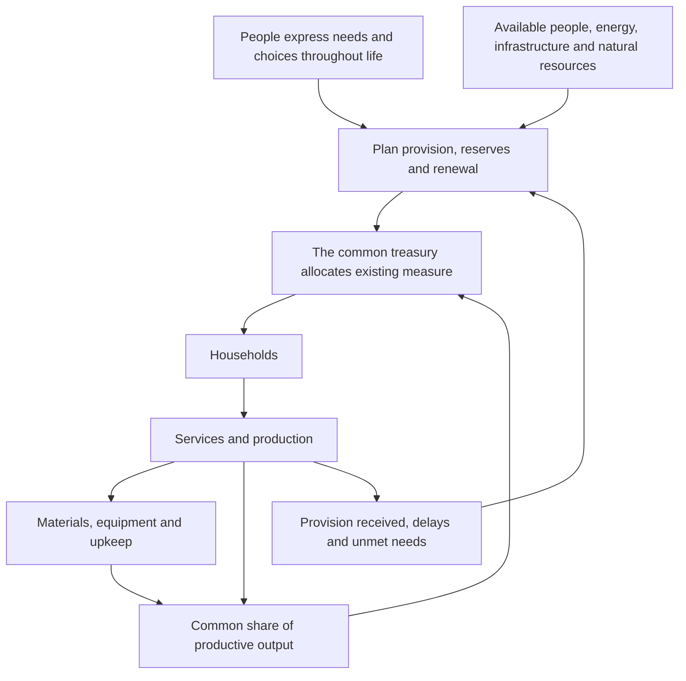

<p align="center">
  
</p>
<h1 align="center">Qazna</h1>
<p align="center"><strong>Human needs · Shared capabilities · Continuous circulation</strong></p>
<p align="center">
  <a href="Cargo.toml"></a>
  <a href="docs/completion-roadmap.md"></a>
  <a href="LICENSE"></a>
</p>
## National scope

Qazna models a state that provides for its whole population through one public treasury. Basic provision follows need throughout life; accepted work can earn a supplement. In the proposed system taxes, interest, refinancing, deposits, credit, shares and bills of exchange play no role in domestic circulation. A comparison with existing institutions can test a claim about access. Adopting the proposed system would require a public decision at state level.

The [five-year national calculation](docs/organism.md#national-grain-reconciliation) starts with 100 million people. It follows regional needs through national production, settlement and delivery to two regional depots. Cancelling one southern trip leaves 6,312 kg of oats at the hub past the January 2028 deadline. The February schedule clears the backlog. [Regional delivery calculation](docs/organism.md#regional-grain-receipts). Sector studies supply components for this calculation. A common plan for all sectors and a defensible rule for measuring growth remain open.

## Why build an economy around circulation?

Qazna starts from a principle of justice: a person's ability to live and develop should survive a loss of employment, illness and old age. In *Tartar and I*, Daulet Baimurza asks what happens when machines can produce more with fewer hours of paid work. A society may gain productive capacity while the people whose work made that gain possible lose access to its benefits. Who has a claim on what society can now produce?

The author uses **chrematistics** for an arrangement in which accumulating money becomes an end in itself. A lender’s claim can grow through accrued interest even when the capacity to house, teach or care for people stands still. Qazna explores a different organising principle, **Тең (equal measure)**. Natural resources and the productive capabilities built across generations are a common inheritance. Everyone has equal standing; how much support a person needs changes over a lifetime. People retain the freedom to choose their work, pursue their talents and challenge a decision about their needs.

Consider a household that loses its income while the shops still have food. The book asks what responsibility society bears when deprivation drives someone to steal, and who bears the harm when desperation turns to violence. In the author's view, democratic institutions lose their purpose when people have a vote but little say over the conditions of their livelihood. Qazna gives this criticism a practical test. Can people take part in setting the rules, keep access to essentials when paid work disappears, and receive additional compensation for work they undertake?

### What circulation contributes to the design

In an animal's body, blood supplies tissues throughout life. A working muscle can require more oxygen now; another organ still needs its supply at rest. The engineering insight is the combination of a common circulation, local signals and reserves that can bridge interruptions. The decision to care for each person on equal terms is a human ethical choice. A community must also decide who sets the norms and how those decisions can be appealed.

In the proposed economy **Tenge** is a common unit of account. One public treasury allocates measure according to need. Existing units circulate from households through services, production, materials and equipment, funding the next cycle. After enterprises meet their intermediate obligations, the common share replenishes the treasury. There is no interest on possession, interest-bearing loan or deposit yield in this circuit. The author reserves additional issuance for independently verified growth of real capacity. The study below runs entirely on existing units. [Principles, governance and evidence](docs/organism.md).



### Two questions the calculations can already answer

**Who keeps access when paid hours fall?** In a one-day comparison, three groups require 4,000, 3,000 and 3,000 units. If the third group loses half its paid hours and income falls proportionally, its uncovered need is 1,500 units. Replacing half the lost income reduces the gap to 750. Full replacement or a need-based entitlement covers the full 3,000. All comparisons hold aggregate means and available output fixed. The calculation identifies the distribution rule that matters; the prevalence of hour losses and the protection already provided require local evidence.

**How much measure must be in circulation?** In a five-year schedule, daily provision grows from 10,000 to 12,000 units. The common treasury channels **20,075,000 units** to need groups over the period. The same units pass through production repeatedly. The minimum opening stock depends on when they become available again.

| Settlement delay | Minimum opening treasury | Extra timing reserve |
| --- | ---: | ---: |
| Same day | 12,000 | 0 |
| 1 day | 24,000 | 12,000 |
| 2 days | 36,000 | 24,000 |
| 5 days | 72,000 | 60,000 |

These bounds keep every scheduled transfer on time. They measure accounting liquidity. Energy, care capacity, workforce, equipment and ecological renewal each have their own physical constraints. Fairness ultimately requires looking at what reaches people, including those with the least access. [Equations, assumptions and reproduction](docs/organism.md#five-year-circulation-and-access) · [Machine-readable results](research/circulation-model.json) · [Physical studies](docs/physical-circulation.md).

The [five-year care study](docs/organism.md#when-automation-a-staffing-outage-and-slow-circulation-coincide) follows five demographic groups in two regions. It shows how the same national total can conceal different access for people who lose paid hours.

## What is ready for independent examination?

Qazna is a research prototype with a Rust calculation engine and a PostgreSQL ledger. An independent team can replay the schedules, reduce a reserve by one unit and locate the first missed transfer. An independent research group can reproduce the national calculation, then test each binding assumption using documented population, resource and settlement data. Human review governs consequential decisions. Running the calculations requires no AI subscription. [Research roadmap](docs/completion-roadmap.md#strategic-priorities) · [Component comparison protocol](docs/pilot-charter.md#comparison-and-decision).

## Book and implementation

The Russian-language essay *Tartar and I* explores world civilization through language, history, ethics and economics. Chapter 26 introduces the economic model. The book and project are available for independent examination. [Read the book online](https://dauletbai.github.io/tartarus/) · [Print PDF](https://media.githubusercontent.com/media/DauletBai/tartarus/main/book/Tartar_i_Ya_print_6x9.pdf).

## Run the checks

<p align="center">
  
  
  
  
</p>
<p align="center">
  
  
  
</p>

Requirements: Rust (tested with 1.97.0), Python 3.11+ and PostgreSQL 16+. From the repository root:

```sh
cd projects/qazna.org
cargo fetch --locked
PG_BIN=/opt/homebrew/opt/postgresql@16/bin python3 scripts/check.py
```

On Linux, set `PG_BIN` to the installed PostgreSQL directory, for example `/usr/lib/postgresql/16/bin`. Checks create a private, socket-only temporary cluster and stop and delete it afterward. Existing databases are not used.

## Documentation

The [settlement walkthrough](docs/two-meals.md) provides a technical example of stock attestation, budget limits and receipt confirmation.

- [Current priorities and deferred sector studies](docs/completion-roadmap.md#strategic-priorities) · [Historical component study](docs/pilot-charter.md)
- [Physical chains and monetary circulation](docs/physical-circulation.md) · [Published calculations](research/) · [Mathematics and computing costs](docs/computation-and-ai-costs.md)
- [Needs and planning norms](docs/norms-and-planning.md) · [Provisioning](docs/provisioning.md) · [Production](docs/production.md) · [Reviewed decisions](docs/drafts.md)
- [AI and economic research](docs/ai-economic-research.md) · [Optional AI and its limits](docs/ai-safety.md) · [Architecture review](docs/architecture-review.md)
- [Operational exercises](docs/exercises.md) · [Access and recovery](docs/recovery-and-access.md) · [Continuous integration](https://github.com/DauletBai/tartarus/actions/workflows/qazna.yml)
- [Changelog](CHANGELOG.md) · [Contributing](CONTRIBUTING.md) · [Security](SECURITY.md) · [Brand assets](assets/brand/README.md)

## Licensing

The software is [AGPL-3.0-or-later](LICENSE), and Qazna documentation is [CC BY-SA 4.0](LICENSE-DOCS). The book and third-party materials have separate terms. [Scope](NOTICE) · [Dependency inventory](THIRD_PARTY_LICENSES.json).
