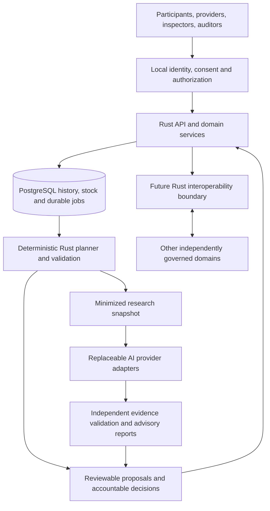

# Architecture, test quality and international readiness review

Review date: 6 November 2026. Runtime baseline: `3e1cd376273b22e23070abebee87057df7fee9f5`, Qazna 0.11.0. This document is the maintained review, not a certification or an assertion that every defect has been found. Update its findings as evidence changes.

## Decision

Keep the Rust/Tokio/Axum/SQLx/PostgreSQL modular core. It is a credible research implementation with substantial transaction tests. It is not yet an externally operated multi-user service, a complete economic circulation model or national infrastructure. There is no evidence that replacing Rust, adding a blockchain or starting with microservices would resolve the actual gaps.

Develop an internationally reusable, open provisioning and transition-research platform. Its initial offer is a reproducible experiment on sustaining essential provision during changes in employment. A global monetary arrangement remains a longer-term proposal requiring economic evidence, legitimate institutions and voluntary participation. AI suppliers can contribute forecasting, evaluation and research resources without controlling people's entitlements, monetary authority or appeal rights.

Useful runtime mechanisms from the earlier projects must be reimplemented in Rust, as instructed by the author. Python remains a research/calculation tool under the existing boundary; it cannot authorize ledger operations. No legacy runtime has been imported in this review.

## Scope and source limits

Inspected the current manifest, CI, domain and service modules, migrations, access configuration, operational scripts and test organization. Ran the prescribed PostgreSQL/HTTP checks, a current RustSec scan and selected deliberate-fault experiments. The test analysis below distinguishes actual coverage from proposed gates. No live penetration test, national-scale load test, formal verification of the entire implementation or legal certification was performed.

Earlier local snapshots used for comparison:

| Project | Local commit | What was inspected |
| --- | --- | --- |
| `qazna-org/qazna.org` | `03116f7e4ce333f1511e7724e3e90cea2f5ed6d5` | Standards, conformance, governance/signatures, audit context, OpenAPI, Rust ledger and TLA+ example |
| `qazna-org/orda` | `60265cc8283d4d20cc3ae72cd69c29f845a98b2f` | README, governance, federation, security interfaces, reconciliation, simulation and selected API/UI paths |

Both local commits are dated 3 April 2026. The connected GitHub API returned 404 for both requested repository names; a web-indexed Qazna page was available but did not establish a current remote head. Consequently, legacy conclusions refer to these local snapshots, not verified latest remote releases. Legacy services/tests were not executed or changed. Sensitive legacy implementation details are not reproduced in this public review.

## What the implementation already gets right

- Integer accounting and string JSON amounts avoid binary floating-point and JavaScript integer rounding. Wide intermediate arithmetic and database aggregates protect calculations.
- PostgreSQL transactions, deterministic account locking, idempotency payload comparison and deferred constraints protect histories and balances. SQL injection is not introduced by interpolating ordinary request values into SQL; reviewed service queries bind their inputs.
- Physical stock, capacity, promises, actual receipts and accounting availability are different states. A forecast is not counted as delivered goods.
- Needs can be registered without purchasing power. Drafts are reviewed and revalidated before atomic application.
- Outbox processing, worker leases and stale-worker rejection provide a sound basis for asynchronous computation.
- Model commentary cannot apply drafts. Structured claims are checked against saved calculations; unverified prose is explicitly distinguished.
- The service refuses non-loopback binding. Scoped observer/reviewer/attestor credentials, live attestor revocation, restricted database roles and logical restoration are real implemented controls.
- Locked dependencies, SHA-pinned checkout, minimal workflow permissions, migration preservation and a third-party license inventory are already present.

These controls support further development. They do not prove physical declarations truthful, resolve collusion, determine fair scarcity policy or establish production reliability.

## Findings and required evidence

P0 blocks consequential operation for real participants. P1 is required before the relevant external pilot or scale step. These priorities describe deployment impact, not claims of currently exposed internet vulnerabilities.

| ID | Priority | Observed evidence | Consequence and closure |
| --- | --- | --- | --- |
| A1 | P0 | `src/api.rs:24`, `src/main.rs:88`: shared operator authority; no resident OIDC/account ownership model; local attestors limited to 64 | Keep loopback. Implement authenticated subject + organization + resource scope, revocation/replacement, independent enrollment, auditor access and negative cross-user tests before exposure. A reverse proxy alone does not supply these checks. |
| A2 | P0 | `src/domain.rs:5`, `docs/pilot-charter.md`, `tests/postgres.rs:307`: unit denomination and complete circulation policy remain open; finite reserve can run short | Define versioned unit/norm authority and a full multi-period circulation scenario covering households, providers, workers, inputs and maintenance. Separate conserved measure from physical provision; do not silently mint, confiscate balances or insert interest/fees. |
| A3 | P0 | `src/planning_service.rs:185` and `tests/cases/planning.rs:337`: caller ordering changes who receives scarce inputs | Current deterministic behavior is not an implemented fairness policy. Compare approved scarcity rules with the same inputs, explain waiting and give people an appeal. Do not substitute model confidence or an employment score for entitlement. |
| A4 | P0 | Immutable records lack a complete correction/dispute/compensation lifecycle; resource categories are food/water/energy in `src/provisioning.rs` | Wrong quantities, disputed receipts, supplier reassignment and honest mistakes need linked correction events. Food pilots need expiry, quality, custody and recall controls. Healthcare/education are not implemented merely because they appear in the book. |
| A5 | P1 | `src/coordination_service.rs:122`: each event creates jobs for every active monitor and reads/locks all monitor rows | Job creation grows as events × monitors. Introduce dependency-scoped invalidations, coalescing, bounded queues, fair scheduling and backpressure. Test that coalescing still observes late commits and never loses a required recalculation. |
| A6 | P1 | `src/observability.rs:17`, ledger/provisioning SQL views and balance constraints aggregate accumulated histories | Correct on small data; cost grows with history and hot accounts. Benchmark realistic histories, query plans, lock wait, WAL, storage and p99. Consider transactionally maintained, independently reconciled projections; do not replace authoritative history with an unchecked cache. |
| A7 | P1 | `src/coordination_service.rs:249` and migration 0008 restrict provider identity to `codex-chatgpt` | International interoperability is not implemented. Add an additive migration and a Rust provider-neutral review envelope with provenance, schema version, input hash, budget and provenance verification status. Keep model execution outside the accounting process. |
| A8 | P1 | Current CI checks formatting, clippy, licenses and behavior; no scheduled vulnerability scan, artifact provenance or reviewed release SBOM | Add dependency triage, source review, signed release provenance, artifact inventory and incident ownership. A lockfile and license list do not establish a secure supply chain. See the concrete RustSec finding below. |
| A9 | P1 | `src/main.rs:33`: pool capped at 10; most paths lack an explicit statement/request budget; reviews are fetched without pagination | Specify per-scope limits, timeouts, pagination, request correlation, cancellation and graceful SIGTERM handling. Test slow clients/DBs and resource exhaustion. The 16 KiB body limit is useful but not complete admission control. |
| A10 | P1 | No current machine-readable OpenAPI contract, service UI or deployable release package; MSRV 1.88 is declared but CI tests 1.97.0 | Publish versioned schemas and compatibility tests; verify the stated minimum toolchain or revise it. Build accessible multilingual participant/operator/auditor flows and an independently reproducible deployment. |
| A11 | P0/P1 | Logical dump restoration is tested; PITR, regional failover, protected backup storage and key recovery are not | Set pilot-specific RPO/RTO and physically rehearse recovery. Keep ordinary essential provision available during outages. Avoid claiming the logical restore rehearsal is disaster recovery certification. |
| A12 | P0 | Free-text bases and identity-linked need/evidence histories can become sensitive; append-only history is not a privacy design | Minimize personal data, separate identity from accounting evidence, define retention and purpose, implement scoped exports and appeals. Share aggregate or synthetic research data with AI providers by default. |

### Dependency scan: a finding that the normal checks missed

`cargo audit 0.22.1` against RustSec commit `26fd2d43f7280a1fb925a3743ec463017afe7119` (database updated 5 November 2026) returned **one lockfile advisory**, `RUSTSEC-2023-0071`, for `rsa 0.9.10`. The lockfile parent is optional `sqlx-mysql 0.8.6`. The current PostgreSQL-only build's `cargo tree --locked --target all` contains neither `rsa` nor `sqlx-mysql`. This establishes a locked-package finding without demonstrating an exploitable RSA path in the current build. Cargo metadata's broad resolution alone must not be mistaken for compiled reachability.

Do not describe the scan as clean, and do not add a blanket advisory suppression. Record feature/build-specific reachability, ensure future feature changes are rechecked, and track the advisory. The [RustSec advisory](https://rustsec.org/advisories/RUSTSEC-2023-0071.html) currently lists no patched version. A dependency upgrade must be tested; no dependency was changed during this review.

## Test quality assessment

The initial baseline passed **89 PostgreSQL tests, 3 Rust unit tests and 11 offline Python tests**. HTTP smoke checks exercised three process restarts; strict evidence scenarios ran both with the owner and the restricted runtime role; logical restore fingerprints matched 36 tables; two actor seeds completed. The normal check returned success. It is meaningful evidence of the tested contracts, not readiness for production.

### Coverage across every current Rust test module

| Module | PostgreSQL tests before this review | Useful challenge and oracle | Important limit |
| --- | ---: | --- | --- |
| `tests/postgres.rs` | 8 | Exact balances/posting counts, conflicting/replayed keys, 10 competing spenders, 16 identical requests, direct SQL rejection, HTTP scopes | Small histories; most tests use owner privileges; no broad input generation |
| `tests/cases/provisioning.rs` | 10 | Money/stock races, settle/cancel single winner, injected late failure, immutable SQL, migration | No transport/expiry/partial delivery policy |
| `tests/cases/needs.rs` | 9 | Need survives shortage, 8 competing requests, unit hierarchy and separate dimensions, rollback | Small hierarchy; no population/lifecycle model |
| `tests/cases/production.rs` | 20 | Shared capacity/inputs, cross-period competition, failed/zero output, terminal races, chained processes, strict evidence | Handwritten recipes; no general optimization, maintenance, logistics or physical measurements |
| `tests/cases/planning.rs` | 10 | Exact expected selections, shared budgets, numeric limits, priority reversal and no forecast-as-stock | Tests the greedy contract; does not establish a desirable or optimal policy |
| `tests/cases/drafts.rs` | 15 | Stale snapshots, apply/discard races, partial-failure rollback, complete action attribution, duplicate forecasts | Limited schedules and states; not all multi-command sequences |
| `tests/cases/coordination.rs` | 10 | Out-of-order commits, concurrent workers, lease expiry, failed result persistence, stale worker fencing, fabricated AI claims | Does not bound event × monitor growth or model-provider behavior statistically |
| `tests/cases/evidence.rs` | 7 | Separate identities, self-attestation rejection, wrong quantity, disputes, live revocation and scoped reads | Matching statements do not prove independent people or actual goods; no collusion detection |

The three Rust unit tests cover exact amount representation and calendar/basis validation. The eleven Python tests target minimization, fabricated evidence, forbidden model actions, credentials, malformed/partial completion and redirects. Mocking the CLI is appropriate for deterministic adapter checks, but cannot measure actual model reliability or sandbox escape resistance.

The integration tests are marked `#[ignore]` so that they require their owned PostgreSQL harness. **A bare `cargo test` is not the acceptance command**: it skips the database suite. `scripts/check.py` explicitly runs ignored tests and is the CI entry point.

### Realism gaps identified

1. Actor exercises use six synthetic residents, 18 needs and two seeds. Ages are descriptive metadata; they do not exercise pregnancy, demography, disability, healthcare or education. Randomness changes a few quantities rather than generating arbitrary state histories.
2. CI uses a 0.02-second cadence. `scripts/exercise.py` explicitly does not exercise its real five-second backlog alert at that speed. A green accelerated exercise is not an alert-delivery test.
3. Usual process stops send SIGINT; forced kill is only a fallback. These do not reproduce machine power loss, storage exhaustion, network partition, acknowledged-write loss or database failover.
4. Recovery checks use logical dumps and row fingerprints. They validate restoration and selected restrictions, not continuous WAL/PITR, encrypted off-site recovery, key restoration or an established RPO/RTO.
5. Most race tests spawn a few tasks without systematically exploring schedules. The old-worker test is stronger: it holds a table lock and waits for lease states. Expand deterministic barrier/fault tests before simply increasing thread counts.
6. Several raw-SQL negative cases accept any SQL error. Stronger negative tests should also assert the intended SQLSTATE/constraint, otherwise a syntax or fixture error could create false confidence.
7. Evidence exercises use synthetic digest strings, including a repeated digest. They test the protocol, not capture/storage/verification of real evidence files, physical independence or sensor authenticity.
8. No demonstrated sustained load envelope, independent sequential/concurrent history checker for all domain operations, fuzz campaign, user-interface accessibility testing or external penetration review exists.
9. Python scenarios use `assert`. Running with optimization can silently remove these checks. The main harness now refuses optimized Python before starting tests.
10. Temporary recovery/exercise reports are deleted with their clusters. CI needs selected, sanitized machine-readable evidence retention and an explicit list of skipped gates; an aggregate success message is insufficient for release review.

### Deliberate-fault experiment and improvements

Added `scripts/mutation_check.py`: it creates a temporary source copy and private socket-only PostgreSQL cluster, runs an unmodified baseline, then changes one behavior at a time. Build/infrastructure failures and zero-test runs are errors, not successful fault detection. It never modifies runtime sources or an existing database.

| Deliberate fault | Existing suite result | Interpretation |
| --- | --- | --- |
| Accept noncanonical leading-zero amounts | Detected | Amount validation has an effective negative oracle |
| Ignore changed payload on an existing idempotency key | Detected | Replay checking is not merely a success-path test |
| Give reviewer credentials write access beyond review routes | Detected | Privilege escalation is tested |
| Increase HTTP body allowance from 16 KiB to 16 MiB | **Survived** | Existing tests did not enforce this protective boundary |

Added two Rust/PostgreSQL tests in `tests/cases/resilience.rs`:

- An otherwise valid authorized transfer padded to 16 KiB + 1 must return 413 with unchanged balances/history; the same key then succeeds at exactly 16 KiB and replays once at normal size. This checks rejection, boundary acceptance and retry semantics together.
- Four seeded histories, 128 commands each, are checked against a separate integer reference model after every step. The 512 requests mix accepted transfers, insufficient funds, unchanged replay and conflicting replay; every account balance and journal count must agree. This is sequential model-based testing, not proof of all concurrent histories.

The expanded full suite passes **91 PostgreSQL, 3 Rust and 11 Python tests**, plus the HTTP/recovery/exercise checks. The repeated mutation run detected all four deliberate faults: the amount mutation failed one unit test; the idempotency mutation failed eight database tests; the reviewer mutation failed one authorization test; the enlarged-body mutation failed the new boundary test. Unmutated baselines passed before both experiments. Repeat the curated mutation run after future changes. Its four cases are not a statistically representative mutation score; equivalent/dead-code mutations and general coverage have not been measured.

Verification environment: macOS/aarch64, Rust 1.97.0, Python 3.14.5 and the PostgreSQL 16 Homebrew binaries. Initial sandboxed `initdb` was blocked by shared-memory permissions; the successful runs used an approved private temporary cluster outside that restriction. No existing database was used. CI continues to exercise Ubuntu/PostgreSQL 16; the new optional workflow-dispatch mutation step must be selected explicitly.

Commands, from the project directory:

```sh
PG_BIN=/opt/homebrew/opt/postgresql@16/bin python3 scripts/check.py
PG_BIN=/opt/homebrew/opt/postgresql@16/bin python3 scripts/mutation_check.py
cargo audit --db /tmp/qazna-rustsec
cargo tree --locked --target all -i rsa
```

### Required next test gates

| Gate | Concrete work | Acceptance evidence |
| --- | --- | --- |
| Before participant access | Authorization matrix for every route; subject substitution, cross-organization IDs, revocation/re-enrollment; runtime DB role | All forbidden actions denied without side effects; selected allowed actions still work |
| Before circulation claims | Multi-period reference model spanning needs, supply chains, worker payments, downtime and reserve use | Separate measure conservation, liquidity and actual delivery; no hidden issuance or erased unmet need |
| Before growth | Scoped queue flood, hot-account contention, long-history reads, slow consumers and resource exhaustion | Predeclared workload, p95/p99, throughput, error rate, queue age, memory, WAL and cost; no invariant violations |
| Before operational pilot | Abrupt process/DB termination at transaction boundaries, dropped responses, retry after reconnect, restore and continuity | No double effect/lost acknowledged operation under the documented durability contract; measured RPO/RTO |
| Before physical dependence | Expiry, recalls, partial receipt, honest error, inaccessible recipient, colluding or absent inspectors | Auditable exceptions and continuity; essential needs persist; no false receipt |
| Before autonomous recommendations expand | Labelled model eval corpus with injection, omission, false reassurance and provider outage | Quantified errors and review burden; no action credentials; deterministic fallback |

Do not set an arbitrary 100% line-coverage target as a release claim. Map each invariant and trust boundary to a positive case, negative case, boundary case, concurrency/failure case and observable postcondition. Track uncovered requirements explicitly.

## What to recover from earlier projects

| Earlier material | Useful idea | Rust adoption and boundary |
| --- | --- | --- |
| Qazna `STANDARD/CONFORMANCE.md`, `API_CONTRACT.md`, `ERROR_MODEL.md` | Requirements linked to executable evidence | Versioned OpenAPI/JSON schemas and conformance tests for the current needs/ledger API; do not copy legacy mint/fee policies |
| Qazna `GOVERNANCE_NEUTRALITY.md`, `CRYPTO_AND_KEYS.md`, `internal/governance` | Versioned signed decision packages, distinct signers, validity intervals | Rust registry of authorized decision makers, canonical payload/hash, replay protection and threshold approval; signature validity alone is not authorization |
| Qazna `internal/audit`, `STANDARD/AUDIT_LOGGING.md` | Request, actor, decision and trace linkage | Structured Rust audit events with redaction and independent export/checkpoints; a hash chain alone cannot stop a privileged administrator rewriting all copies |
| Qazna `web/docs/tla/ledger.tla` | Conservation and ordering specified independently | Expand the state model to reservations, cancellation and leases; implement/run Rust state-machine tests. The old example follows a fixed transfer sequence and is not a proof of the new concurrent system |
| Orda reconciliation and simulation modules | Detect external/internal mismatches; run isolated scenarios | Rust exact-integer reconciliation and seeded scenario engine; compare physical receipt evidence as well as accounting, preserve reproducible inputs |
| Orda federation design | Independent operating domains cooperating | Rust durable inbox/outbox, domain-bound identities, unique message IDs, expiry, replay prevention and explicit cross-domain finality. No automatic issuance merely because a remote peer sent a message |
| Orda signing interface and hardware-key experiments | Separate signing from domain logic | Rust signer interface backed by reviewed KMS/HSM integration when justified; key lifecycle, availability and hardware verification remain separate acceptance gates |
| Earlier observability, ISO 20022 and UI work | Monitoring, standards adapters and comprehensible workflows | Rust telemetry/API/adapters; React/TypeScript remains the planned UI. Validate message semantics/profile against counterpart requirements; an XML parser is not ISO certification |

The older implementations contain demonstration assumptions, incomplete execution paths and different economic policies. Adopt requirements and test vectors after review, preserve attribution for reused material, and rewrite runtime logic in Rust. Do not import example credentials, floating-point accounting, blanket administrative authority, fees, confiscation policies or currency speculation into the new core. Go-to-Rust translation by itself does not repair a flawed protocol.

## International target architecture



Retain a modular monolith for a pilot. Keep domain, transport, persistence and external integration boundaries explicit, extracting components only when measured operational needs justify them. Exact accounting, physical quantities and stochastic forecasts should have distinct types; a forecast's decimal approximation must never become an authoritative posting through implicit conversion.

International readiness requires domain identifiers, locale/time-zone rules, physical-unit registries, versioned normative measures, configurable lawful institutional responsibilities, multilingual accessible interfaces and exportability. An English README alone is not internationalization. The experimental Tenge unit must be distinguished from Kazakhstan's legal currency identifiers; no exchange or legal-currency equivalence is implied.

For initial independent pilots, prefer separate deployments and databases. Later federation requires explicit consistency and reconciliation protocols. A single planet-wide write database, identity registry or AI administrator would create both a failure concentration and a governance problem. Aggregated planning and local execution can share a protocol without surrendering all decision authority to one vendor.

### Scale arithmetic, not a benchmark

Assume 10 domain commands per person per day, a 10× average peak and 1,000 stored bytes per command. These are sensitivity inputs, not measured workload or measured row size. A domain command may create multiple SQL rows and jobs.

| Population | Commands/day | Average commands/s | Assumed peak/s | Raw annual bytes, decimal TB |
| ---: | ---: | ---: | ---: | ---: |
| 100,000 | 1,000,000 | 11.57 | 115.74 | 0.365 |
| 1,000,000 | 10,000,000 | 115.74 | 1,157.41 | 3.65 |
| 100,000,000 | 1,000,000,000 | 11,574.07 | 115,740.74 | 365 |
| 1,000,000,000 | 10,000,000,000 | 115,740.74 | 1,157,407.41 | 3,650 |

Formulas: `average = population * commands_per_day / 86400`; `annual_bytes = population * commands_per_day * bytes_per_command * 365`. Indexes, WAL, replicas, backups, observations, images and retention increase storage. No node count can be inferred without hardware/query benchmarks and recovery constraints.

With the present dispatcher, only 10 relevant events/s and 1,000 active monitors can create **10,000 jobs/s**, or **864 million jobs/day**, even when most scopes are unrelated. This follows from the SQL fan-out, not a load measurement. Reducing unnecessary work should precede choosing a distributed queue.

## Industry reference matrix

Verified against primary pages on 6 November 2026. These are selected applicable references, not a claim to satisfy every industry standard.

| Reference | Application here | Current position |
| --- | --- | --- |
| [NIST SSDF 1.1, SP 800-218](https://csrc.nist.gov/pubs/sp/800/218/final) | Development, review, provenance and vulnerability response | Partial practices; maintain an evidence/owner matrix, not a certification label |
| [OWASP ASVS 5.0.0](https://asvs.owasp.org/) | API/application security requirements and verification | Target applicable Level 2 controls for an external pilot, with higher-assurance review of critical actions; no conformance claim |
| [OAuth Security BCP, RFC 9700](https://www.rfc-editor.org/rfc/rfc9700.html), [FAPI 2.0 final](https://openid.net/specs/fapi-security-profile-2_0-final.html) | Strong authorization for high-value integrations | Static local tokens are not FAPI; choose provider/profile and test object permissions separately |
| [SLSA 1.2](https://slsa.dev/spec/v1.2/) | Build/source provenance | CI is a starting point; no attained SLSA level asserted |
| [RustSec](https://rustsec.org/) | Known dependency advisories and triage | Explicit scan finding above; add scheduled checks and feature-sensitive review |
| [OpenTelemetry](https://opentelemetry.io/docs/what-is-opentelemetry/) | Correlated traces, metrics and logs | Current tracing/status endpoint needs service SLOs, bounded metrics and external alerts |
| [WCAG 2.2](https://www.w3.org/TR/WCAG22/) | Accessible participant/operator interface | UI pending; plan AA verification, assisted access and language support |
| [ISO 20022 implementation checklist](https://www.iso20022.org/sites/default/files/media/file/ISO20022_ComplianceChecklist.pdf) | Optional boundary interoperability | Use official message definitions and a specified community profile; no blanket compatibility claim |

## International collaboration route

The [AI economic research brief](ai-economic-research.md) now supplies the detailed evidence review, six testable contributions, measurement definitions and experimental design. On 6 November, OpenAI's summer Exchange intake is confirmed closed; Microsoft's AIEI Cohort 4 has a published 30 November deadline and institutional/degree requirements. Anthropic's newer fund has institutional and project-size constraints. Google research activity does not establish an open application route. Treat the table below as thematic mapping, not an invitation or eligibility decision.

The premise that AI will inevitably eliminate most jobs in the next few years is not established. The [ILO/NASK 2025 assessment](https://www.ilo.org/resource/news/one-four-jobs-risk-being-transformed-genai-new-ilo%E2%80%93nask-global-index-shows) estimates exposure for one in four jobs globally and emphasizes transformation over wholesale replacement. Exposure, adoption, productivity gains and actual displacement must be different scenario variables. Design the experiment to remain useful under both severe displacement and gradual task change.

There are real research entry points, although none has expressed interest in this project:

| Organization / verified initiative | Potential fit | Concrete research offer |
| --- | --- | --- |
| [Anthropic Economic Futures](https://www.anthropic.com/economic-futures) | Economic transitions and support instruments | Compare essential-provision mechanisms under labour displacement and supply shocks using a reproducible, independently evaluated pilot |
| [OpenAI Economic Research Exchange](https://openai.com/index/economic-research-exchange-request-for-proposals/) | Empirical AI effects, household welfare and unequal benefits | A scoped question, identified data partners and evaluation design; code alone is not an empirical research result |
| [Google AI & Economy Research Program](https://ai.google/economy/) | Work, productivity and economic transformation | Multi-country scenario assumptions and portable measurement/experimental protocols |
| [Microsoft AI Economy Institute](https://www.microsoft.com/en-us/research/group/aiei/aiei-open-call-4/) and New Future of Work | Organizational change and uneven gains | Study how human review and provision coordination affect coverage, workload, learning and exclusion |

These are thematic matches, not confirmation of eligibility, an open funding round or endorsement. Check current application terms before contacting. No outreach was sent in this review.

Suggested English positioning:

> Qazna is an open, Rust-based research platform for testing needs-based provisioning during AI-driven economic transitions. It separates physical resources, exact accounting and AI advice, and preserves accountable human decisions. We seek research partners to evaluate whether this approach can improve essential-needs coverage under labour displacement and supply constraints. The implementation is a local research MVP; national monetary adoption and large-scale effectiveness remain unproven.

Offer a short English technical brief, a reproducible synthetic demonstration, a verified limitations/test report, a versioned scenario dataset and a pilot protocol with an independent evaluator. Link the complete book as the author's conceptual background. Technical reviewers must be able to reproduce economic claims without first agreeing with its historical or philosophical hypotheses.

Keep the existing AGPL-3.0-or-later code and CC-BY-SA-4.0 project-documentation scope. Commercial collaboration is not automatically prohibited, but partners must assess their actual license obligations. Do not promise that use of an API automatically relicenses an AI model, or that the license controls independently implemented economic ideas. Preserve contributor rights and upstream notices when porting; relicensing is a separate decision.

## Recommended sequence and decision gates

1. **Close research credibility gaps:** maintain this review, tested scenarios and traceable requirements; triage RustSec; verify CI cannot skip required tests; publish accurate scope. Finish an executable multi-period circulation specification with independently checked physical and accounting balances.
2. **Build a participant-safe shadow pilot:** identity/ownership, correction/appeal, essential-provision continuity, actual food lifecycle, accessible interface and named responsibilities. Set coverage, waiting, waste, exclusion, review burden and recovery thresholds before enrollment. Existing provision remains authoritative during comparison.
3. **Prepare international integration:** versioned API/schema, Rust governance and reconciliation mechanisms from the older designs, vendor-neutral AI envelopes and localized measurement/rights policies. Keep providers replaceable.
4. **Demonstrate operational limits:** scope/coalesce jobs, collect independent performance evidence, test sustained load and abrupt failures, validate backup recovery and security. Capacity and cost estimates must use these measurements.
5. **Invite independent research partners:** approach universities, communities and corporate economic-research teams in parallel with state review. Compare policy alternatives under shared resource assumptions. Publish negative results and distributional effects as well as averages.
6. **Consider wider federation only after evidence:** independent deployment domains, agreed interoperability and responsibility, proven cross-domain replay/recovery behavior, and informed consent. A declined eOtinish proposal does not prevent research, but a corporate partnership would not supply state monetary authority either.

The next implementation block should address scoped access and accountable policy/correction contracts before broad public deployment. Queue amplification and test depth should advance alongside it. This review changes tests and documentation; it does not implement OIDC, federation, a global optimizer or an economic policy by implication.


## Mathematical/circulation update — 7 November 2026

The offline verifier now checks finite ordered circulation, minimum opening
balances and unavailable/underfunded events without executing ledger actions.
The maintained study includes one-treasury common entitlements, timing reserves,
quantity growth and intraday rescheduling. The HTTP drill runs this explicit
synthetic candidate through existing operator commands and checks partial-cycle
restart and replay. Executables are pinned per exercise to avoid mixed-build
restart traces. No migration, new issuance permission, automatic social policy,
enterprise ownership registry or independently verified upstream supply chain is
introduced. See [the calculations](computation-and-ai-costs.md#closed-circulation-candidate--7-november-2026)
and [execution boundaries](exercises.md#shared-entitlement-circulation-exercise).
