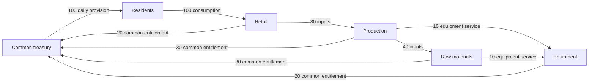

# Mathematical operation without AI: design and cost study

As of 6 November 2026. This is a reproducible engineering study, not a procurement quotation, national deployment plan or evidence that the proposed economy has been validated. All infrastructure capacities, staffing and workloads are editable assumptions. Only the explicitly sourced API tariffs are observed prices. Amounts are approximate external IT costs in USD, not a conversion of Qazna's normative Tenge measure.

## Decision and implemented boundary

Qazna should remain operational without generative AI. Exact postings, resource balances, eligibility rules, capacity checks and plan validation need deterministic software. Optimization does not require a language model. AI may assist with explanations, document extraction, forecasting features and incident investigation, provided its contribution is independently checked and worth its full cost.

The current Rust coordinator already calls `propose_provisioning` directly. The separate opt-in `scripts/ai_review.py` adds commentary. No model review is required to calculate and apply a valid draft. The PostgreSQL test `automatic_recalculation_keeps_operator_authority_and_deduplicates_drafts` now explicitly checks that the review table remains empty through recalculation and operator application. This verifies one complete path, not national-scale unattended operation.

The current `ordered-planner-v2` is bounded, sequential and caller-ordered; it is not a global LP/MIP optimizer. It is limited to 32 needs and 64 candidates per proposal. A small exact optimizer has been added as a **research example**, not integrated into economic authority. AI-independent operation and optimal planning are separate capabilities.

| Function | Non-AI implementation | Optional AI contribution |
| --- | --- | --- |
| Accounting circulation | Integer postings, double entry, atomic transactions, idempotency | Explain a saved, reconciled result |
| Supply and production | Resource balance, min-cost flow, linear/mixed-integer optimization | Propose a formulation for independent validation |
| Daily/long-term planning | Rolling horizons, scenario trees, robust constraints, classical forecasting | Improve forecasts if out-of-sample evaluation justifies it |
| Individual needs | Versioned human-approved norms, verified events, preferences, choice and appeal | Assist registration; no inferred entitlement from personality or employment |
| Shortage detection | Constraint residuals, inventory/queue thresholds, statistical change detection | Triage unfamiliar combinations and explain evidence |
| Security | Authentication, scoped authorization, signatures, rate limits, audit, isolation and deterministic incident rules | Advisory investigation of sanitized incident bundles |

Anomaly detection is not inherently dependent on AI either. Start with rules and statistical baselines such as EWMA/CUSUM. Calling a language model for every transaction is unnecessary. Automatic isolation should use preapproved, bounded rules with recovery procedures; a model must not independently confiscate balances, reject essential provision or change monetary norms.

## Economic formulation

Indices: region `r`, resource `k`, production process `j`, person/group `i`, time `t`. Quantities carry physical units. Let `s` be stocks, `x` process activity, `B` usable output coefficients, `A` consumed input coefficients, `y` confirmed provision, `f` shipments with arrival delay, and `w` spoilage. A time-expanded physical balance is:

```text
s[r,k,t+1] = s[r,k,t] + sum_j (B[k,j]-A[k,j])*x[r,j,t]
            + arrivals[r,k,t] - dispatches[r,k,t]
            - sum_i y[i,r,k,t] - w[r,k,t]
s >= 0; x >= 0; y >= 0
0 <= y[i,r,k,t] <= validated_need[i,r,k,t]
C*x <= available_capacity
L*x <= available_skilled_hours
E*x <= available_energy
shipments <= route_capacity
```

A production lead time moves output to its actual completion period. Likewise, dispatch is not same-period arrival. Include maintenance, transport, construction, education and health as explicit activities consuming inputs and capacity; they cannot be covered by a financial balance alone. Changing needs, births, equipment failures and preferences require revised forecasts and feedback. No optimizer has perfect knowledge of future choices.

Use a human-approved **lexicographic** objective: first protect specified essential-service constraints, then improve worst-group coverage, then reduce remaining unmet needs and waste, then unnecessary changes to an accepted schedule. Units and priorities must be explicit; do not add litres, meals and care-hours. For a positive frozen need `n`, a coverage constraint `y >= z*n`, `0 <= z <= 1`, can maximize the common minimum fraction `z`. Higher-priority clinical constraints need separate treatment. This defines a research comparison, not an enacted distribution policy.

Linear programming handles divisible activities. Mixed-integer programming handles indivisible machines, shifts and open/closed facilities. Scheduling may need constraint programming; quadratic penalties may model schedule stability. Multi-period uncertainty needs scenario/robust optimization rather than pretending a single equation predicts everything. If a problem times out, preserve a validated feasible incumbent and its reported optimality gap. An infeasible problem must report the bottleneck; it must not silently invent stock or deprive someone by changing the input need.

The simple input-output equation `(I-A)x=d` is useful only for a compatible square technology model: a nonnegative productive matrix, suitable spectral-radius conditions, and no omitted capacity/time limits. Solving it alone is not a complete state plan.

For accounting, let `D` be the account-edge incidence matrix (each transfer column sums to zero), `q` the exact integer transfer vector, and `b` balances:

```text
b_next = b + D*q + explicitly_authorized_net_issuance
sum(b_next) = sum(b) + sum(explicitly_authorized_net_issuance)
```

Ordinary circulation has zero issuance. Reservations must prevent conflicting spend before settlement. The presence of a balance does not prove physical availability, and a constant accounting unit does not make resources unlimited. There is no interest, tax, deposit return or speculative price mechanism introduced by these equations. Governance of norms and issuance remains an unresolved, separately authorized policy problem.

## Executable result without a model

The Rust example solves a bounded integer problem exactly. Two processes produce the same provision unit. Process X consumes two grain units and one energy unit; Y consumes one grain and two energy units. Their individual capacities are 100. Demand is 200. Maximize `x+y`, then minimize energy among tied solutions:

```text
2x+y <= G; x+2y <= E; x <= cap_X; y <= cap_Y; x+y <= 200
x,y are nonnegative integers
```

| Scenario | Grain / energy | X / Y activity | Provided | Unmet | X-first greedy provision |
| --- | ---: | ---: | ---: | ---: | ---: |
| Balanced | 240 / 240 | 80 / 80 | 160 | 40 | 140 |
| Energy shortage | 240 / 150 | 100 / 25 | 125 | 75 | 125 |
| Grain shortage | 120 / 240 | 10 / 100 | 110 | 90 | 60 |
| X capacity falls to 40 | 240 / 240 | 40 / 100 | 140 | 60 | 140 |

For the balanced case, adding the two resource inequalities proves `3(x+y)<=480`, hence no solution can exceed 160; `(80,80)` attains that bound. The test also compares the optimizer against exhaustive independent enumeration over small resource/capacity/demand combinations. Another test reproduces the published JSON from the current inputs, preventing stale results after a calculation change. This is a genuine minimal result: optimization can outperform ordering without AI. It neither proves a nationwide benefit of 14.3% nor establishes the complete economic proposal.

For a larger solver, [HiGHS](https://highs.dev/) provides MIT-licensed LP/MIP/QP software. Its implementation is C++, not Rust. A possible architecture is a restricted external solver process with Rust-owned input construction and independent exact feasibility validation. No solver is integrated yet. Keeping authoritative runtime logic in Rust does not require claiming an external numerical library was written in Rust; adopting one requires explicit dependency/license and execution-boundary review.

Use regional/time/commodity decomposition and sparse matrices. Individual settlements remain separate from aggregated production planning. A billion residents do not require one dense billion-variable solve every second. Cross-region balances must be reconciled; decomposition does not automatically retain the global optimum. Current all-monitor event fan-out and history-query hot spots must be fixed before extrapolating throughput.

## Reproducible budget assumptions

Run from the project directory:

```sh
cargo test --locked --example no_ai_study
cargo run --locked --quiet --example no_ai_study > research/computation-cost-results.json
```

Inputs: [editable JSON](../research/computation-cost-inputs.json). Results: [generated JSON](../research/computation-cost-results.json). Code: [Rust example](../examples/no_ai_study.rs). No credentials, paid model request or participant data are used. Floating point is only for approximate research costs; authoritative postings remain exact integers.

Base workload is 10 commands/person/day, peak 10 times average, 10 CPU-ms/command, 50% utilization, twice ledger compute capacity for redundancy, minimum eight vCPUs. Planning domains contain 100,000 people, with 96 runs/day, 60 CPU-seconds/run and 50% utilization. These are **unmeasured planning assumptions**, not claims about PostgreSQL throughput, solver time or service availability.

Storage is 2,000 bytes/command including assumed index/history overhead, four copies, $0.08/decimal-GB/month. Compute is $0.04/vCPU-hour. Network/observability adds 30% of compute/storage cost. Engineering/operations uses `6+ceil(population/1m)` FTE at $100,000 fully loaded/year. Independent assurance is `$50,000+$0.01/person/year`. A 25% contingency is included. Initial study/build allowance is ten person-years plus $200,000 assurance, or $1.5m with contingency. **This fixed initial allowance is research development, not the cost of deploying a country.**

Memory, IOPS, inter-region bandwidth, compliance, identity rollout, devices, physical delivery staff, supplier integration and organization-specific overhead need separate sizing/quotes; a percentage allowance cannot guarantee coverage. The model does not include food, hospitals, schools, housing or other real national provision budgets. Existing operator application/attestation labour also needs measured case throughput; engineering FTE is not a substitute for it. National readiness cannot be purchased for the numbers below.

```text
commands_day = population * commands_per_person_day
ledger_vCPU = ceil(avg_commands_second * CPU_seconds * peak / utilization * redundancy)
planner_vCPU = ceil(domains * runs_day * seconds_run / 86400 / utilization)
storage_end_year_GB = commands_day * 365 * bytes_command * copies / 1e9
```

The first operating year starts with empty storage and linear accumulation, so average storage is half its year-end value. The baseline five-year calculation assumes a one-year rolling stored dataset: build + first year + four steady years. Prices, activity and staffing are held fixed in 2026 USD across five years; no inflation, discounting or growth forecast is assumed. This is a cost scenario, **not permission to delete immutable financial history**. Retaining all five years at the same storage tier adds the separately reported amount. Real hot/cold archival tiers need new prices and restore testing.

| Population | Average / peak commands per second | Year-end storage, all copies | First-year recurring, no AI | Five years + study/build, rolling storage | Extra to retain all five years |
| --- | ---: | ---: | ---: | ---: | ---: |
| 100,000 | 11.6 / 116 | 2.92 TB | $0.946m | $6.240m | $0.036m |
| 1 million | 116 / 1,157 | 29.2 TB | $1.001m | $6.594m | $0.364m |
| 100 million | 11,574 / 115,741 | 2.92 PB | $19.553m | $108.374m | $36.442m |
| 1 billion | 115,741 / 1,157,407 | 29.2 PB | $188.210m | $1,033.652m | $364.416m |

Decimal PB means 10^15 bytes. Five years of full retention for the 100m scenario gives **$144.816m**, including the $1.5m research/build allowance. Hardware counts are capacity arithmetic, not a measured cluster design. The billion-person row is a stress extrapolation; geographic/legal/failure-domain complexity is not linear.

For 100m residents, changing CPU cost/command to 2–50 ms, bytes/command to 500–8,000, copy factor to 2–6, and planning CPU time to 10–600 seconds gives **$15.388m–$42.169m** first-year recurring cost, with staffing and prices held fixed. These are selected scenarios, not confidence bounds. Longer solver runtimes, higher human workload or stronger resilience can exceed the range.

## Optional AI cost

Standard text API tariff snapshots, USD per million input/output tokens, checked 6 November 2026:

| Model | Input | Output | Official source |
| --- | ---: | ---: | --- |
| GPT-6 Luna | 0.10 | 0.50 | [OpenAI pricing](https://developers.openai.com/api/docs/pricing) |
| GPT-6.1 Terra | 1.00 | 5.00 | Same source |
| GPT-6.1 Sol | 2.00 | 10.00 | Same source |
| GPT-6 Astra | 10.00 | 50.00 | Same source |
| Claude Haiku 5.5, short-context tier | 0.10 | 0.50 | [Anthropic pricing](https://platform.claude.com/docs/en/about-claude/pricing) |
| Claude Sonnet 5.5 | 2.00 | 10.00 | Same source |

Prices are not a quality ranking. Haiku's listed tier applies up to 100k input context; larger contexts differ. Tokenizers differ, so identical token counts do not guarantee equivalent documents. Google/Azure commercial quotes and pricing were not established for this calculation. No bulk discounts, caches, subscription entitlements or free research credits are assumed. Regional premiums, tools, retrieval, long context and reasoning output can add costs. Recheck tariffs before a purchasing decision.

Each reviewed case assumes 2,000 input and **500 billed output** tokens including reasoning if charged, with a 1.1 attempt multiplier. Review a fraction `f` of commands after deterministic filtering and aggregation; grouping incidents can make actual case count much smaller. Adversarial repeated alerts can make it larger.

```text
annual_API = commands_day * 365 * f * attempts
             * (input_tokens*input_rate + billed_output_tokens*output_rate) / 1e6
additional_AI_case_review_FTE = commands_day * 365 * f
             * review_fraction * minutes_per_review / (60 * productive_hours_year)
```

The hybrid estimate additionally assumes two integration/operations FTE and $25,000/year evaluation, plus human inspection of 1% of AI cases at two minutes/case and 1,600 productive hours/reviewer/year. This is additional AI-output review, not all human authority/physical-delivery labour. It may be inadequate for complex cases; critical decisions cannot use a 1% sample as their authorization policy. All increments receive the same 25% contingency.

| 100m residents: commands sent for AI assistance | API/year, Luna | API/year, Sol | Extra case-review FTE | First-year recurring total, Luna | First-year recurring total, Sol |
| --- | ---: | ---: | ---: | ---: | ---: |
| None | $0 | $0 | 0 | $19.553m | $19.553m |
| 0.01% | $18,068 | $361,350 | 7.6 | $20.807m | $21.236m |
| 0.1% | $180,675 | $3,613,500 | 76.0 | $29.565m | $33.856m |
| 1% | $1,806,750 | $36,135,000 | 760.4 | $117.144m | $160.055m |
| Every command | $180,675,000 | $3,613,500,000 | 76,041.7 | $9,750.886m | $14,041.917m |

The last row exposes the cost of the assumed workflow; it is not a recommendation to review every transfer. At 0.1%, five-year hybrid totals with rolling storage are $158.436m / $179.891m; add $36.442m for full five-year storage retention. If human inspection is unnecessary for a bounded, noncritical explanatory task, set its review fraction explicitly to zero: the 0.1% first-year totals become $20.060m / $24.351m. Do not silently omit human cost from an oversight-dependent design.

For a self-hosted **different open-weight model**, the example assumes $2/GPU-hour, one effective 2,000+500-token request/second/GPU, 50% utilization, peak factor ten and at least two GPUs. At 0.1% that implies 255 GPUs, $4.468m/year GPU rental and $34.924m total first-year recurring cost with the same review assumptions. This is a sensitivity reference, not a claim that any listed proprietary model can run locally or that a given GPU achieves this rate/quality. Benchmark model size, memory, batching, peak concurrency and latency before considering a break-even comparison. Queued nonurgent inference may require far less peak capacity.

## Implementation sequence and acceptance

1. Preserve the deterministic service and an explicit no-AI deployment profile. No provider SDK/credential belongs in posting authorization. Existing offline tests require no paid provider; add provider-unavailability and credential-absence checks when production adapters exist.
2. Measure command CPU, DB I/O/index growth, operator/attestation time and recovery under realistic concurrent workloads. Replace assumed rates in the JSON, including document storage and data locality. Resolve monitor fan-out before extrapolation.
3. Build a Rust-owned multi-period scenario contract and restricted solver interface. Compare current greedy, exact small oracle and candidate LP/MIP on identical inputs. Check independent physical/accounting conservation, stale snapshots, integer rounding, timeouts, scarcity, priorities and delay. Performance gains must not hide new unmet needs.
4. Add dependency-aware jobs, debounce/coalescing, bounded queues and regional planning. Never combine mutually dependent resources without shared reservation/reconciliation.
5. Run deterministic incident rules first. Introduce optional AI only for a measured use case, with minimized data, no signing keys, bounded retries/context, daily monetary cap and automatic fallback. Those provider-budget controls are proposed, not implemented today. Compare false negatives, false positives, response time, harmful actions, human effort and total cost against the non-AI baseline.
6. Before live provision, close identity, appeal, privacy, lifecycle and independent assurance gaps from the [architecture review](architecture-review.md). Economic welfare requires a voluntary evaluated pilot, as described in [AI economic research](ai-economic-research.md), not merely successful code tests.

The recommended default is deterministic planning/settlement plus statistical monitoring. Optional AI must demonstrate an incremental benefit; losing the AI service or exceeding its budget must not stop ordinary provision or circulation.

## Exact mathematical verification and five-year resource study

Added 6 November 2026. The new code does not use an AI service or introduce
interest, taxes, deposits or an issuance endpoint. The research functions have no
database side effects. The operational planner is still the existing bounded
caller-order implementation; mathematical research is not silently applied as a
new distribution policy.

### What is proved and what is tested

| Result | Evidence | Boundary |
| --- | --- | --- |
| Feasibility of a supplied linear plan | Every sparse row checked with exact signed integer arithmetic on rational numerators/denominators | Correctness is relative to declared coefficients, resources and timing |
| Optimality | Primal feasibility, dual feasibility and exactly zero gap | The selected objective and supplied model only; fractional optima are labelled non-integral |
| Infeasibility | A Farkas multiplier with nonnegative combined variable coefficients and strictly negative combined bound | Proves no plan satisfies those constraints; does not prove the real economy is impossible |
| Circulation liquidity | Exact minimum prefix balances, with a closed form for repeated schedules | Fixed amount, event order and timing; no authority to impose any edge |
| Integer allocation | Exhaustive comparisons and explicit mathematical properties | Neither algorithm defines justice or health priority; they have different trade-offs |
| Live software behavior | Real Rust HTTP API and owned PostgreSQL, synthetic attestors and an independent accounting oracle | No real residents, physical measurements or national-load claim |

Use [Yinyu Ye's Stanford duality notes](https://web.stanford.edu/class/msande211x/lecture15.pdf)
for the standard primal/dual certificate principle. Qazna independently implements
exact row checks; it does not invent a new duality theorem or formally verify the
Rust compiler. Arithmetic overflow rejects a certificate rather than rounding it.

For a maximization problem `max c.x`, `A_le*x <= b_le`, `A_eq*x = b_eq`, `x >= 0`,
a dual multiplier has nonnegative entries on the inequality rows and unrestricted
entries on equality rows. If `A^T*y >= c`, then `c.x <= b.y`. Equality certifies an
optimum. If a nonnegative primal is also integral, it is optimal among integer
plans too; otherwise integrality is not inferred.

For infeasibility, `A^T*y >= 0` and `b.y < 0`, with the same multiplier sign rules,
would require `0 <= y^T A x <= y^T b < 0`. This contradiction is a certificate,
stronger than a particular planner failing to find a solution.

Example: maximize `x+y` subject to `2x+y <= 240`, `x+2y <= 240`, `x,y >= 0`.
The integer plan `(80,80)` gives 160. Multiplying each constraint by `1/3` gives
the upper bound `x+y <= 160`; the matching feasible plan proves the optimum.
A feasible plan `(100,0)` is explicitly rejected as an optimum with that same
certificate.

### Time-expanded resource matrix

The `horizon` module compiles each period into deliveries `d`, closing stock `s`,
discarded quantities `w` and production starts `x`. Every resource keeps its own
unit. All variables are nonnegative. For resource `k` and period `t`:

```text
s[k,t] + d[k,t] + w[k,t] + sum_j A[k,j]*x[j,t]
 - s[k,t-1] - sum_j B[k,j]*x[j,t-lead[j]] = external_supply[k,t]
0 <= d[k,t] <= declared_need[k,t]
0 <= s[k,t] <= declared_storage_capacity[k]
0 <= x[j,t] <= declared_process_capacity[j,t]
```

Initial stock replaces `s[k,-1]`. Every process has a positive lead time, so
circular recipes cannot manufacture initial inputs by borrowing their future
output. Starts finishing outside the horizon are disallowed. Non-storable service
capacity has zero closing-stock allowance; unused quantity is explicitly discarded,
not carried into a future period. The compiler currently limits its matrix size;
it is not a distributed national solver.

`examples/horizon_study.rs` generates four deterministic studies at a population
scale of 100 million, each with 1,825 synthetic daily periods (five 365-day years,
not a civil-calendar forecast). There are six resource dimensions: grain, water,
energy, meals, care-hours and learning-hours. These are synthetic quantities,
not validated nutritional, demographic, educational or healthcare norms. Population
is fixed, no individuals are simulated, and external resource/service supplies
are assumed. Upstream extraction, staffing, transport, construction, demography,
spoilage-age and the full financial network remain outside this small model.

Each scenario has **34,675 variables, 34,675 rows and 74,818 nonzero coefficients**.
The causal heuristic extrapolates today's meal demand; it is not given tomorrow's
shock. The matrix checker is separate from this heuristic. Full outputs, units,
annual snapshots and discarded quantities are in
[`research/horizon-results.json`](../research/horizon-results.json).

| Scenario | First unmet period (zero-based) | Unmet meals across horizon | Additional result |
| --- | ---: | ---: | --- |
| Baseline | None | 0 | Full delivery of every declared need; total-meal objective optimum certified |
| 40-period production outage | 368 | 3,799,999,999 | Full meal provision in the outage window proved infeasible under the supplied capacities/storage |
| 30-period demand doubling | 603 | 1,350,000,000 | Feasible heuristic plan, no optimality claim |
| 30-period interruption of external energy | 902 | 2,599,999,999 | Also 2,766,666,667 unmet energy units; no optimality claim |

For the outage window, even a maximum opening meal stock of 300 million plus
maximum already-started incoming output of 150 million cannot cover 4 billion
required meals. The Farkas certificate establishes at least 3.55 billion missing
meals for full-coverage requirements within these assumptions. More compute cannot
remove that constraint; reserves, capacity, timing or requirements must change.
The heuristic's actual shortage is larger than that lower bound.

The baseline's meal certificate does not minimize waste, prove an equitable
allocation among people, establish multi-objective optimality or validate the
external supplies. The report deliberately records discarded quantities rather
than hiding excess supplies. A fixed-population resource example is not the full
five-year demographic and sectoral state plan described as the long-term goal.

### Exact liquidity requirement for circulation

Let `delta_i(k)` be cumulative inflow minus outflow for account `i` after event
`k` in one ordered cycle, including the zero-length prefix. Define
`m_i = min_k delta_i(k) <= 0` and `D_i = delta_i(last)`. For `H >= 1` repetitions:

```text
B_i_min(H) = -m_i + (H-1)*max(-D_i, 0)
```

Proof: every prefix in repetition `h` has cumulative change `h*D_i+delta_i(k)`.
For `D_i >= 0`, the minimum occurs in the first repetition; for `D_i < 0`, in the
last. Starting below the resulting componentwise bound makes at least one prefix
negative. At or above it, every ordered transfer can be funded. This assumes the
specified schedule; it does not optimize the schedule or solve contested rights.

For `Treasury -> Resident -> Provider`, 100 units per cycle, the five-year minimum
opening treasury amount is **182,500**. The total measure is conserved but
accumulates with the provider. Adding a hypothetical third edge
`Provider -> Treasury` reduces the repeatable cycle's minimum opening amount to
**100**. That edge is only a mathematical comparison: no fee, tax, forced payment
or automatic treasury replenishment has been added to the economy or the API.
The economic basis of all circulation edges must be explicit. A promise that
money will circulate is insufficient to prove that particular accounts remain
funded at the required times.

### Distribution rounding: two different guarantees

For total interchangeable integer supply `S` and needs `n_i`, let
`T=min(S,sum(n_i))` and `q_i=T*n_i/sum(n_i)`.
Hamilton allocation starts with `floor(q_i)` and assigns remaining units by
fractional remainder, using stable unique IDs for ties. It conserves supply,
never exceeds need, and remains within one unit of proportional quota. It can
reduce a recipient's quantity when supply increases.

For needs `[1500,1500,900,500,500,200]`:

```text
S=25 -> [7,7,4,3,3,1]
S=26 -> [8,8,5,2,2,1]
```

The two 500-unit claimants lose a unit despite the larger supply. This is a known
apportionment phenomenon, independently reproduced in Qazna; see the
[US Census methods explanation](https://www.census.gov/about/history/historical-censuses-and-surveys/census-programs-surveys/decennial-census/methods.html).

The alternate Jefferson/D'Hondt implementation selects descending exact priorities
`n_i/(allocated_i+1)`. Fixed priorities and tie order make supply increments
monotone. Starting with lower proportional quotas leaves fewer than `N` heap
steps, avoiding a loop over billions of resource units. It matches a separate
unit-by-unit reference over exhaustive small inputs. The standard method's lower
quota and monotonicity properties are discussed by
[Balinski and Young, SIAM Review](https://doi.org/10.1137/1020040).

This alternative can exceed an upper quota: needs `[100,1,1,1,1,1]` with supply 50
produce `[50,0,0,0,0,0]`, although the first upper proportional quota is 48.
Neither method is automatically an acceptable rule for essential human provision.
Minimum guarantees, urgency, choice, temporal fairness, indivisibility and tie
handling require explicit policies and further comparisons. Both implementations
remain offline research tools; neither replaces the live caller-order planner.

### Reproduce and challenge

```sh
cargo test --locked --test mathematics
cargo run --locked --example horizon_study
PG_BIN=/opt/homebrew/opt/postgresql@16/bin python3 scripts/check.py
```

Tests include exhaustive small feasible-plan enumeration, 90,077 Hamilton cases,
Jefferson comparison against a separate sequential oracle, 500 circulation
schedules checked at every prefix, delayed production and circular recipe attacks,
invalid dimensions, forged delivery, fractional plans, sign errors and overflow.
The full harness regenerates the published five-year result and requires a byte
match. A later solver or external AI may propose plans and certificates; the exact
checker remains independently responsible for accepting the mathematical claims.

## Closed circulation candidate — 7 November 2026

The previous finite-treasury trace deliberately omitted the rest of circulation.
Its depletion diagnoses that incomplete schedule, not an impossibility theorem
about a needs-based economy. The new candidate explicitly connects consumption,
intermediate production payments and unconditional common-production entitlements.
No counterpart is created merely to hide an imbalance.

### Ownership and entitlement assumption

For this **synthetic candidate**, productive units administer common productive
capacity. Their receipts cover declared intermediate inputs. The residual is
accounted from the outset as the community's provision entitlement, not privately
owned profit subsequently taken away. One common treasury routes that entitlement
to residents according to needs, without an employment test. This is a proposed
accounting/ownership rule requiring social and institutional evaluation; a label
alone cannot turn a levy on independently owned private income into a non-tax.

The experiment contains no interest, loans, tax rate, deposit yield or repeated
issuance. Intermediate payments and common entitlements are disjoint: the model
does not count a wage, dividend and entitlement as three uses of the same amount.
Additional contribution rewards, private assets, transition rules, exports/imports
and changing individual choices are not resolved by this candidate.

A toy cycle in whole accounting units is:

| Unit | Receipts | Intermediate payments | Common provision entitlement |
| --- | ---: | --- | ---: |
| Retail | 100 from households | 80 to production | 20 |
| Production | 80 | 40 to raw materials; 10 to equipment | 30 |
| Raw-material unit | 40 | 10 to equipment | 30 |
| Equipment service | 20 | 0 in this bounded example | 20 |
| Common treasury | 100 of assigned common entitlements | 100 for household needs | 0 retained per cycle |



The 100-unit household requirement is split 40/30/30 between synthetic groups
(children, people unable to work, other working-age residents). These weights are
illustrative needs, not demographic estimates or a proposed national tariff.
No person must prove economic usefulness to receive their share.

Let `C_j` be final consumption paid to unit `j`, and `X_ij` an intermediate payment
from `i` to `j`. Let `E_j` be its common entitlement contribution:

```text
I_j = C_j + sum_i X_ij
E_j = I_j - sum_k X_jk >= 0
sum_j E_j = sum_j C_j
```

The last identity follows by cancelling internal intermediate payments. This is
an accounting identity in the closed declared network, not proof that all real
inputs have been captured. An equipment unit cannot indefinitely treat replacement,
energy and staffing needs as zero simply because this toy boundary excludes them.
For continuous coverage each resident/group must also receive its own necessary
amount on time: the total identity alone does not prove that condition.

### Timing, reserves and daily personal expenditure

The main `pooled_*` cases fund the day's need immediately before consumption and
route common entitlements through a single treasury. Every resident/group closes
every modelled day at **zero**; this is checked for every period. Timing reserves
stay in the common treasury. The earlier direct-distribution cases are comparison
experiments and carry personal balances into the next day; they do **not** implement
the author's strict daily-personal-expenditure condition.

Funds in delayed settlement are recorded in explicit transit accounts and counted
in the conserved total. They are not multiplied, erased or assumed instantly
spendable. For constant daily requirement `C` and a delay of `L` whole periods,
with old entitlements arriving **after** today's disbursement:

```text
minimum opening common treasury = (L + 1) * C
```

Proof: before the first delayed settlement, `L+1` disbursements of `C` have occurred.
Thereafter one scheduled settlement replaces each disbursement, so this same
maximum prefix deficit suffices. Earlier intraday settlement, unequal obligations
or changing delays change the bound; the general exact prefix calculation applies.
No deposit remuneration or borrowing is needed for this reserve.

`examples/circulation_study.rs` uses 100 minor units per toy whole unit and
1,825 modelled days. The accounting unit is unchanged in every scenario. Growth
increases the required **quantity** by five percentage points of the initial
quantity per year, reaching 120% in year five; it is not a price-index change.
No new funds are issued during these traces.

| Pooled case | Initial common measure, minor units | Scheduled transfers | Missed payments |
| --- | ---: | ---: | ---: |
| Same-day circulation | 10,000 | 62,050 | 0 |
| Two-period settlement delay | 30,000 | 62,050 | 0 |
| Quantity growth to 120% | 12,000 | 62,050 | 0 |
| Same growth, two intraday circulation waves | 6,000 | 124,100 | 0 |

These are **componentwise minimal** initial balances for the supplied ordering,
not a globally minimal money stock over every possible rescheduling. The growth
case prepositions 12,000 initially. It does not prove an issuance rule or show that
a strictly smaller initial stock can always serve growth without faster circulation.
The two-wave comparison supplies the same daily quantities at the same unit
measure but splits each transfer into an integer floor and its exact complement.
Every day closes with the same treasury amount and zero resident balances. Its
6,000-unit bound shows that more scheduled turnover can serve this growth without
new issuance. This is not a universal velocity target: physical deliveries,
settlement capacity and people's access/choice must support the proposed timing.
Physical stocks, production replacement and service capacities must be coupled
separately before these figures can represent a real economy.

The comparison traces show the boundaries:

- With a two-period delay but only 10,000 initially distributed minor units, the
  first missed transfer occurs in period 1 (zero-based).
- With growing needs and only the initial 10,000, a missed obligation occurs at
  period 365.
- Blocking three production-to-raw-material payments at periods 100–102 disrupts
  downstream obligations despite conservation of the total measure.
- Two complete, separately funded circuits need no cross-region money movement
  for these accounting obligations. Real regions still need their physical inputs.
- A balanced aggregate can still fail one group when its entitlement is less than
  its need; an independent test reproduces that case.

A scheduled obligation is attempted once in these deadline traces. A blocked
transfer changes neither endpoint; dependent obligations use actual balances.
The results are not a claim that recovery is impossible after a network outage.
Retries, changed timing and replacement suppliers require a new feasible schedule.
The API experiment separately tests durable retries after a restart.

### Reproducibility and boundaries

`research/circulation-model.json` retains all cases, starting balances, exact
liquidity certificates, the first-period transfer purposes and failure summaries.
`ScheduleRun.settled_volume` sums all transfers, including intermediate and treasury
movements: it must not be presented as GDP, delivered consumption or newly created
value. No real residents, national-scale load or calibrated economic effect is
claimed. Aggregate groups are used to expose the mechanism.

```sh
cargo test --locked --test mathematics
cargo run --locked --example circulation_study
cargo build --locked
PG_BIN=/opt/homebrew/opt/postgresql@16/bin python3 scripts/circulation_exercise.py \
  --closed --steps 180 --tick 1 --output .local/closed-circulation-new-run
```

The test suite independently enumerates 256 small schedules over 81 starting
states each; tests all 64 availability patterns of a six-edge network; checks
relabelled accounts, isolated regions, wrong entitlement shares, delay, large
amounts, invalid order and unavailable-event indices. The full harness regenerates
both maintained mathematical reports byte-for-byte and runs the finite-treasury
counterexample plus the shared-entitlement candidate on separate temporary databases.
This closes a bounded circulation example, not the roadmap's entire economic gate.


## Physical-chain coupling

The next phase is documented in [Physical capabilities and monetary circulation](physical-circulation.md).
It extends the exact matrix with shared assets/qualified capacity and dated
withdrawals, then verifies that each goods payment corresponds exactly to an
actual input, provision or completed capital item. The five-year coupled report
retains baseline coverage, shortages, discarded quantities and opening working
measure; it does not equate money availability with physical sufficiency.
