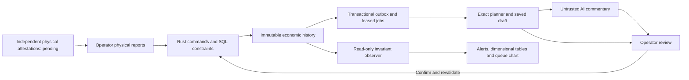

# Organism audit and exercise boundaries

Date: 3 November 2026. The analogy suggests questions, not proof that a society or a body is infallible. Bodies suffer infection, cancer, trauma and coordination failures. Health cannot be inferred from morality. Qazna protects autonomy and needs; it does not classify people as disposable, diseased or obedient cells.

## Architecture review

| Analogy | Engineering responsibility | Implemented and exercised | Missing / next acceptance evidence |
| --- | --- | --- | --- |
| Cells | Individually attributable needs and events | Exact quantities, immutable IDs, atomic commands, retries | Resident identity, consent, changing needs and correction events |
| Skeleton | Stable constraints and dimensions | Rust types, SQL constraints, units kept separate, append-only history | Independent database roles, migration/restore rehearsal at scale |
| Spinal cord and reflexes | Fast local protection independent of AI | Authorization, locks, exact arithmetic, insufficient stock/funds rejection | Per-principal rate limits, resource budgets, overload admission policy |
| Brain | Planning and explanation | Deterministic planner v2, optional untrusted model reviews, operator application | Fairness and urgency policy, global optimization, external scientific validation |
| Nervous system | Reliable observations and coordination | Transactional outbox, leases, recovery, consistent operational snapshots | Multi-site continuity, queue coalescing/budgets, external alert delivery |
| Circulation | Provision moving to residents | Stock/funds holds, cancellation, receipt, provenance | Transport time, routes, custody and delivery attestation |
| Digestion and metabolism | Transform inputs to usable output | Recipe/capacity limits, consumed inputs, losses, output shortfall | Energy/waste accounting for each real process, shelf life, material substitutions |
| Immune response | Detect and contain abuse | Reject invalid credentials, privilege escalation, duplicate commands and fabricated structured AI evidence | Independent identities, collusion and coercion analysis, key rotation and incident procedures |
| Senses | Establish facts about physical reality | Declarations are explicitly distinguished from verified facts | Independent attestations, measurements, reconciliation and dispute process; the exercise demonstrates this gap |
| Liver and kidneys | Reconcile errors, losses and obsolete information | Loss records and immutable history; no silent deletion | Reversals, retention/privacy rules, waste and expiry handling |
| Repair and sleep | Recover safely and maintain capacity | Worker restart, retry bounds, output loss handling, transaction rollback | Backup restoration, regional outage, maintenance and staff availability models |
| Growth | Sustain and expand capabilities | Capacity declarations and experimental norms with provenance | Verified growth, depreciation and approved monetary circulation/issuance rules |
| Pain and feedback | Make failure visible without denying people needs | Dimensional shortage reports, queue age, invariant alerts | Prioritization/appeals and service-level objectives chosen by human governance |

The largest current gap is not model eloquence: a trusted operator can declare a nonexistent resource. Consistent accounting cannot establish physical existence. Do not automate punitive action, confiscation, issuance or allocation priority from anomaly scores. Independent attestation requires a separate design with accountable identities and separation of duties; adding an AI judge does not provide that evidence.

## Changes resulting from this review

1. Planner v2 subtracts active, explicitly need-linked production commitments from the remaining planning gap after available stock selection. It reports `committed_production` and `forecast_excess`. These quantities never become received stock or reduce recorded unmet need. Cancellation/completion removes the active forecast. Standalone production is not silently assigned to a resident.
2. Operator, observer and reviewer credentials are distinct. The observer can read only aggregate status. The reviewer can read saved calculations and append validated commentary, never execute economic actions. These are machine capabilities, not resident ownership authorization.
3. A repeatable-read status snapshot checks accounting, physical holds, capacity and needs together, reports queue health and explicitly labels physical evidence limitations.
4. A small Python actor harness drives the actual Rust HTTP API and worker against an owned disposable PostgreSQL database. It emits timestamped request/results, snapshots and an offline/live HTML report. It does not create six expensive model sessions or introduce a new backend stack.

## Self-monitoring authority

The database enforces invariants synchronously. An observer reports drift and liveness; a coordinator calculates proposals; an optional language model explains saved findings; an operator confirms application. None of the observers or model reviews can rewrite history or approve their own plan.

The dashboard updates on a one-second target cadence. HTTP calls, scheduling, statement deadlines and a slow database can delay observations: this is operational monitoring, not a hard real-time control guarantee. Failed telemetry must be shown as unavailable, never as zero risk. The harness fails and preserves a failure report on an unexpected API or invariant error. The status endpoint is an observation, not a second authoritative ledger or an automatic repair command.

A database owner can disable constraints. A test deliberately injects such corruption into a disposable schema and verifies that the independent status query detects it. This demonstrates detection, not protection against a malicious database administrator. Backups and independent audit storage are still necessary.

## Readiness decisions

Passing exercises means the specified assertions held for the tested implementation and synthetic inputs. It does not establish economic viability, prove the absence of vulnerabilities, validate age-specific needs or reproduce an entire society. A known-gap case stays visible even when the test process exits successfully because it accurately reproduced that limitation.

Before handling real people or assets: establish independent evidence and correction policies; implement identities/ownership and runtime DB roles; rehearse backup restoration; define logistics, expiry and maintenance; test bounded queues and overload; obtain external security and economic review. These requirements remain tracked, rather than being filled with invented policies.

## Attestation milestone (4 November 2026)

Version 0.10 adds an explicit strict mode: two distinct inspector accounts attest each lot, and custodian plus actual recipient attest delivery before operator settlement. The [evidence protocol](evidence.md) documents activation, credential scope, disputes and remaining gaps. The lone-operator declaration gap is constrained in strict mode; collusion, identity authenticity and physical truth remain unresolved. Historical v0.9 exercise results above remain evidence of that version.
