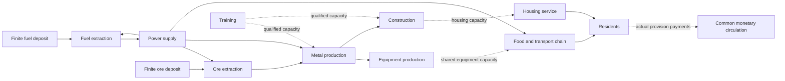

# Physical capabilities and monetary circulation

Added 7 November 2026. `examples/coupled_study.rs` now generates one coupled
five-year calculation instead of assuming that a successful money circuit proves
that goods, equipment or trained capacity exist. It is a bounded synthetic research
model, not a calibrated national plan or an autonomous production controller.

## What is connected

The example has 16 resource/capability dimensions, 12 processes and 1,825 daily
periods. A synthetic cohort of 1,000 residents is scaled by 100,000 to the stated
100-million population scale. This is aggregate arithmetic, not individual agents
or an estimate of actual Kazakhstan needs. Annual requirements grow by five
percentage points of the initial quantity, reaching 120% in year five. This
schedule is declared in advance; outages are not anticipated by the heuristic.

| Process | Main inputs | Output | Completion delay, periods |
| --- | --- | --- | ---: |
| Fuel extraction | Finite deposit, energy | Fuel | 1 |
| Power supply | Fuel, water | Energy available next period | 1 |
| Ore extraction | Finite deposit, energy | Ore | 1 |
| Metal production | Ore, energy | Metal | 2 |
| Equipment production | Metal, energy | Equipment units | 20 |
| Farming | Water, energy | Grain at farm | 5 |
| Grain transport | Grain at farm, energy | Grain at processing location | 1 |
| Cooking | Grain at processing location, energy | Meals at kitchen | 1 |
| Last-mile delivery | Meals at kitchen, energy | Delivered meals | 1 |
| Construction | Metal, energy | Housing-capacity places | 60 |
| Training | Eligible training places, energy, instructor capacity | Qualified work capacity | 180; stress case 720 |
| Housing service | Water, energy, available housing capacity | Housing-place days | 1 |

Delays and coefficients are experimental assumptions, not observed curricula,
engineering specifications or nutrition standards. The power process represents
committed next-period supply; it does not posit an unmodelled electrical battery.
Water is an external boundary supply. Deposits, initial material stocks, equipment,
housing and qualified capacity are explicitly declared. Buildings are represented
as housing-capacity places, not one whole building per resident. Training places
represent eligible voluntary capacity; people are neither owned nor traded.



## Equations and capability timing

The existing time-expanded stock equations retain each resource's unit. Explicit
withdrawals `w[k,t]` remove declared retired equipment or qualified availability:

```text
s[k,t] + d[k,t] + discarded[k,t] + sum_j A[k,j] * x[j,t]
 = s[k,t-1] - w[k,t] + external[k,t]
   + sum_j B[k,j] * x[j,t-lead[j]]
w[k,t] <= s[k,t-1]
```

An additional shared-use row prevents two processes from each assuming exclusive
use of the same equipment, skilled hours or housing capacity:

```text
sum_j U[l,j] * x[j,t] <= rate[l] * (s[resource[l],t-1] - w[resource[l],t])
```

For period zero, declared initial stocks replace the previous closing balance.
New equipment or qualifications completed in a period can supply capacity only
from the following period. This is an explicit conservative timing convention.
Skill capacity is retained during work; it is not consumed as a material input.
A withdrawal of work capacity never cancels a resident's basic needs.

The example includes an equipment retirement shock and a withdrawal of qualified
availability in period 400. Baseline replacement and training can prepare for these
declared events. Specific retirement quantities are scenario assumptions.

There are **109,500 variables and 114,977 rows** per scenario, including three
shared-capacity constraints per period and the withdrawal guards. The ordinary
case has 309,959 nonzero terms; the longer training delay changes this count.
Every physical row is checked with exact arithmetic. A separate replay checks
stock conservation and shared-capacity use directly from activities and timing.

## Link each goods payment to its physical basis

`CashLink` binds a payment to one of three sources:

1. An actual input consumed by a named process in a named period.
2. An actual final quantity delivered to residents.
3. An equipment/housing completion designated as public capital procurement.

For fixed normative measure `v[k]`, the linked amount must be exactly `q * v[k]`.
The checker requires every priced obligation once, and rejects missing, duplicate,
unsupported, wrong-quantity and wrong-amount links. Public capital cannot also be
billed as household provision in the same model. A completion cannot be paid as
completed capital before its lead time has elapsed. Natural deposits, water and
people have no commodity price in this example.

A resident's observed goods payment is funded through the common treasury and
settled to the corresponding provisioning unit. Input consumers pay the declared
source unit for actual input release. Completed equipment and housing enter common
capacity and are procured by the treasury; training inputs are publicly funded.
Missing goods remain missing in the needs report: the absence of a goods payment
is not a decision cancelling the person's entitlement.

Every priced single-output recipe has an exact common-entitlement coefficient:

```text
entitlement_per_output_unit = output_unit_measure
                           - input_measure_per_batch / output_quantity_per_batch
```

The example checks exact divisibility and nonnegative coefficients. On actual
receipt, the supplying unit circulates that declared share through the treasury;
the input-cost portion remains available for its own input obligations. This is
the previously stated common-ownership candidate, not a levy inferred for private
enterprises. The model does not add separate wages or dividends on top of the same
accounted amount. Additional contribution rewards remain an open policy design.

The baseline has **25,175 checked goods/payment links** and **54,000 monetary
movements**, including funding and entitlement movements. Transfer volume must not
be called GDP or added physical value. Exact prefix bounds calculate the opening
working measure at every account; residents require no opening balance and close
at zero. Productive units and the treasury may need working reserves before output
can be completed and paid. These reserves are explicit initial endowments in the
simulation, not loans or later issuance. The normative unit never changes.

## Results and negative cases

All values below are synthetic scaled quantities. First missed periods are
zero-based. A missed need in a heuristic trace is not generally proof that no
better plan exists.

| Scenario | First missed period | Unmet meals | Unmet housing-place days |
| --- | ---: | ---: | ---: |
| Baseline | None | 0 | 0 |
| Transport stopped for 30 periods | 369 | 2,755,000,000 | 0 |
| Power supply stopped for 15 periods | 602 | 1,180,000,000 | 1,575,000,000 |
| Equipment replacement disabled | 415 | 102,898,422,170 | 0 |
| Training completion delayed to 720 periods | 425 | 18,796,018,810 | 0 |

Baseline food delivery reaches the exact demand upper bound, so its food objective
has a valid primal/dual optimality certificate. Housing needs also receive full
coverage. Neither statement proves minimum waste, minimum expenditure or fair
individual allocation. The deterministic heuristic prioritizes core energy,
housing and the food chain, then expansion and training; other priorities can
change the distribution of shortages.

For the transport outage an additional Farkas certificate proves a lower bound:
maximum allowed opening delivered-meal stock plus maximum already-started incoming
output cannot cover the declared 30-period requirement. At least **2,050,000,000**
meals remain unprovided under those constraints. The heuristic's actual shortage
is larger. More money cannot remove that particular physical infeasibility.

Every reported monetary trace is prefunded by its exact opening bound and passes
its own accounting replay. This does not erase the physical shortages, prove that
all scenarios need the same money stock, or establish indefinitely stationary
circulation. Work in progress, inventory growth, retirement and waste affect the
working balances. The report retains discarded quantities; baseline full coverage
is not proof of efficient production. The next optimization must address these
losses and terminal inventories explicitly.

## Verification and remaining scope

The mathematical tests cover shared-capacity overbooking, premature use of a
qualification, retirement before production, insufficient withdrawal stock,
invalid/overflowing constraints, omitted or forged payments, double billing and
premature capital procurement. Each scenario also rejects a deliberately increased
payment. All reports are regenerated byte-for-byte by the full check.

```sh
cargo test --locked --test mathematics
cargo run --locked --example coupled_study
PG_BIN=/opt/homebrew/opt/postgresql@16/bin python3 scripts/check.py
```

This phase adds research verifiers and a coupled example. It does not replace the
live planner, introduce a national optimization service or grant an AI execution
authority. Main remaining work: calibrated sector coefficients and unit registry;
cohort demography and specific qualification pipelines; equipment maintenance and
lifetimes; inventory age/expiry; regional logistics and grid limits; individual
choice and priorities; objective-aware rolling optimization and sensitivity ranges;
accountable ownership, entitlement and transition rules. Water extraction and many
other upstream industries remain explicit external boundaries, rather than being
silently claimed complete.
