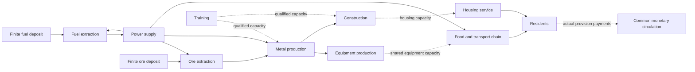

# Physical capabilities and monetary circulation

Added 7 November 2026. `examples/coupled_study.rs` now generates one coupled
five-year calculation instead of assuming that a successful money circuit proves
that goods, equipment or trained capacity exist. It is a bounded synthetic research
model, not a calibrated national plan or an autonomous production controller.

## What is connected

The schema-10 report has a coupled model with 22 resource/capability dimensions, 21 processes and 1,825 daily
periods. A synthetic cohort of 1,000 residents is scaled by 100,000 to the stated
100-million population scale. This is aggregate arithmetic, not individual agents
or an estimate of actual Kazakhstan needs. Annual requirements grow by five
percentage points of the initial quantity, reaching 120% in year five. This
schedule is declared in advance; outages are not anticipated by the heuristic.

| Process | Main inputs | Output | Completion delay, periods |
| --- | --- | --- | ---: |
| Fuel extraction | Finite deposit, energy | Fuel | 1 |
| Power supply | Fuel, water | Energy available next period | 1 |
| Ore extraction | Finite deposit, energy | Ore | 1 |
| Metal production | Ore, energy | Metal | 2 |
| Equipment production | Metal, energy | Equipment units | 20 |
| Farming | Water, energy | Grain at farm | 5 |
| Grain transport | Grain at farm, energy | Grain at processing location | 1 |
| Food processing | Legacy comparator: cooking; target: grain, energy and packaging metal | Legacy meals or preserved sealed product | 1 |
| Product delivery | Processed product, energy | Product at collection | 1 |
| Construction | Metal, energy | Housing-capacity places | 60 |
| Training | Eligible training places, energy, instructor capacity | Qualified work capacity | 180; stress case 720 |
| Housing service | Water, energy, available housing capacity | Housing-place days | 1 |
| Reserve grain transport | Grain at farm, energy, more shared capability | Grain at processing location | 2 |
| Reserve last-mile delivery | Meals at kitchen, energy, more shared capability | Delivered meals | 2 |
| Reserve generator construction | Metal, energy, shared equipment/work capacity | Reserve generator | 30 |
| Fuel storage construction | Metal, energy, shared equipment/work capacity | Storage unit | 30 |
| Reserve power | Fuel, water, completed generator capacity | Energy | 1 |
| Generator service | Metal, energy, shared qualified/equipment capacity | Internally consumed completed service | 2 |
| Dry-grain storage construction | Metal, energy, shared work/equipment | Grain storage unit | 30 |
| Packaged-food storage construction | Metal, energy, shared work/equipment | Sealed-food storage unit | 30 |

Delays and coefficients are experimental assumptions, not observed curricula,
engineering specifications or nutrition standards. The power process represents
committed next-period supply; it does not posit an unmodelled electrical battery.
Water is an external boundary supply. Deposits, initial material stocks, equipment,
housing and qualified capacity are explicitly declared. Buildings are represented
as housing-capacity places, not one whole building per resident. Training places
represent eligible voluntary capacity; people are neither owned nor traded.



## Equations and capability timing

The existing time-expanded stock equations retain each resource's unit. Explicit
withdrawals `w[k,t]` remove declared retired equipment or qualified availability:

```text
s[k,t] + d[k,t] + discarded[k,t] + sum_j A[k,j] * x[j,t]
 = s[k,t-1] - w[k,t] + external[k,t]
   + sum_j B[k,j] * x[j,t-lead[j]]
w[k,t] <= s[k,t-1]
```

An additional shared-use row prevents two processes from each assuming exclusive
use of the same equipment, skilled hours or housing capacity:

```text
sum_j U[l,j] * x[j,t] <= rate[l] * (s[resource[l],t-1] - w[resource[l],t])
```

For period zero, declared initial stocks replace the previous closing balance.
New equipment or qualifications completed in a period can supply capacity only
from the following period. This is an explicit conservative timing convention.
Skill capacity is retained during work; it is not consumed as a material input.
A withdrawal of work capacity never cancels a resident's basic needs.

The example includes an equipment retirement shock and a withdrawal of qualified
availability in period 400. Baseline replacement and training can prepare for these
declared events. Specific retirement quantities are scenario assumptions.

The coupled ordinary case has **151,475 variables and 160,602 rows**, including
four shared-capacity constraints per period, constructed fuel-storage constraints
and withdrawal guards. It has 459,476 nonzero terms. Daily storage-loss withdrawals
add 1,824 prior-stock guards; longer training delays also change the matrix. The
former 16-resource/14-process configuration had 113,150 variables and 118,627 rows;
its numerical service and circulation results are retained with inactive extension
columns in the current report.
Every physical row is checked with exact arithmetic. A separate replay checks
stock conservation and shared-capacity use directly from activities and timing.

## Link each goods payment to its physical basis

`CashLink` binds a payment to one of three sources:

1. An actual input consumed by a named process in a named period.
2. An actual final quantity delivered to residents.
3. An equipment/housing completion designated as public capital procurement.

For fixed normative measure `v[k]`, the linked amount must be exactly `q * v[k]`.
The checker requires every priced obligation once, and rejects missing, duplicate,
unsupported, wrong-quantity and wrong-amount links. Public capital cannot also be
billed as household provision in the same model. A completion cannot be paid as
completed capital before its lead time has elapsed. Natural deposits, water and
people have no commodity price in this example.

A resident's observed goods payment is funded through the common treasury and
settled to the corresponding provisioning unit. Input consumers pay the declared
source unit for actual input release. Completed equipment and housing enter common
capacity and are procured by the treasury; training inputs are publicly funded.
Missing goods remain missing in the needs report: the absence of a goods payment
is not a decision cancelling the person's entitlement.

Every priced single-output recipe has an exact common-entitlement coefficient:

```text
entitlement_per_output_unit = output_unit_measure
                           - input_measure_per_batch / output_quantity_per_batch
```

The example checks exact divisibility and nonnegative coefficients. On actual
receipt, the supplying unit circulates that declared share through the treasury;
the input-cost portion remains available for its own input obligations. This is
the previously stated common-ownership candidate, not a levy inferred for private
enterprises. The model does not add separate wages or dividends on top of the same
accounted amount. Additional contribution rewards remain an open policy design.

The baseline has **25,175 checked goods/payment links** and **54,000 monetary
movements**, including funding and entitlement movements. Transfer volume must not
be called GDP or added physical value. Exact prefix bounds calculate the opening
working measure at every account; residents require no opening balance and close
at zero. Productive units and the treasury may need working reserves before output
can be completed and paid. These reserves are explicit initial endowments in the
simulation, not loans or later issuance. The normative unit never changes.

## Results and negative cases

All values below are synthetic scaled quantities. First missed periods are
zero-based. A missed need in a heuristic trace is not generally proof that no
better plan exists.

| Scenario | First missed period | Unmet meals | Unmet housing-place days |
| --- | ---: | ---: | ---: |
| Baseline | None | 0 | 0 |
| Transport stopped for 30 periods | 369 | 2,755,000,000 | 0 |
| Power supply stopped for 15 periods | 602 | 1,180,000,000 | 1,575,000,000 |
| Equipment replacement disabled | 415 | 102,898,422,170 | 0 |
| Training completion delayed to 720 periods | 425 | 18,796,018,810 | 0 |

Baseline food delivery reaches the exact demand upper bound, so its food objective
has a valid primal/dual optimality certificate. Housing needs also receive full
coverage. Neither statement proves minimum waste, minimum expenditure or fair
individual allocation. The deterministic heuristic prioritizes core energy,
housing and the food chain, then expansion and training; other priorities can
change the distribution of shortages.

For the transport outage under the **fixed-route policy**, an additional Farkas
certificate proves a lower bound. Its explicit added rows forbid reserve meal
dispatch; this certificate does not apply when reserve routes are permitted:
maximum allowed opening delivered-meal stock plus maximum already-started incoming
output cannot cover the declared 30-period requirement. At least **2,050,000,000**
meals remain unprovided under those constraints. The heuristic's actual shortage
is larger. More money cannot remove that particular physical infeasibility.

Every reported monetary trace is prefunded by its exact opening bound and passes
its own accounting replay. This does not erase the physical shortages, prove that
all scenarios need the same money stock, or establish indefinitely stationary
circulation. Work in progress, inventory growth, retirement and waste affect the
working balances. The report retains discarded quantities; baseline full coverage
is not proof of efficient production. The next optimization must address these
losses and terminal inventories explicitly.

## Verification and remaining scope

The mathematical tests cover shared-capacity overbooking, premature use of a
qualification, retirement before production, insufficient withdrawal stock,
invalid/overflowing constraints, omitted or forged payments, double billing and
premature capital procurement. Each scenario also rejects a deliberately increased
payment. All reports are regenerated byte-for-byte by the full check.

```sh
cargo test --locked --test mathematics
cargo run --locked --example coupled_study
PG_BIN=/opt/homebrew/opt/postgresql@16/bin python3 scripts/check.py
```

This phase adds research verifiers and a coupled example. It does not replace the
live planner, introduce a national optimization service or grant an AI execution
authority. Main remaining work: calibrated sector coefficients and unit registry;
cohort demography and specific qualification pipelines; equipment maintenance and
lifetimes; inventory age/expiry; regional logistics and grid limits; individual
choice and priorities; objective-aware rolling optimization and sensitivity ranges;
accountable ownership, entitlement and transition rules. Water extraction and many
other upstream industries remain explicit external boundaries, rather than being
silently claimed complete.

## Reducing excess production while preserving provision

The next 7 November stage adds `optimization::trim_plan`, an exact integer
coordinate-improvement procedure. It takes a feasible seed plan and a declared
process order. It never changes deliveries, supply, normative values, process
recipes or capacity declarations. It only reduces the number of process starts,
recomputes affected inventories and overflow disposal, and preserves explicit
terminal reserve floors. In the coupled study those floors equal the seed plan's
closing stocks for **every** resource. Saved raw deposits can remain in the ground.

For a reduction `q` in process `j` started in period `t`, affected stock coordinates
are replayed as follows (all terms use the same resource unit):

```text
available'[k,u] = closing[k,u] + discarded[k,u] + delta[k,u-1]
               + A[k,j] * q * indicator(u=t)
               - B[k,j] * q * indicator(u=t+lead[j])
closing'[k,u]   = min(storage_cap[k], available'[k,u])
discarded'[k,u] = available'[k,u] - closing'[k,u]
delta[k,u]     = closing'[k,u] - closing[k,u]
```

Negative availability rejects a candidate. Closing stock must also cover the next
period's withdrawal and shared capability requirement, plus the terminal floor at
the end. Required capability stocks are computed using exact integer ceilings.
This prevents a seemingly economical reduction in training/equipment from
silently removing the capacity needed for a later promised service.

One-coordinate closing stock is a minimum of affine functions of `q`, hence
concave. Lower bounds on stock and capacity give a feasible interval containing
zero. Integer bisection finds the largest allowed reduction for that coordinate.
After each pass the original time-expanded matrix independently verifies the whole
plan, with no numerical tolerance. An independent full-stock replay and the
complete goods/payment checker then verify the published scenarios.

The procedure visits periods in reverse order and uses an explicit process order;
the study allows at most eight passes. `coordinate_irreducible` is set only after a
full pass makes no change. A pass-budget stop is reported without that label.
Neither label is a global optimum. A test supplies an unnecessary two-process round
trip that is irreducible one coordinate at a time while both operations can be
removed jointly. This is a documented counterexample to overclaiming the method.

All payment links and cash events are rebuilt from the changed physical plan.
Prefix-bound working measure is calculated again; a reduction in resource use does
not guarantee a reduction in the required opening measure at every account.
Neither transfer volume nor that opening measure is a national budget estimate.

The comparisons are **retrospective**: the trimming stage sees the seed's entire
five-year trajectory, including its realized outages. It is an improvement bound
for a supplied trace, not an online controller that can foresee future outages.
It preserves any seed shortage rather than solving it through changed priorities.
Intermediate safety stocks, spoilage, new choices and full rolling-horizon
optimization require further explicit constraints. The causal reserve-route
experiment below adds two alternatives without claiming that broader optimizer.

### Measured comparison inside the synthetic model

The retained original scenarios and their trimmed counterparts are in the same
`research/coupled-results.json` report (schema version 4). The unchanged seed
results were compared field-by-field after refactoring payment generation. All
five trimmed scenarios finish with a no-change second pass. This certifies only
irreducibility under the declared one-coordinate moves and reserve constraints.

| Scenario | Power starts before | Power starts after | Energy discarded before | Energy discarded after | Unmet needs changed? |
| --- | ---: | ---: | ---: | ---: | --- |
| Baseline | 40,128,000,000 | 22,439,163,342 | 175,292,200,000 | 172,717,085 | No |
| Transport outage | 40,128,000,000 | 22,160,880,519 | 178,047,200,000 | 172,717,138 | No |
| Power outage | 39,798,000,000 | 22,304,062,326 | 173,362,700,000 | 172,717,027 | No |
| Replacement disabled | 40,128,000,000 | 11,884,777,250 | 279,780,622,167 | 172,716,942 | No |
| Training delay | 40,128,000,000 | 20,540,575,535 | 194,088,218,810 | 172,716,606 | No |

A power start produces ten abstract energy units. Baseline power output falls by
**44.0810%** and its discarded energy by **99.9015%**, relative to the deliberately
simple fixed-output seed. Fuel extraction falls from 4,012,800,000 to 2,243,916,335
batches (ten fuel units each). All other activity counts remain unchanged in this
experiment. This is not a forecast of real-world savings or evidence of an optimal
construction/training schedule.

Baseline exact opening working measure falls from **2,005,344,000,000** to
**256,691,834,280** normative units (87.1996%). These are finite-schedule prefunding
bounds for each separately calculated trace, not public expenditure, real currency,
a reduction of personal entitlements or proof of indefinitely repeatable balances.
In stressed cases the treasury's own opening requirement can increase even while
the sum across accounts decreases. Every account's bound remains in the report.

Saved baseline fuel deposits increase the terminal in-ground stock from
59,872,000,000 to 77,560,836,650 units. No terminal resource falls below its seed
quantity. Unused external water increases because fewer power batches require it:
1,563,757,000,000 to 1,581,445,836,658 units. This boundary-supply surplus is not an
improvement in water abstraction: abstraction is not controlled by this model.
It illustrates why a single unqualified “total waste” percentage would mislead.

### Units and calibration gate

The report labels every case `synthetic_uncalibrated`. Its population scale is an
aggregate multiplier, not a demographic observation. Energy/fuel/material recipe
units are abstract and must not be relabelled as measured kWh or tonnes. The water
boundary supplies more than recipes consume; unused external water is reported
separately from avoidable energy output. Adding those quantities would be invalid.

Before presenting a calibrated five-year national plan, each input needs a source,
region, observation year, physical unit, uncertainty range and conversion rule:

| Input family | Required evidence before calibration | Current boundary |
| --- | --- | --- |
| Needs and population | Cohort counts, births/deaths, service norms, observed choice | Synthetic annual +5 percentage-point requirement schedule |
| Energy | Input/output balances by carrier, losses, grid capacity, dispatch and storage | Single abstract energy resource, no inter-period storage |
| Materials and equipment | Input-output recipes, extraction limits, maintenance, lifetimes | Aggregate recipes and one declared retirement shock |
| Transport | Distances, load factors, fleet schedules, fuel and route capacity | Two aggregate food transport legs, each with a slower reserve route |
| Construction | Bill of materials, commissioning phases, occupancy and maintenance | One abstract housing-capacity recipe |
| Qualifications | Voluntary eligible cohorts, instructor specialisms, curriculum and attrition | One aggregate qualification pipeline |
| Monetary norms | Approved fixed-unit registry and ownership/entitlement basis | Fixed experimental integers; no adoption decision |

No empirical coefficients have been substituted without this evidence. The
implemented result is an exact comparison within declared assumptions, ready for
calibration and challenge rather than evidence that those assumptions are true.


## Causal recovery through reserve routes

The next experiment adds a daily feedback policy and `replanning::ProductionPipeline`.
It observes today's capacities, completed arrivals, available inventory and already
committed outputs. It does not read tomorrow's outage or its recovery date. The
published annual needs schedule is known; that assumption is distinct from knowing
future failures. This is a causal inventory-target policy, not a solved rolling
multi-objective optimization problem.

Each primary food transport leg takes one period. Each declared reserve leg takes
two, uses four units each of shared equipment and qualified capacity per batch,
and has capacity 500 × the scaling factor per day. Primary legs use two equipment
units and two qualified-capacity units. Reserve recipes use the same two abstract
energy units per ten transported units as the primary recipes. These are explicit
experimental coefficients, not measured emergency-route performance. Both policy
comparisons have the same declared reserve infrastructure; the fixed-route policy
leaves it idle. No asset appears for free when an interruption occurs.

For a resource k, define committed output that has not arrived yet as P[k,t].
A primary route is attempted first; the reserve route sees the remaining target:

```text
P[k,t] = sum of recorded outputs due strictly after today's arrivals
requested_batches[j,t] = ceil(max(0, target[k] - available[k,t] - P[k,t]) / B[k,j])
starts[j,t] = min(requested_batches, observed route capacity,
                  input-limited batches, shared-capability-limited batches)
```

A newly accepted start immediately joins P. It cannot be delivered until its due
period. This prevents recovery of the primary route from triggering duplicate
orders for goods already travelling on a slower route. The pipeline releases each
commitment once; identical command retries are no-ops and changed retries fail,
even after the original completion. Overflow and malformed commands leave the
pipeline unchanged. A route closure blocks new dispatch; destruction of cargo in
transit is not modelled in this experiment and would need a separate loss event.

### Observed comparison

All periods are zero-based; quantities are synthetic aggregate meal units over the
whole 1,825-period trace. Previous missed meals are never erased by later delivery.

| Interruption | Fixed-route unmet meals | Reserve-policy unmet meals | First missed period, fixed / reserve |
| --- | ---: | ---: | --- |
| None | 0 | 0 | None / none |
| Primary routes closed in periods 365–394 | 2,755,000,000 | 0 | 369 / none |
| Primary routes closed in periods 365–454 | 9,055,000,000 | 2,513,917,060 | 369 / 421 |

The 30-period case starts the reserve legs in period 365, not before the failure.
Each reserve leg performs 315,000,000 batches over the trace. Initial stocks and
working capacity bridge the longer delivery delay. This proves feasibility for
these declared assumptions; it does not prove that any real disruption can be
absorbed. The 90-period case overlaps the period-400 equipment/qualification
withdrawal. Reserve routing reduces missed meals by **72.2372%** and delays the
first miss by 52 periods, but shared capability limits remain binding. Its residual
shortage is a result of this policy, not a proof that every other policy must fail.

The complete normal and 30-period-outage plans match exactly through period 364.
The complete 30- and 90-period-outage plans match through period 394, while their
future restoration dates differ. These prefix assertions cover activities,
deliveries, stocks and disposal, and run on every regeneration. They test the
specified scenarios against premature reactions, not every possible future.

Every recovery trace passes the same independent physical matrix, per-period stock
and capacity replay, exact goods/payment links and monetary conservation checks.
The monetary opening bound remains a **retrospective** calculation for each full
trace: causal physical decisions do not make that bound an online cash forecast.
No claim is made that one common starting balance supports all unknown futures.
The two routes share the corresponding provisioning unit's account and fixed
norms; additional accounting value is not invented for the reserve route.

Next work: jointly choose safety reserves, route capacity, service priorities and
capital/training schedules across multiple unknown disruption paths; add expiry,
in-transit losses and a fixed opening liquidity envelope. Report guaranteed service
bounds only for explicitly bounded uncertainty and independently verified plans.

## Common opening measure across bounded disruption scenarios

`mathematics::common_schedule_opening` now computes one opening balance vector for
a declared finite family of ordered schedules. It does not select a different
starting balance after learning which failure will occur. The current family uses
the same initial physical stocks, storage caps, recipes, shared capabilities,
withdrawals, normative units and account ownership, checked for equality in code.
The reserve-routing policy is the same in every member.

| Family member | Primary transport closure | Power closure |
| --- | --- | --- |
| normal | None | None |
| transport_30 | 365–394 | None |
| transport_90 | 365–454 | None |
| power_15 | None | 600–614 |
| compound_15 | 365–454 | 390–404 |
| compound_30 | 365–454 | 390–419 |

Periods are zero-based and endpoints inclusive. All members also have the same
previously declared equipment/qualified-capacity withdrawal in period 400. The
compound cases therefore combine transport, energy and capability stress. These
six paths are a bounded experimental set, not all combinations of failures, a
probability distribution or a worst-case claim over every possible future.

### Exact bound and proof scope

For account a, scenario ω and event prefix t, C[a,ω,t] is cumulative net inflow,
starting at zero. Let:

```text
E[a] = max(0, max_{ω,t} -C[a,ω,t])
E_total = sum_a E[a]
```

Sufficiency follows because every E[a] + C[a,ω,t] is nonnegative. Necessity follows
from an attaining prefix: a smaller opening for that account makes the balance
negative in its witness scenario, unless the schedule is changed. The result saves
that scenario, zero-based event index, period and exact cumulative net value for
each positive coordinate. An all-zero requirement has no negative witness.

This is componentwise minimal for the supplied fixed schedules, with their fixed
order and no extra rebalancing or later issuance. It is not a global minimum over
alternative plans. In general, E_total is **not** the largest scenario-specific
total: one schedule may require 7 units at account A, another 9 at account B. The
common vector is (7,9), total 16, although the larger individual total is only 9.
Keeping the total in the wrong accounts does not meet the obligation sequence.

The Rust routine validates the complete named family before calculation, rejects
ambiguous names, invalid schedules and unbounded input sizes, and uses checked
integer arithmetic. Decimal strings preserve mathematical values beyond runtime
account limits; a caller must separately validate its execution representation.
The coupled experiment's balances fit its replay representation. No ledger command,
monetary policy or issuance authority is added.

### Independent verification

Each scenario is replayed with the **same E**, preserving money exactly and checking
that every planned payment settles. All positive account requirements are then
reduced individually by one unit; the corresponding witness must fail at the saved
event. The mathematical tests also exhaustively enumerate initial vectors for 16
small three-scenario families using a separate transfer simulator, verify witness
prefixes and scenario-order invariance, and retain a counterexample for unavailable
payment edges. A cash reserve cannot make a disabled payment channel operate.

The existing physical matrix and goods/payment checks still apply. Identical
physical decision prefixes are checked for normal/power through period 599,
long-transport/compound through 389, and the two compound cases through 404,
in addition to the previous transport-prefix comparisons. Thus no advance reaction
to the tested future divergence is hidden in the reported physical policy.

A second cash-only replay uses the normal scenario's smaller opening balances on
each stress schedule. This is a diagnostic showing when payments would block; its
physical trace is not re-solved after underfunding. Do not present its original
physical deliveries as executed outcomes of a cash-blocked economy.

Physical reserve quantities are explicit and unchanged across the family; they
are not yet jointly optimized. The family envelope is designed offline and then
held fixed during all six replays. It protects these stated schedules, not unseen
failure paths or infinite repetition. Missing meals/housing remain missing even
when every payment for goods actually supplied succeeds. The next optimization
must jointly choose routes, reserves, production and capability renewal, and report
service deficits and resource costs separately from this monetary sufficiency bound.

### Measured common-funding result

The six-path common opening is **2,030,483,170,650 normative units**, compared with
**2,005,344,000,000** for the normal trace alone: an additional **25,139,170,650**
(**1.253609%**). This is a stock of opening working measure, not annual expenditure,
GDP, actual KZT or a forecast of required national issuance. It uses the untrimmed
causal reserve-route policy; the earlier retrospective production savings have not
been silently combined with it.

| Scenario | Unmet meal units | Unmet housing-place days | Payments blocked with common opening | First blocked period using normal-only opening |
| --- | ---: | ---: | ---: | --- |
| normal | 0 | 0 | 0 | None |
| transport_30 | 0 | 0 | 0 | None |
| transport_90 | 2,513,917,060 | 0 | 0 | 1795 |
| power_15 | 1,180,000,000 | 1,575,000,000 | 0 | None |
| compound_15 | 3,792,016,560 | 1,575,000,000 | 0 | 538 |
| compound_30 | 5,089,395,840 | 3,150,000,000 | 0 | None |

All 320,329 scheduled movements across the six separate replays settle with the
common opening; money is conserved and the resident account's closing balance is
zero. Ten positive opening coordinates have attaining witnesses, and every
one-unit reduction fails at its saved event. All 14 previously published physical
trace results and comparisons are unchanged; three additional physical traces
extend the same maintained report to schema 4.

The long-transport trace alone needs 2,030,483,170,600 units, the largest individual
total. It still misses **50 units at a different account** needed by compound_15
(account 4, period 538). The family therefore requires 50 more than that largest
total. This is exact integer arithmetic, not floating-point rounding. The report
retains the responsible prefixes instead of rounding away a small but real failure.

Normal-only funding produces 39 underfunded attempted payments in transport_90
and 13 in compound_15. The more severe compound_30 needs a smaller monetary stock
than compound_15 for its particular executed-goods schedule, because less physical
provision occurs. Lower required working measure must not be interpreted as better
welfare. Financial sufficiency and successful material provision remain distinct.


## Joint reserve, replacement and training policies

The schema-5 calculation exhaustively evaluates **eight precommitted feedback
policies across six disruption paths** (48 physical/cash traces, 1,825 periods
per trace). It expands the previous common-funding experiment; the earlier results
remain in the same report. No initial assets, deposits, recipes, transport routes,
process capacities, storage capacities or monetary norms are added for a candidate.
All candidates use the two existing slower reserve transport routes.

Three binary choices generate the eight policies:

| Choice | Reference | Alternative |
| --- | --- | --- |
| Food stock targets | Farm/city/kitchen/delivered: 12,000 / 5,000 / 5,000 / 5,000 | Existing storage ceilings: 15,000 / 6,000 / 6,000 / 6,000 |
| Equipment target | 400 | 580; additional machines must consume metal/energy and complete the existing 20-period process |
| Training priority | After food/material/capital starts | After energy, fuel and housing service, before food starts; same eligible places, instructors, inputs and 180-period lead |

Targets above are unscaled synthetic cohort quantities; multiply by 100,000 for
report quantities. They are inventory targets, not guaranteed available inventory.
Equipment production remains limited to one unscaled batch per period and uses
shared equipment/work capacity. The known period-400 equipment/skill withdrawal
still applies. Training is not manufactured labour: the 120 initial eligible
places and instructor constraints remain unchanged, with no invented trainees.
Construction retains its existing 1,300-place target, recipe and 60-period lead;
its resource competition and completed procurement are checked in every run, but
its design is not an additional search variable in this bounded experiment.

One policy is selected before the disruption path is known. Each day's decisions
use only current stocks, current capacities and committed completions. Five
same-observation prefix pairs per policy (40 checks) reject reliance on future
outage duration. The design is selected against a declared stress family; that is
not an out-of-sample forecast of unknown events.

All scenarios must end with at least the following common reserves: 300 equipment,
200 qualified-capacity units, 1,000 housing-capacity places, 6,000 farm grain,
4,000 city grain, 4,000 kitchen meals and 3,800 delivered meals, multiplied by the
same scale. Other resource floors are zero, with nonnegative balances checked at
every period. These are explicit terminal constraints, not indefinite resource
renewal. The delivered-meal floor reflects final-day consumption. All eight
candidates satisfy them, so improved service is not obtained by violating these
floors. Inventory ageing remains unmodelled.

### Objective and exact evidence

For policy p, scenario w and service k, let U[p,w,k] be unmet units and D[w,k]
total required units. The experimental criterion treats both services equally in
**fractional coverage**, without adding different physical units:

```text
min_p max_(w,k) U[p,w,k] / D[w,k]
```

Here all twelve denominators happen to equal **200,750,000,000**, allowing exact
integer comparison of the largest numerator. That simplification must not be
carried over to differently sized service demands. No monetary tie-break defines
social priorities. The report separately lists the nondominated alternatives in
worst meal shortage, worst housing-service shortage, maximum capital procurement
and common opening measure. Equal-score alternatives remain visible.

Every candidate is verified against the physical matrix and a separate stock/
capacity replay. All goods-payment links are rebuilt; every scenario is replayed
with its policy's common accountwise opening vector and no later issuance. The
initial physical basis is equal across policies; funding requirements are
recalculated and compared, not held artificially equal.

| Policy ID (early-training counterpart) | Changes | Worst unmet meals | Worst unmet housing-place days | Common opening measure | Maximum completed capital measure |
| --- | --- | ---: | ---: | ---: | ---: |
| 0 (4) | Reference | 5,089,395,840 | 3,150,000,000 | 2,030,483,170,650 | 580,000,000,000 |
| 1 (5) | Food buffers | 4,126,346,850 | 3,150,000,000 | 2,143,790,783,200 | 580,000,000,000 |
| 2 (6) | Equipment | 2,860,000,000 | 3,150,000,000 | 2,001,564,000,000 | 760,000,000,000 |
| 3 (7) | Equipment and food buffers | 2,760,000,000 | 3,150,000,000 | 2,121,164,000,000 | 760,000,000,000 |

The early-training counterparts have identical values in this table. Earlier
priority alone produces no measured advantage for these scenarios and objectives;
this is not a conclusion that education is unimportant. All eight are nondominated
on the four reported axes (equal metric vectors are retained). Extra equipment
improves worst food provision and working funds, but requires more completed
capital; extra food reserves further reduce food losses at higher opening measure.
Working funds and cumulative procurement are different quantities and must not be
added or advertised as national budget costs. Monetary units are synthetic norms,
not market prices or measured KZT.

For the 90-period transport-only interruption, equipment policies reduce missed
meals from **2,513,917,060 to zero** while retaining the same initial stock. For the
combined 90-period transport/30-period power event, the joint policy reduces missed
meals from **5,089,395,840 to 2,760,000,000**. Energy-dependent housing service still
loses **3,150,000,000 place-days**. A housing-service deficit here means an unmet
modelled service requiring energy; it is not a forecast of demolished buildings or
numbers of homeless people.

### Why the remaining gap cannot be removed by these schedules

The compound path disables power starts in periods 390–419. Power has a one-period
lead, energy storage is zero, housing-service starts require energy, the service
also has a one-period lead, and housing-service output cannot be stored. Therefore
housing service cannot be delivered in periods **392–421**, inclusive. These 30
periods require 105,000,000 units each, producing a lower bound of 3,150,000,000 on
the worst unmet numerator for **any feasible schedule under these assumptions**.

This is checked with an exact sparse dual certificate, not inferred from a failed
heuristic. Sum the housing balance rows for 392–421 with weight 1, the energy
balance rows for 391–420 with weight 10, the primary and disabled-backup
power-capacity rows for 390–419 with weight 100, and the initial-window storage rows `storage:391:15` and
`storage:390:3` with weights 1 and 10. The resulting row combination bounds total
housing delivery in the window by zero. Nonzero multipliers are published with
the report. Removing a required capacity multiplier or allowing one unit of energy
storage causes the verifier to reject the claimed exact zero optimum.

Policies **2, 3, 6 and 7** attain that lower bound:

```text
best worst unmet fraction = 3,150,000,000 / 200,750,000,000
                         = 63 / 4015 ≈ 1.5691158%
absolute numerator gap to the physical lower bound = 0
```

Thus this particular minimax coverage objective is optimal for the supplied
six-path physical model, not merely best among eight policies. It is **not** a
proof that every service is complete, that food shortage is minimized, that money/
capital is globally minimized, or that the model describes a real country.
A five-year aggregate fraction also conceals a severe consecutive interruption;
individual service/day outcomes and the outage window must remain visible.

The reserve experiment below tests energy continuity with constructed assets and
explicit loss constraints. Inventory expiry, in-transit losses and equipment
maintenance are tested later in a separate lifecycle submodel; their integration
into these coupled physical/cash traces remains open. Increasing cash alone cannot close the gap in the
reserve-free configuration. Unknown scenarios, demographic calibration and live
service integration remain open. No runtime authority or economic policy changes.


## Constructed reserve and recovery experiment

The author's moderate body-energy-reserve analogy is implemented as a bounded
shared physical stock, not personal money accumulation. Schema 6 adds **35
five-year traces**: four storage-aware designs (no new backup, 7, 30 and 60 periods)
and a retained defective 60-period design, each under seven scenarios. All begin
with the same deposits, materials, qualifications and other assets; **zero new
storage units and zero backup generators** exist initially. The historical cases
and joint-policy comparison remain in the same report with inactive extension
processes. Numerical legacy provision, activity totals and opening measure were
checked unchanged after padding the resource/account vectors.

A generator and a storage unit each require 10 metal, 10 energy and 30 periods;
construction is limited to one unscaled batch per process per period and consumes
shared equipment/work capacity. Twenty-two unscaled generators allow 220 backup
power starts per period; each start consumes one fuel and one water and produces
10 energy one period later. This deliberately uses the primary generator's
synthetic conversion recipe, so both have the same normative variable cost.
Standby infrastructure is accounted separately as completed public capital.
No real-world generator efficiency or building cost is inferred from these inputs.

Closing fuel stock is constrained by:

```text
fuel[t] <= 2,000 * scale + 1,000 * completed_storage_units[t]
fuel[t] <= 20,000 * scale
backup_starts[t] <= 10 * generators[t-1]
scale = 100,000
```

Storage can hold stock at the close of its completion period; generator capability
becomes usable the following period. `BuiltStorage` adds the storage inequality to
the exact physical matrix. Fuel must be extracted from the finite deposit, using
energy and productive capacity. Fuel storage has a declared daily **1,000 ppm
(0.1%)** loss rounded upward to the physical quantum. This is an experimental
parameter, not a measured property of a specified fuel. Losses are explicit
withdrawals before new arrivals; they cannot be spent or silently reconstructed.

### Sizing and causal replenishment

Let u be fuel used per period, F the retained restart stock and p the loss rate in
parts per million. For n periods without replenishment:

```text
L(s) = ceil(s * p / 1,000,000)
s_next = s - L(s) - u
B[0] = F
B[n+1] = ceil((B[n] + u) * 1,000,000 / (1,000,000 - p))
```

`required_reserve` returns the **minimum integer opening stock for this component
recurrence**. Its minimality is tested by independent exhaustive forward simulation,
including zero demand, zero periods, large integer inputs and overflow/invalid
rates. This is not a theorem that the entire economy remains supplied.

Here u = 22,000,000, F = 44,000,000 and p = 1,000. Exact minimum component stocks
are 198,927,093 (7 periods), 715,680,726 (30) and 1,407,827,562 (60). The operational
target rounds up to an unscaled cohort unit. The reserve keeps two nominal fuel-use
periods for restarting productive activity; that floor is protected from backup
dispatch, **not exempt from storage loss**. It does not promise indefinite survival.

The daily controller:

1. Uses backup generation when observed primary output capacity cannot supply the
   normal planned power starts; it never learns a future restoration date.
2. Prioritizes current food/housing production before reserve replenishment while
   sufficient restart stock exists. Below that floor, fuel recovery regains priority.
3. Limits new fuel commitments to **already completed** storage capacity and accounts
   for next-period loss before setting the refill quantity. Unbuilt space cannot
   justify extraction that will later overflow.
4. Replenishes from actual production after recovery, retaining all inputs, delays,
   stock losses, payments and finite-deposit depletion.

Twenty-five equal-observation prefix comparisons pass. Every scenario has an exact
physical matrix check, independent stock/capacity/loss replay and recalculated
physical-payment links. Each design uses one common accountwise opening vector
across its seven scenarios, without later issuance. All 1,862,357 scheduled payments
across the 35 traces settle. Cash settlement does not erase physical shortfalls.

### Coverage and cost comparisons

The prepared stress family includes ordinary operation; the previous combined
90-period transport/30-period power interruption; simultaneous fuel-extraction and
primary-power interruptions of 30 periods; and two such 30-period interruptions
separated by 20 recovery periods. Longer 60/90-period interruptions and an early
failure in periods 10–39 are reported separately as boundary tests.

| Storage-aware design | 30-period supply interruption | 60-period interruption | 90-period interruption | Two 30-period interruptions | Normal completed capital measure | Common opening measure across all seven paths |
| --- | --- | --- | --- | --- | ---: | ---: |
| No new reserve | Shortage | Shortage | Shortage | Shortage | 760,000,000,000 | 2,232,709,274,250 |
| 7 periods | Shortage | Shortage | Shortage | Shortage | 782,000,000,000 | 2,279,811,695,350 |
| 30 periods | Full provision | Shortage | Shortage | Full provision | 788,000,000,000 | 2,296,337,963,140 |
| 60 periods | Full provision | Full provision | Shortage | Full provision | 795,000,000,000 | 2,317,675,692,440 |

Full provision means both declared services on **every period** of that scenario,
not an average hiding days without service. All four storage-aware designs retain
the previous terminal food/equipment/qualification/housing floors and cause zero
fuel overflow. They do incur real storage losses and consume finite natural fuel.
The 30-period design uses six new storage units; the 60-period design uses thirteen,
with 22 standby generators in each (all multiplied by scale). These counts are
synthetic aggregate units, not engineering specifications for 100 million people.

Thirty periods is the **smallest adequate tested target** for the prepared family,
not a global minimum over all reserve sizes, alternative power sources or schedules.
The 30-period design reaches its fuel target after the first outage in period 422
(restoration begins 420), and after the second in period 472 (restoration begins
470). The 60-period design refills after its 60-period outage by period 453
(restoration begins 450). Target attainment does not imply zero ageing or perpetual
adequacy; it is an observed result of these declared inputs and priorities.

For a 90-period supply interruption, even the 60-period design misses 2,639,998,700
meal units and 3,045,000,000 housing-place days. All four designs miss services
when interruption begins before infrastructure construction is complete. These
failures are retained, not removed by changing the denominator or cancelling needs.

Normative capital flows and the opening circulation stock are different measures;
they must not be summed or described as estimated national budget expenditure.
No interest, tax, deposit income or speculative money trading is introduced.

### Retained counterexample: fill before storage exists

The fifth design keeps the same 60-period target but disables capacity-aware filling
and service-first refill priority. In normal operation it discards **63,396,705,601**
fuel units, exhausts the finite fuel deposit, misses 30,649,818,970 meal units and
29,400,000,000 housing-place days, and violates the terminal meal floor. It is marked
inadmissible; its mathematical conservation remains verified. The same target with
the corrected feedback rule supplies both services fully in normal operation,
discards no fuel and retains 56,096,964,530 units in the natural fuel deposit.

This isolates a planning failure rather than establishing that a 60-period reserve
is inherently harmful. Both the failed and corrected variants remain executable
regression cases. A sufficient reserve must be **constructed, filled, protected,
delivered and renewed**; a larger target alone proves none of these properties.

Remaining work includes optimizing emergency power use and reserve size jointly
with service needs (the current 220-start target is fixed), perishable food lots
and expiry, in-transit losses,
maintenance/correlated backup failures, changing needs, water-supply failures,
calibrated coefficients and live reviewed-plan integration. The current loss law
models fuel-storage depletion only; it does not implement every resource lifecycle
or confer autonomous control on the runtime service.

## Dated food, transport loss and standby maintenance

The next bounded stage (7 November 2026) is implemented in `src/lifecycle.rs` and
`examples/support/lifecycle_study.rs`, called by the existing coupled example.
Results are kept in `research/coupled-results.json` under `food_asset_lifecycle`
(schema 7). The previous 18-resource calculations remain intact. This is a
**separate lifecycle submodel**, not a claim that expiry and repair have already
been integrated into every physical matrix, monetary replay or live endpoint.

### Explicit state and timing

A food lot has an immutable identity and exclusive expiry period `e`. It is usable
only for `t < e`. Its age is preserved when split, dispatched, damaged or received;
transport cannot create a fresh expiry date. Each contiguous day begins by removing
expired stock at the source, destination and in transit. Observed arrivals then
precede consumption; new boundary supplies and dispatches follow consumption.
The example uses first-expiring-first-out (FEFO). A dispatch with a planned arrival
at or after expiry is rejected. An unexpected late arrival can still expire in
transit. Shipment identities cannot be reused and closed shipments cannot be
received twice. Invalid commands leave state unchanged.

For one physical commodity, every period checks:

```text
cumulative supply = consumption + expiry + transport loss
                  + source stock + destination stock + in-transit stock
```

Destroyed units are classified once. They cannot subsequently become receipts or
expiry. Inventory at the horizon is explicitly retained, not treated as delivered.
The tests also track individual units independently of the aggregated lot model,
including unequal expiry dates, split shipments and maximum integer quantities.

A standby asset produces no usable capacity while overdue, undergoing service,
or affected by a declared external failure. Service needs a spare at its start
and labour on **each** service day. Missing labour pauses work; it does not
magically complete maintenance. Completion restores capacity from the following
period. Calendar ageing and the service interval are synthetic engineering
assumptions. With unrestricted service resources, an independent closed-form
oracle checks available capacity over repeating `interval + duration` cycles.

### Five-year sensitivity experiment

Four designs × eight paths × 1,825 periods = **58,400 verified periods**. Twenty-eight
comparisons ensure the first 390 days of decisions are identical before future
scenario observations diverge. This prevents a hidden forecast of the outage from
entering the feedback policy.

Daily demand is 1,000 food units; explicit boundary supply is 1,200. The destination
and transit target is 4,000 units, transit takes two periods and dispatch capacity
is at most 2,000. Two pre-existing standby units each offer 1,200 capacity, require
service after 20 calendar days, and need two service days at two labour units per
day. Only two maintenance labour units are available daily. Each service consumes
one spare. Baseline opening spares are 200 and backup fuel 5,000; backup dispatch
uses `ceil(dispatched / 10)` fuel, without refill in this submodel.

These are synthetic units, not tonnes, engineering norms or a calibrated population.
Food production, preservation, fuel production and new asset construction are
boundary assumptions here. The earlier constructed-reserve experiment addresses
some of those mechanisms separately; joining the two models is still required.

| Path | Unmet food after the initial 10 periods, maintained fresh-food design | Without spares |
| --- | ---: | ---: |
| Normal | 0 | 0 |
| Primary power unavailable for 30 days | 0 | 28,800 |
| 10% loss on arrivals for 30 days | 0 | 0 |
| Power outage plus transport loss | 0 | 28,820 |
| Route unavailable for 15 days | 13,800 | 13,800 |
| Arrivals held for 10 days | 8,800 | 8,800 |
| Primary and both backup units fail together for 10 days | 8,800 | 28,800 |
| Two 30-day power interruptions, no fuel refill | 17,000 | 57,600 |

Every design also records 2,000 initially unmet units while the initially empty
pipeline fills. Initial unmet needs are included in totals, not erased by the
post-startup comparison. The delayed-arrival case expires 10,600 units in transit.
The repeated-power case exhausts the maintained design's 5,000 fuel units: surviving
the first outage does not establish readiness for the second.

The baseline has 362,000 expired units after five years: fixed supply exceeds
consumption, and expiry is now visible rather than hidden in an undated total.
Extending shelf life from 5 to 30 periods lowers recorded expiry to 332,000 but
leaves more stock at the horizon and does not improve the tested service shortages.
That is not evidence of equivalent long-run waste reduction or cost-free
preservation. This stage deliberately retains the fixed-supply counterexample;
production and replenishment must next respond to usable age-qualified stock,
not simply to total inventory. Aligned versus staggered initial asset ages do not
change the measured service outcome under the tested buffer and service policy;
no general scheduling advantage is claimed.

Receipt measure is calculated as `700 × actual consumed units`, using exact integer
arithmetic. This value is not a new ledger simulation, financing certificate or
payment for destroyed/expired goods. Existing economic norms are not changed.

### Remaining integration work

Connect dated inventories, transport events and maintenance inputs to the full
resource matrix and rebuild its associated monetary schedules. Test adaptive
production, cold-chain/preservation costs, spare manufacture and replenishment,
maintenance energy, quality/recall, dispatch/receipt attestations, and different
repair priorities. Service availability, finite shared inputs and physical
shortfalls must remain separate from sufficient accounting balances. The live
runtime remains unchanged and receives no automatic allocation or issuance power.

## Integrating lifecycle constraints with the complete graph

The schema-8 experiment adds `integrated_lifecycle_graph`. It uses the full
raw-material, energy, equipment, transport, construction and training model,
expanded to **19 resources and 18 processes**. At that stage the additional resource was completed
generator service and the additional process consumes metal and energy to perform
that service. Dated food is no longer an unrelated boundary-supply calculation.
Every changed start, input consumption and actual delivery generates a freshly
verified monetary schedule in the same graph.

### Age-qualified physical flow

For resource `k`, expiry cohort `e` and day `t`, usable stock obeys `e > t`.
Dispatch of a cohort through a route with delay `L` additionally requires
`e > t + L`. FEFO chooses the earliest eligible expiry first. Transport preserves
that expiry; it never resets shelf life. Farming creates grain with a synthetic
90-day life. Cooking consumes valid grain and creates a new cooked-food cohort
with five days of life after completion. The latter is an explicit processing
assumption, not food-safety certification.

Cohort expiry and observed transport damage are included in the same daily matrix
as discarded physical quantities:

```text
previous stock - explicit withdrawals + external supply + gross completions
    = usable closing stock + actual deliveries + production inputs
      + expiry + transport damage + other discard
```

Loss occurs before consumption. A damaged or expired unit cannot appear as a
resident receipt. Input payments for an operation that later loses output remain
recorded: loss is not financed by inventing goods or silently deleting earlier
payments. In the shock scenario, transport loses `ceil(q / 10)` per arriving
cohort. Conservation counts damage first and expiration of the remaining quantity
second, without double counting.

The aggregate LP alone cannot establish a lot's age: it is checked jointly with
an explicit cohort replay. Changing a candidate plan requires rerunning both
checks. `DatedStock` is tested against individual-unit selection, including exact
expiry boundaries, ineligible dispatch, overflow and failed-operation atomicity.

### Endogenous maintenance

Generator cohorts exist only after the model's generator-construction process
completes. They become usable the following period. After 20 calendar days a
cohort is overdue and contributes zero backup capacity until serviced. A service
start consumes one metal unit and one energy unit per generator unit, shares four
qualified-hours and one equipment-use unit with the other production processes,
and takes two periods to complete. Metal is supplied by the model's ore/metal
chain, not an inexhaustible spare-parts boundary.

Completed service is used internally, with zero commodity measure. It is not a
resident's basic need. Service input costs are paid from the common treasury and
included in the same complete goods/payment-link validation. The separate
constructed-generator stock remains in place while unavailable; maintenance does
not fabricate a second generator.

Labour is charged at service start in this graph. This is a front-loaded synthetic
work/turnaround model; the separate standby example's per-day service-work
reservations have not yet been integrated. Maintenance quality, specialised spare
manufacture and unplanned repair time also remain open.

### Bounded comparison

Seven five-year scenarios share one initial physical state and policy: normal,
30-day fuel/primary-power loss, repeated loss, transport damage, combined loss,
correlated primary/backup outage and disabled maintenance. Five pairs have
identical physical decisions before day 390; disabled maintenance is an explicit
policy intervention from the outset. A fixed-target normal case is retained as
an eighth run and counterexample. The candidate meal policy targets three current
demand days at kitchen/destination, including committed output, rather than the
previous static 6,000-unit target. This is a tested heuristic, not an optimal
stock norm.

For every scenario, the full matrix is feasible, physical balances and shared
capacities are replayed, cash links are complete, and the ordered money schedule
is reconstructed. A componentwise common opening vector is calculated across the
seven schedules; every schedule is then replayed with that same vector, no later
issuance and zero resident closing balance. The vector is conditional on the
specified schedules and fixed normative measures, not a forecast of a state's
budget or a guarantee that no physical shortages occur.

The prior numerical cases are retained with an inactive service dimension. This
stage changes neither live reservation rules nor monetary policy. Next priorities
are an independent optimisation candidate for age-aware stocks, time-distributed
maintenance capacity, and calibration of shelf life, actual resource recipes and
service guarantees.

The integrated run produced the following exact synthetic outcomes (food and
housing are separate physical dimensions; do not add them):

| Scenario, three-demand-day meal policy | Unmet food | Unmet housing service |
| --- | ---: | ---: |
| Normal | 0 | 0 |
| 30-day fuel/primary-power interruption | 0 | 0 |
| Repeated interruption | 0 | 0 |
| Transport damage | 0 | 0 |
| Combined fuel/power interruption and transport damage | 0 | 0 |
| Correlated primary and backup outage | 3,045,000,000 | 3,150,000,000 |
| Generator maintenance disabled | 3,045,000,000 | 3,150,000,000 |

The static-target normal counterexample leaves **23,423,996,290** food units unmet
and expires **53,939,908,320** food units. The three-day normal case serves all
modelled needs but still expires **33,580,000,000** units. Service coverage therefore
does not establish efficient stock management; age-aware target optimisation and
better coordination between cooking and delivery are still necessary.

Normal-case opening measure changes from **35,222,360,721,160** in the static-target
counterexample to **22,374,208,912,770** in the three-day candidate. The common
componentwise opening envelope for the seven candidate schedules is
**22,705,133,512,370**. It settles **436,726** movements without later issuance,
including the two scenarios with physical shortages. These are synthetic normative
units, not a currency valuation or a real-state fiscal estimate. Initial vectors,
annual stocks, shortages, exact links, schedule bounds and replay outcomes are
recorded in the existing JSON report.


## Preserved-food reserves: the target architecture

The author's revised requirement is to store **preserved products, not a strategic
stock of fresh perishable food**. Preparation for storage may use drying,
freeze-drying, a validated thermal process, appropriate packaging, vacuum or a
controlled atmosphere in a suitable combination. The model does not treat vacuum
or CO2 alone as proof that any food is safe at room temperature for decades.
Historical fresh-food runs remain reproducible comparators, not the selected design.

The organism analogy supplies the principle: retain a useful, stable reserve and
convert or distribute it when needed. The economic reserve is a portfolio of
foods and ingredients with distinct nutrient profiles, rather than one universal
substance. A scalar staple unit cannot establish adequate protein, micronutrients,
water or dietary suitability. Those are independent dimensions in a calibrated
food model.

### Evidence and the specification gate

Long storage is possible for specific products under specified conditions:

| Evidence | What it establishes | What it does not establish |
| --- | --- | --- |
| [Coons et al., 2004](https://scholarsarchive.byu.edu/facpub/67/), conference poster abstract | Studied 18 donated white-rice samples aged 6–30 years in reduced-oxygen cans; emergency acceptance exceeded 88% for both types at 30 years | Universal safety, complete nutrient retention, or a shelf life for every prepared meal |
| [Utah State University: white rice](https://extension.usu.edu/preserve-the-harvest/research/storing-white-rice) | Properly sealed and stored polished white rice can have a 25–30-year storage life | Equivalent performance of other foods, temperatures, packages or handling |
| [USDA: canned goods](https://ask.fsis.usda.gov/article/How-long-can-you-keep-canned-goods) | Best-quality guidance differs: up to 18 months for high-acid products, 2–5 years for low-acid meat/vegetables | An automatic safety cutoff, or a general decades-long guarantee |

A calibrated product profile must identify its recipe, preservation process,
water activity/moisture, packaging and seal, atmosphere where applicable,
temperature/humidity envelope, nutrient/quality retention, acceptance/quarantine
rules, opening/rehydration requirements, energy/material/work coefficients, units
and versioned source. These fields are recorded as a specification gate in the
maintained report. The demonstrator does not authorize real food safety decisions.

### Two implemented comparisons

`durable_food_reserve` first isolates the storage-location issue: same starting
stocks, 90-day synthetic grain life and five-day meals as the preceding model,
but a 30-day upstream grain reserve and short downstream flow. The grain storage
must be built. Future stock positions exclude lots expiring before the planning
date and arrivals due after it. This removes ongoing overproduction/expiry in the
ordinary comparison, leaving 300 million units of initial perishable stock expiry.
The previous integrated baseline had 33.58 billion expired food units. Those are
synthetic scaled quantities, not tonnes or measured national food losses.

`preserved_food_reserve` then implements the chosen design. Resources 12 and 13
are sealed preserved product at packaging and collection, not fresh meals. For ten
abstract product units, preservation uses ten grain, eight energy and one metal
packaging unit, with shared work/equipment and one-day lead. These coefficients
are experimental. The prior cooking recipe used five energy and no packaging
metal. Monetary norms stay fixed; actual consumption, procurement and supplier
circulation are rebuilt from the new recipe.

The packaged product has a **730-day test life**. This is a scenario parameter,
not a certification inferred from rice research. The 90-day grain parameter is
retained to keep its comparison conservative; it is not a claimed upper bound on
real dry-grain storage. Unit tests also exercise 10- and 30-year abstract package
deadlines without extending a lot's date during transport. A five-year simulation
does not validate 30-year physical preservation.

The initial product quantities now represent **already preserved, sealed stock**.
Their preparation is part of the declared initial endowment. This is a changed
product specification, not free conversion of the old perishable stock. Added
storage is not an endowment: each unit consumes ten metal, ten energy and shared
capacity, completes after 30 days, and then adds 1,000 units of space. Initial
capacity is 6,000; the ceiling is 60,000. Incomplete storage cannot hold goods.

### Reserve, rotation and restart

For collection resource k, the selected inventory-position target is:

```text
restart_lead = power_lead + preservation_lead
               + max(primary_delivery_lead, reserve_delivery_lead) = 4 days
position_target[t] = (30 disruption days + 1 operating day + restart_lead) * D[t]
additional_store_target[t] = ceil(max(0, position_target[t] - 6000) / 1000)
usable_position[k,h] = stock surviving through h
                    + committed arrivals due by h and surviving through h
new_batches = ceil(max(0, target - usable_position) / batch_output)
```

Physical input, package, energy, shared work/equipment, deadline and constructed
storage constraints cap each start. Existing commitments are included to avoid
placing the same order twice. The four-day allowance is a tested conservative
choice for these routes, not a global minimum for arbitrary failures.

The grain target remains 30 demand-days plus one operating day; farm inventory
covers seven demand-days and packaging flow two known near-term demand-days.
Forecast annual growth is published; future failures and their duration are not
visible to the planner. FEFO rotates lots through actual consumption. A product
allowed to last decades need not sit untouched for decades. Long life protects
against disruption and slow rotation rather than encouraging indefinite stockpiling.

A nominal reserve that ignored restart produced 155 million unmet food units in
the 30-day correlated power failure. Including the lead-time allowance eliminated
that food shortfall in the tested scenario. Its housing deficit remains: preserved
food cannot replace the energy needed to provide housing services.

### Five-year results and boundaries

The target design has eleven five-year paths; the raw-reserve comparator has nine.
An additional nominal-reserve counterexample is retained. Every trace passes the
complete physical matrix, independent stock/shared-capacity replay, dated-lot
guards and rebuilt physical/payment checks. Each design has one common initial
funding vector across its scenarios, with no subsequent issuance and zero personal
closing balance. Funding does not erase physical shortages.

| Target-design scenario | Unmet staple units over five years | Food expiry |
| --- | ---: | ---: |
| Ordinary operation | 0 | 0 |
| Harvest suspended for 30 days | 0 | 0 |
| Harvest suspended for 60 days | 0 | 0 |
| Harvest suspended for 90 days | 2,745,000,000 | 0 |
| Transport damage / compound supply-and-damage | 0 | 0; actual transit damage remains recorded |
| Preservation plant stopped for 15 days | 0 | 0 |
| Harvest stopped before reserves are ready | 1,700,000,000 | 0 |
| Main and reserve power fail for 30 days | 0 | 0 |
| Main and reserve power fail for 60 days | 2,905,000,000 | 260,000,000 grain units |
| Extra packaged storage unavailable, 30-day power failure | 2,655,000,000 | 0 |

Completed capital procurement is 856 billion normative units in the ordinary
target case, versus 788 billion in the former integrated baseline. The difference
includes both food-storage extensions. These are **synthetic fixed-unit accounting
measures**, not tenge prices or an investment quotation. Extra processing energy,
packaging metal and construction are counted; climate control, inspection,
packaging failures, recycling and ongoing storage costs still need calibration.
It would be premature to call real storage costs negligible.

The experiment assumes edible preserved staple-equivalents are already accessible
at local collection points. It does not prove that dry food can be eaten without
water or heating, or that a remote resident receives it during a transport failure.
Diet diversity, allergies, cohort-specific nutrition, household preparation and
last-mile accessibility are the next calibration/integration tasks. The live
service, its permissions and its issuance authority are unchanged.


The target baseline matrix now has 151,475 variables, 166,076 rows and 470,425
nonzero terms. The eleven target scenarios settle 762,673 monetary movements
under a common opening measure of 4,843,621,465,750. The nine intermediate
raw-reserve scenarios settle 597,298 movements. These are separate envelopes,
not additive budgets for one population. Legacy regression checks retained 1,245
numerical fields, allowing only inactive appended resource/process dimensions.


## Daily maintenance work and unavailable technical teams

The 7 November 2026 schema-10 extension closes the front-loaded service-work gap
for the declared generator recipe. The previous scenarios remain historical
comparators. A new work-in-progress dimension and a second service process make
both workdays subject to the same daily capacity equations as other production.
The target still uses preserved food, not fresh perishable reserves.

Let `a[t]` be first-phase starts, `b[t]` second-phase starts, and `W[t]` unfinished
first-phase work at the close of day t. Then:

```text
W[t] = W[t-1] + a[t-1] - b[t] >= 0
b[t] <= observed_second_phase_capacity[t]
2*a[t] + 2*b[t] + sum(other_process_hours[t]) <= 8*qualified_capacity_opening[t]
service_completed[t] = b[t-1]
```

First-phase starts consume one metal and one energy per generator, two qualified
work units and one equipment-use unit. Phase two consumes its actual first-phase
output and another two qualified work units. Thus the total work and material
requirement is unchanged, but it cannot all be charged on day one. Additional
energy/equipment use in phase two is zero **by this synthetic recipe**, not an
engineering finding. Qualification has not yet been separated into real trades.
An observed capacity restriction represents unavailability of the second-phase
technical team, while other qualified workers can still perform phase one.

A cohort in repair cannot generate power or start another repair. Completing
phase two schedules the service certificate for the following day; the generator
becomes usable one day after that, preserving the earlier conservative convention.
Elapsed calendar time alone cannot complete a paused repair. The full resource
matrix checks shared work, inputs and work-in-progress; separate cohort guards
check generator identities and readiness. Independent scalar queue replay checks
all first/second starts and certificates without using those cohort guards.

Five 1,825-day paths share initial assets and one common opening measure. The
technical-team failures coincide with loss of primary fuel extraction and power;
this tests a correlated disruption rather than a harmless staffing-only event.
Both repeated shocks use windows 390–419 and 440–469 (zero-based days).

| Scenario | Unmet food units | Unmet housing-service units |
| --- | ---: | ---: |
| Ordinary operation | 0 | 0 |
| Primary supply unavailable for 30 days, team present | 0 | 0 |
| Primary supply and second-phase team unavailable for 30 days | 0 | 951,000,000 |
| Both unavailable for 60 days | 1,160,019,870 | 4,101,000,000 |
| Two 30-day correlated interruptions | 0 | 951,000,000 |

These are cumulative synthetic service units over the full five-year horizon,
not numbers of people or measured national welfare. The food buffer covers the
shorter interruption, but does not provide the energy needed for housing service.
During the first team interruption, 2,200,000 scaled generator units accumulate
as work in progress. The old front-loaded comparator reports 2,800,000 completed
services during the 30-day absence, or 3,600,000 during the 60-day absence; the new
model reports **zero** after the already-started completion pipeline clears.
The technical team resumes second-phase work on day 420 or 450 respectively.
This is an executable counterexample to the old calendar-completion assumption.

All **337,663** monetary movements in the five target paths settle under the same
opening vector, totalling **4,144,408,770,490 normative units**, without later
issuance. The vector is componentwise minimal for these fixed schedules only.
It does not finance nonexistent goods or prove minimum national funding. Comparing
this amount with a different scenario family's envelope is not a saving estimate.

The stage adds 729 exhaustive six-day availability patterns checked against three
individually represented generators, plus tests for indefinite pause, premature
phase two, forged first-phase completion and duplicate service starts. Each target
path is checked by the full matrix, independent physical replay and monetary
replay. Past numerical findings remain preserved with the new dimensions inactive.

Remaining work includes service specializations and alternative teams, full
multi-day work accounting for construction/training, evidence-based coefficients,
nutrients and rehydration/local access, and reviewed persistence in the live
service. These are offline experiments: no API route, migration, AI authority or
automatic monetary policy is introduced. The current five paths drain their
service queues before the horizon; persistent end-of-horizon outage is an explicit
future scenario, not permission to discard unfinished work.

## Nutrient needs, agricultural requirements and household orders

The 7 November nutrition stage adds `src/nutrition.rs` and the maintained report's
`nutrition_and_orders` annex. The sequence is individual needs → voluntarily
chosen ingredient basket → production requirements → separately ordered cooking
and delivery. An abstract meal count is no longer treated as evidence of adequate
protein, fat, carbohydrate, vitamins or minerals.

### Sources and dimensions

[USDA Foundation Foods, April 2026](https://fdc.nal.usda.gov/download-datasets/)
supplies a pinned, small extract of 13 foods and 29 nutrient definitions in
`research/food-composition.json`. Each cell preserves the USDA identifier,
original amount/unit and whether it is absent, published or derived.
`scripts/import_food_composition.py` reproduces it from the checksum-pinned ZIP;
the build and tests require no network. Values refer to the described raw/dry or
as-sold edible portion. [USDA documentation](https://fdc.nal.usda.gov/Foundation_Foods_Documentation/)
explains incomplete nutrient coverage and the general Atwater energy calculation.
An absent protein value for oil is **unknown**, not an inferred zero. Energy is
calculated as 4×protein + 9×fat + 4×carbohydrate only when all three are supplied,
and is marked as derived. Published values are nominal coefficients, not
statistical confidence bounds; source zeros do not prove biological absence.
The importer refuses explicitly LOQ-coded entries until intervals are supported.
No such entries occur among the selected cells of this pinned release.

Two illustrative profiles use selected adult references from the
[EFSA 2017 summary](https://www.efsa.europa.eu/sites/default/files/2017_09_DRVs_summary_report.pdf),
including its table footnotes, plus the [WHO adult sodium target](https://www.who.int/en/news-room/fact-sheets/detail/healthy-diet).
Each profile specifies age, sex, assumed body mass, life stage and assumed energy.
These are a versioned research snapshot, not a complete current clinical standard.
The profiles contain 28 constraints. Zinc data are retained, but a zinc norm
requires the unresolved phytate-intake choice. Protein uses the adult 0.83 g/kg reference;
energy envelopes and total-carbohydrate envelopes are declared synthetic choices.
EFSA available-carbohydrate percentages are not substituted for USDA carbohydrate
by difference (which includes fibre). Retinol equivalents (RE), retinol activity
equivalents (RAE), niacin equivalents and folate equivalents remain distinct.

The 100-million scenario uses two equal synthetic adult cohorts, not national
age statistics. Children, pregnancy, lactation, illnesses, activity changes,
allergies, essential amino/fatty acids, drinking water and comprehensive tolerable
upper levels require further profiles and review. A lower reference intake is
not an upper safe limit. Shared stock does not erase personal differences.

### Exact constraints

For profile `c`, food `f`, nutrient `n`, let `x[c,f]` be daily edible ingredient
grams, `a[f,n]` the reported amount per 100 g, and `r[f,n]` the retained fraction
after the specified processing and storage. For a measured interval `[r-,r+]`:

```text
L[c,n] <= sum_f a[f,n] * x[c,f] * r-[f,n] / 100
sum_f a[f,n] * x[c,f] * r+[f,n] / 100 <= U[c,n]  (where supplied)
```

One source unit is represented by 1,000,000 integer quanta; retention uses basis
points. Products and sums are checked in 128-bit arithmetic. Comparisons use the
unrounded rational values. Display bounds round outwards, so a fractional
shortfall cannot round into success. Unknown composition yields an unknown upper
bound; unknown retention remains a visible evidence gap. Neither can establish a
complete verification. `constraint_matrix` compiles complete coefficients into
ordinary linear inequalities for the independent exact verifier. It refuses
missing coefficients. Its zero objective is feasibility, not diet optimization.

Checks run **before population aggregation**. One group's excess cannot hide
another group's deficit. Even a verified supplied constraint set does not prove
a complete or safe diet. Production requirements remain proposals, not automatic
permission to serve, procure, post money or change stocks.

### Choice and agricultural quantities

Each daily order snapshot names a profile, persons, households, ingredients,
home/prepared mode and a separate delivery choice. Counts must fit disjoint
cohorts; duplicate order IDs and overbooking fail. In these two adult cohorts the protein planning floor is
`50,000,000 × 58.1 + 50,000,000 × 49.8 = 5,395,000,000 g/day`, or
5,395 tonnes/day. It survives an empty order snapshot. This is an illustration
of the declared profiles, not a national demographic estimate.

No orders means unassigned
people and zero kitchen/delivery demand, not zero human need. The population
nutrient planning vector is retained independently of orders, with covered-person
counts for each nutrient. Choosing a crop/food mix still requires preferences or
an explicitly declared forecast basket; nutrients alone do not uniquely specify
crops. Long-lead production uses such forecast candidates, not a last-minute
assumption that food can be grown after the daily preparation order. Mixed-profile
households and authenticated individual orders are not yet a runtime feature.
The sample counts homogeneous two-person households to avoid a hidden assumption
about mixed-household delivery grouping.

```text
D[f] = sum_orders persons[order] * x[order,f]
G[f] = ceil(D[f] / (edible_yield[f] * usable_after_loss[f]))
R[k] = ceil(sum_f G[f] * input_coefficient[f,k] / 1000)
K = sum persons for prepared-food orders
T = sum households requesting delivery (home groceries may also be delivered)
```

`D` and `G` are grams; input coefficients specify physical units per kg of gross
production. Requirements distinguish grain, pulses, meat, fish, vegetables,
fruit, dairy, oil crops and nuts. Production lead times are explicit: an order
today cannot produce a new crop today. Annual/five-year totals repeat the stated
daily snapshot for 365/1,825 days; they are not a seasonal or demographic forecast.

Yield, loss, agricultural water/energy/feed and service coefficients are **synthetic**.
They are not USDA measurements. Feed-grain demand is exposed separately and is
not claimed to include its own land/water/energy chain. Seed, breeding stocks,
land, soil replenishment, fisheries limits, regional yields and initial committed
production still need a closed physical graph. Food retention must be validated
for each preparation/preservation route, including long-lived emergency stock.
The earlier abstract-food monetary graph is retained; this annex does not
silently reinterpret its units as grams or create a new funding certificate.

### Bounded results and counterexamples

Twenty-four explicitly ranked candidate menus replace the oil ingredient with
walnuts in a separate choice experiment and vary oats. Twelve pass the four
**raw-ingredient** energy/protein/fat/total-carbohydrate constraints: four male and
eight female candidates. Direct arithmetic and compiled matrix verification agree.
The first eligible candidates contain respectively 2,226.58/1,929.18 kcal,
103.5425/95.8575 g protein and 60.1135/50.3835 g fat. These are research outcomes,
not recommended personal menus: micronutrient gaps and cooking losses still
prevent full diet certification. No forced substitution or allergy clearance is
inferred from mathematical feasibility.

Four 100-million order scenarios retain the same chosen ingredient requirements
while changing preparation/delivery. With the declared 35-million daily kitchen
capacity, 30% prepared orders fit and 100% prepared orders expose a 65-million
person-day gap. With 40-million delivery capacity, 50-million requested household
deliveries expose a 10-million consignment gap. Home cooking consumes its own
water/energy. These limits are intentionally synthetic, not national estimates.
Thus moving preparation location neither doubles agricultural production nor
makes household or central-kitchen resource requirements disappear.

The next closure is retained nutrient composition for approved recipes and
preserved reserves, wider demographic profiles, seasonal feed/crop/land chains,
and mapping validated orders onto dated production and reviewed runtime drafts.

## Seasonal cereal and feed balance — 11 November 2026

The schema-12 `seasonal_food` annex connects the unchanged 100-million-person
order snapshot to **60 monthly periods** of rice gross-equivalent, oats
gross-equivalent and animal feed-grain equivalent. These are three separate
stock dimensions in kilograms. Feed is derived once from animal-product routes;
it is not additional food for residents. Other food sectors remain outside this
seasonal subchain. Household preparation and delivery choices remain unchanged.

Each crop-year is a separate activity with a seed input, a five-month production
lead, allowed April sowing, September harvest, occupied land and stage irrigation.
All crop activities compete for the same declared land pool. A crop releases land
at harvest; harvest is available at the beginning of that monthly period. There
are five repeated 365-day years, with leap days excluded. This coarse calendar
does not establish within-month logistics or daily receipt by residents.

For resource `k`, crop activity `j`, month `t` and lead `L_j`, the matrix contains:

```text
S[k,t] = S[k,t-1] + supply[k,t]
         + sum_j output[k,j] * x[j,t-L_j]
         - sum_j input[k,j] * x[j,t] - need[k,t] - discard[k,t]
0 <= S[k,t] <= storage_capacity[k]
S[k,t] >= declared_closing_floor[k,t]
x[j,t] = 0 outside the permitted sowing calendar
sum_j sum_(s <= t < s+L_j) hectares[j] * x[j,s] <= land[t]
sum_j sum_(s <= t < s+L_j) irrigation[j,t-s] * x[j,s] <= water_budget[t]
```

Every declared need must be delivered, including feed and non-objective resources.
The objective is zero: this block checks feasibility of supplied candidates; it
claims no optimum. A separate chronological event replay checks stock, receipts,
seed use, calendars, shared capacity and floors without evaluating the compiled
matrix. Each scenario has **1,440 variables and 2,625 rows**. The ordinary horizon
compiler's physical balances remain the underlying matrix representation.

The simplified stage-water helper uses:

```text
withdrawal_m3_per_ha = ceil(10 * max(ETc_mm - effective_rain_mm, 0) / efficiency)
```

One millimetre over one hectare is ten cubic metres. Water budgets are withdrawals,
not total evapotranspiration. Unused monthly withdrawal allowance is not banked.
[FAO crop-water methodology](https://www.fao.org/4/s2022e/s2022e02.htm) distinguishes
climate, crop and growth-stage effects; the
[FAO Crop Calendar](https://cropcalendar.apps.fao.org/#/home) is a source for future
regional calendar calibration. These sources **do not supply the example's
coefficients**. Stage ETc `[40,70,100,90,50]` mm, effective rain 20 mm per stage,
efficiency 80%, yields, seed rates and shared land are synthetic. Soil-water
carryover, paddy percolation, irrigation infrastructure and crop response to water
shortage are not modelled. This stage-water calculation replaces a generic water
coefficient for this submodel; it must not be added to it as a second charge.

### Reproducible conditional result

| Model resource | Daily gross requirement, tonnes (rounded) | Baseline planted hectares each year | Yield / seed, kg per hectare |
| --- | ---: | ---: | ---: |
| Rice gross-equivalent | 15,131.579 | 1,445,819 | 4,000 / 180 |
| Oats gross-equivalent | 10,526.316 | 1,136,718 | 3,500 / 120 |
| Feed-grain equivalent | 91,117.905 | 5,685,135 | 6,000 / 150 |

Baseline area is **8,267,672 hectares**; modelled annual irrigation withdrawal is
**25,836,475,000 m³**. These are outputs of the stated synthetic system, not
estimates of land or irrigation needed by Kazakhstan. Gross cereal equivalents
are not a reviewed paddy/milling/feed-ration specification. All three opening
stocks explicitly include the January–August bridge to first harvest, first-year
seed and a separate 90-day reserve. They are assumed existing endowments, not
production created by issuance. Startup production and acquisition are unresolved.

| Candidate | Result under supplied constraints |
| --- | --- |
| Normal harvest, 90-day reserve | All monthly withdrawals and terminal stocks feasible |
| Year-three harvest reduced by 20%, no replenishment response | Current withdrawals remain feasible; terminal reserve requirement fails |
| Same loss, extra production in years four and five | Both current provision and terminal reserve requirements feasible |
| Same loss with no disruption reserve | Negative-stock counterexample; requests cannot be met on this schedule |
| Peak year-three irrigation allowance halved | Monthly irrigation constraint fails despite sufficient annual allowance |
| Feed-crop activity unavailable | Candidate is rejected for exceeding feed-production capacity |

Without replenishment, final stock is short by **1,156,643,915 kg rice-equivalent,
795,694,745 kg oats-equivalent and 6,822,139,280 kg feed-equivalent** relative to
the required next-cycle bridge and reserve. The tested replenishment candidate
uses **1,597,214 / 1,254,426 / 6,268,226 hectares** respectively in years four and
five. It fits the explicitly assumed 12% spare land envelope and monthly water
limits, consumes additional seed, and restores the opening stock floors.
These are predeclared scenario candidates, not an autonomous forecasting or
land-allocation policy. This shows why reserve sizing and replenishment need
separate checks. It does
not prove that extra land, equipment or workers will be available in practice.

Negative candidates remain in the report as diagnostic equations, never as
executable allocations. The no-feed case tests rejection of the existing schedule;
it does not forecast an alternative ration, optimize replacement production or
assert that every conceivable alternative is impossible.

### Preparation retention and preserved-stock boundary

The checksum-pinned `research/food-retention.json` retains 78 original USDA rows
(three rice preparation categories, 26 nutrient definitions). The upstream
[USDA Release 6 catalogue](https://catalog.data.gov/dataset/usda-table-of-nutrient-retention-factors-release-6-2007)
provides the source, licence and data dictionary. Source codes are kept separate
from FoodData Central nutrient IDs; only the explicitly reviewed **thiamin** mapping
is used in this example. This is a preparation estimate, not evidence of storage
stability. Source factors are reported in 5% steps and are not confidence bounds.

The selected raw rice has 0.326 mg thiamin per 100 g. Applied as point assumptions,
source code 431 gives 0.2445 mg retained after cooking/draining; code 432 gives
0.2608 mg with cooking water used. A conditional drained-then-reheated chain
(431 followed by 434) gives 0.232275 mg. All amounts refer to the nutrients from
**100 g of the original raw ingredient**, not to 100 g of cooked food. Moisture
gain does not create nutrients; cooked concentration needs a separate mass yield.
The exact decimals do not imply matching empirical precision.

`sequential_retention` composes supplied stage intervals with outward rounding.
An unmeasured storage stage keeps the chain unknown rather than treating retention
as 100%. The seasonal mass example assumes usable preserved stock without
quantity deterioration; integration with the existing dated FEFO/loss module and
validated retention curves remains required. No complete diet, decades-long
shelf life, food-safety certificate or automatic menu change follows from these
calculations.

### Remaining integration gate

Calibrate region/product-specific crop calendars, harvest/seed yields, land and
water; close labour, fertilizer, energy, processing, transport and animal-ration
chains in these same monthly units; connect dated lots and nutrient retention;
then extend the remaining food sectors and demographic profiles. Only after those
steps can a reviewed mapping connect this annex to runtime drafts and accounting.
Existing monetary traces and household entitlements have not been changed.

## Automation, seasonal output and dated distribution — 11 November 2026

The schema-13 `automation_and_food_chain` annex extends the unchanged seasonal
100-million-person order snapshot into **one 60-month matrix**: 17 resources,
29 processes, 4,800 variables and 7,005 constraints per candidate. All needs must
be delivered on their original dates. Rice, oats and feed remain distinct gross
stock equivalents; feed is not counted a second time as human food. Two one-month
routes connect harvested/seed grain to preserved inventory and then destination
inventory. No clinical nutrient equivalence or actual milling yield is inferred
from these identity routes. Household cooking and delivery choices remain in the
order model and are not overwritten by automation.

Three deployment scenarios (slow, reference, rapid) are compared with a manual
reference and with a three-month common control outage. A synthetic automated
cell is a **pooled industrial/logistics module**, not one physical robot. Its
capacity is shared across all crops and both routes. Installation takes three
months and preparation of consenting available crews six months; completed
capacity becomes usable in the following month. Rapid model improvement does
not instantly install equipment, train specialists or increase existing capacity.

The additional constraints are:

```text
sum_j human_work[j] * starts[t,j] <= available_work[t-1]
sum_j automated_route[j] * starts[t,j] <= 5,000,000 * installed_cells[t-1]
sum_j automated_route[j] * starts[t,j] <= 5,000,000 * qualified_crews[t-1]
stock[t,r] = stock[t-1,r] + boundary[t,r] + completed[t,r]
             - sum_j inputs[j,r] * starts[t,j] - needs[t,r] - unused[t,r]
```

At period zero, explicit initial stocks replace the previous-period quantities.
The seasonal land/water/calendar/full-needs/floor constraints remain active in
this same matrix. `replay_with_capabilities` independently checks chronological
balances and shared use. There is no objective certificate or claim of a globally
optimal deployment rate.

All five feasible candidates supply the same **213,115,833,990 kg of declared
cereal/feed equivalents** over five years. The following year-five comparison
uses billion **synthetic ticks**, not working hours, national employment or kWh:

| Scenario | Human work, billion ticks | Reduction from manual | Energy, billion ticks | Actual automated share of route quantity |
| --- | ---: | ---: | ---: | ---: |
| Manual | 511.478 | 0% | 85.246 | 0% |
| Slow adoption | 383.704 | 24.98% | 109.356 | 28.15% |
| Reference adoption | 210.605 | 58.82% | 151.771 | 77.65% |
| Rapid adoption | 147.062 | 71.25% | 166.890 | 95.00% |

Work includes the declared installation/training effort and residual human work
on automated routes. The result is possible released work, **not a reduction in
any person's provision or a forecast of unemployment**. The rapid scenario needs
about 95.8% more energy ticks in year five. The chosen automated recipes exchange
labour for energy and upkeep material; technology that saves both needs different,
measured coefficients. No monetary cost saving follows automatically from these
numbers. Energy ticks must be calibrated to kWh and infrastructure before any
budget estimate can be made.

The model retains five annual shutdown months (including the terminal month with
no route starts). The common control outage at months 30–32 uses manual capacity.
Its actions match the no-outage case before observation of the failure. In year three the outage requires an additional 62.393 billion human-work ticks. Removing
that fallback fails the fixed plan, while maintaining it preserves delivery.
Six further fixed-candidate counterexamples cover an energy cut, unavailable
first training intake, missing robot kits, removed manual fallback, inadequate
packaging at terminal replenishment and absent upkeep material. Rejection proves
that the candidate cannot operate under those constraints, not that every other
possible schedule is infeasible. Annual figures for rejected candidates describe
the proposed schedule, not actual completed provision.

Initial processing and destination inventories are **additional stated
endowments**, and terminal floors restore both as well as the original raw reserve.
Preparing that final bridge creates resource peaks: a five-billion-tick monthly
packaging allowance that covers ordinary months fails during replenishment.
The feasible comparison declares eight billion packaging ticks, twelve billion
upkeep ticks, thirty billion energy ticks and ninety billion human-work ticks per
month. Unused boundary allowances appear explicitly as discarded/unutilized
quantities, not accumulating energy. These are scenario capacities, not a resource
optimization or a recommendation to manufacture unused materials.

An independent FEFO replay follows original expiry through both routes; neither
processing nor transport resets it. It checks source, pending arrivals and
closing inventories against the same proposed graph. An assumed **18-month
remaining life**, including opening endowments, passes with no expiry loss.
Sensitivity checks at 6, 9, 12 and 15 months reject this particular schedule;
24 months also passes. This does not certify an 18-month food life or prove that
shorter-life schedules are impossible. Preservation conditions, starting age,
nutrients, biological losses and safe real commodity profiles require evidence.

Remaining boundaries: external energy, packaging, materials, kits and training
places are not endogenously produced here; store capacities are declared rather
than newly constructed. Per-use upkeep and planned shutdowns do not replace a
calendar-age failure/replacement model. Existing detailed generator-maintenance
and transport-damage experiments remain separate. Other crops, fisheries,
complete animal rations, regional logistics and individual service needs remain
open. No new ledger policy, AI requirement, endpoint or emission authority was
introduced. See [AI evidence and interpretation](ai-economic-research.md#automation-scenarios-in-the-physical-graph).

## Upstream production and finite-life capital — 11 November 2026

Schema 14 adds `upstream_capital` without changing any of the 18 preceding report
sections. It extends the rapid-automation cereal/feed candidate into one
**60-month graph with 27 resources, 42 processes, 7,380 variables and 10,845
constraints**. Recurring boundary supplies of energy, packaging, upkeep material,
robot kits and training places are replaced by extraction, generation, refining,
manufacturing and training-intake processes. Existing food need dates, original
expiry and raw/processing/destination stock floors remain active.

Starting land, water budgets, people, initial deposits, installed assets, stocks
and operating buffers remain declared endowments. This is bounded supply-chain
closure, not a claim that everything in an economy has been modelled. Ore and
fuel deposits are finite and decline with extraction. They are shared physical
resources, not private titles or automatically priced assets. No financial entry
creates them. The upstream coefficients remain synthetic ticks, not measured
ore grades, conversion efficiencies, tonnes, kWh or national budget amounts.

### Cohorts, retirement and usable capacity

`CapitalCycle` composes seasonal balances, shared capabilities and constructed
storage with deterministic asset cohorts. A build starting in month `s` completes
in `c = s + construction_lag`, becomes usable in `c + 1`, and retires at
`c + 1 + service_life`. The initial cohort has its own remaining life. Hence:

```text
retired[t,k] = initial[k] * I(t = initial_remaining[k])
               + sum_s,j output[j,k] * starts[s,j]
                 * I(t = s + lead[j] + 1 + service_life[k])
closing[t,k] = closing[t-1,k] + completed[t,k] - retired[t,k]
active[t,k]  = opening[t,k] - retired[t,k]
shared_use[t,k] <= units_per_asset[k] * active[t,k]
sum_r closing_stored[t,r] <= storage_per_asset * active_warehouses[t]
```

Expiry is at the start of the period; new completions do not supply current-period
capacity. Retirement must equal the calculated cohort expiry. Unsupported early
asset consumption, arbitrary disposal, external asset supply and duplicate pools
claiming the same warehouse capacity are rejected. A warehouse pool sums all
nine compatible grain/preserved/destination quantities in gross-equivalent kg.
Other material buffers still use declared storage caps.

Initial infrastructure comprises twenty modules each of generation, factory,
warehouse, training-centre and extraction capacity. Synthetic service lives and
remaining lives deliberately exercise replacement within five years; they are
**not estimates of actual equipment durability**. Construction takes three months
and consumes material, energy and shared work. Factory capacity is shared by
refining, packaging, upkeep, kits and infrastructure construction. Extraction is
shared by ore and fuel; training centres constrain intake-place production.
People and qualifications are not placed in the depreciating-asset registry.

The robot path installs 5,400 cells including replacement, retires 2,400 and ends
with 3,000 available cells. Infrastructure construction adds 180 modules; 160
retire within the horizon. Forty factory modules remain at month 59 because the
next replacement has already completed before the following expiry boundary.
This does not certify all operations after month 59: rolling commitments, future
retirements and continued provisioning require another horizon.

### Generation matched to need

The first candidate commits a fixed thirty million fuel ticks per month for
subsequent output. It is feasible with four billion initial deposit ticks but
curtails substantial energy. The second candidate computes generation from known
next-period recipe requirements, adjusts extraction and restores the initial
extracted-fuel buffer. For this synthetic 1000:1 generation recipe:

```text
generation_start[t] = ceil(required_energy[t+1] / 1000)
fuel_extraction[t] = generation_start[t+1]
# Terminal extraction also restores the fuel drawn in period zero.
```

Extraction itself needs energy, so a bounded integer fixed-point iteration
recomputes the coupled schedule and stops only at equality. Tests check the fixed
point, rounding, final fuel buffer, and then the full independent matrix/replay.
This is a candidate constructor for this recipe and known demand; it is not a
general optimizer, proof of convergence for arbitrary technologies, or a causal
response to unknown future failures.

| Five-year candidate | Fixed generation | Generation matched to need |
| --- | ---: | ---: |
| Initial fuel deposit, synthetic ticks | 4,000,000,000 | 1,000,000,000 |
| Fuel extracted/committed | 1,770,000,000 | 667,734,165 |
| Deposit remaining | 2,230,000,000 | 332,265,835 |
| End extracted-fuel buffer | 60,000,000 | 60,000,000 |
| Curtailed energy ticks | 1,123,536,627,237 | 22,373,058,072 |
| Declared food/feed provision | Same full schedule | Same full schedule |

The matched candidate uses about **62.27% less newly extracted fuel**. In the
matched case, curtailment after the opening month is below 1,000 ticks per month
from integer rounding. Most remaining curtailment is the common first-month
output endowment. Extraction/refining/material schedules are not jointly globally
optimized; the comparison is not a financial savings forecast.

Electricity stock closes at zero every month. Initial energy represents stated
first-month output of existing infrastructure; later output becomes available
one period after fuel commitment, and unused energy is curtailed. Monthly
aggregation is not hourly electrical dispatch, a battery model or grid-stability
validation. Opening-output provenance, intramonth peaks, transmission losses and
real generation efficiencies remain calibration gates.

### Counterexamples and remaining boundaries

Ten candidates are retained: two feasible designs and eight fixed-plan failures.
Failures cover omitted replacement, depletion of a smaller fuel deposit under the
fixed schedule, unavailable first power construction, one-month-late power
replacement, omitted warehouse replacement, missing robot-kit manufacture, shared
factory congestion and a three-month generation outage. Removing a resource or
changing a capacity never reduces human entitlements. Failed schedules are not
reported as completed deliveries. Explicit stock, active-capacity and storage-gap
traces identify shortfalls even when a verifier encounters a terminal floor first.

The smaller deposit that fails the fixed schedule passes after demand-matched
planning. This is why rejection of one candidate must not be presented as proof
that every design is impossible. Conversely, feasible equations do not establish
that their assumed technologies exist at the stated scale.

Open boundaries include regional calibration, renewable resource cycles, ore
recovery and residues, upstream transportation, emissions, asset recycling,
random failure/repair, demographic services and reviewed live plan integration.
Initial resources and seasonal water remain external endowments. No new money,
automatic postings, AI calls, runtime permissions, endpoints or migrations are
introduced by this offline annex.

## Rolling commitments and conserved material — 11 November 2026

Schema 15 adds `rolling_and_materials`, preserving the preceding 19 report
sections. It has two explicitly different scopes: continuation of the existing
27-resource upstream graph, and a separately dimensioned dry-material chain.
The latter does not relabel the former's synthetic ticks as measured kilograms.

### An absolute timeline, not a restarted economy

`RollingCapital::checkpoint` first verifies a complete candidate with the exact
matrix and independent capital replay. It freezes all plan columns before a
selected boundary `b`. The next calculation retains the original timeline:

```text
x_new[t,k] = x_committed[t,k]                 for t < b
opening[b,r] = closing[b-1,r]
pending_output[t,r] = sum_{s<b, s+lag[j]=t} output[j,r] * starts[s,j]
expiry = completion + 1 + service_life        unchanged by replanning
```

Starts in the fixed prefix have already consumed their inputs. Their outputs
arrive on their original dates; they are neither charged again nor supplied a
second time at the new boundary. The same absolute starts retain crop land and
stage-water use. Initial cohorts keep their original remaining life and later
cohorts keep their original expiry. A snapshot lists opening quantities, pending
process starts/completions and opening asset cohorts; a cohort expiring exactly at
the boundary is physically present in opening stock but cannot operate there.

The next model can change future supplies, needs, capacities, calendars and
seasonal budgets, and extend the total timeline within existing dimension limits.
It cannot change historical periods, original stocks, process coefficients/delays,
asset lives, shared capability definitions or storage definitions. Past starts and
outcomes remain equality constraints. Recipe migration requires a separate design
for versioned commitments; this implementation rejects that change.

Eight checkpoints of the same 60-month demand-matched upstream plan are checked
at boundaries 1, 12, 15, 18, 24, 30, 42 and 59. Both matrix and replay accept every
unchanged continuation. At boundary 15, the power build started in month 14 still
completes in month 17 and only becomes operational in month 18. A one-tick future
energy supply revision with corresponding curtailment is accepted. Resetting the
original power-cohort lifetime is rejected. Removing month-18 generation capacity
rejects the unchanged candidate, rather than declaring deliveries completed.

A small separate fixture extends an 8-period plan at boundary 5 into a 14-period
plan and checkpoints it again at boundary 10. Continuation exactly matches the
single long plan. Conversely, extending only after a closed short plan has ended
cannot invent a production start that should have occurred in its last period.
Thus regular forward planning and explicit future commitments are necessary;
a terminal stock number alone does not certify perpetual provision.

This is offline mathematical continuity of candidate plans, **not authenticated
execution**. The complete prefix remains in the matrix; there is no compact
state import, database snapshot, signature, operator approval or automatic runtime
application in this module. Original food-lot expiry remains in the existing full
report, but an aggregate rolling snapshot does not transfer individual lot ages
or certify freshness. Dated-lot checkpointing is still required before live use.

### A constituent cannot be manufactured by accounting

`MaterialBasis` declares a named constituent, its unit, source and nonnegative
integer quantity per resource unit. A zero weight excludes another dimension
such as energy; it is not a way to hide losses of the tracked constituent. Every
recipe must satisfy:

```text
sum_r weight[r] * input[j,r] = sum_r weight[r] * output[j,r]
initial + cumulative_supply = closing_stock + work_in_progress
                               + cumulative_delivery + cumulative_disposal
```

Both sides use the declared physical unit, never a monetary measure. Recovery
residue and unrecovered waste are explicit resources. The independent accounting
pass tracks committed mass during lead times and checks the second identity at
every boundary. Quantity products and accumulations use checked integer arithmetic.

A six-period synthetic chain delivers the same **100 kg** of usable material:

* Primary recipe: 10 kg ore and 2 energy ticks become 7 kg material and 3 kg
  recoverable residue after two periods.
* Recovery recipe: 5 kg residue and 1 energy tick become 2 kg material and 3 kg
  unrecovered waste after one period.

| Quantity | Primary only | With residue recovery |
| --- | ---: | ---: |
| Common initial ore stock, kg | 150 | 150 |
| Ore consumed, kg | 150 | 130 |
| Energy consumed, synthetic ticks | 30 | 31 |
| Material delivered, kg | 100 | 100 |
| Remaining ore, kg | 0 | 20 |
| Remaining usable material, kg | 5 | 1 |
| Recoverable residue, kg | 45 | 14 |
| Unrecovered waste, kg | 0 | 15 |

The recovery candidate consumes **13.33% less ore** and **3.33% more energy**.
This compares two feasible schedules, not a global optimum. The primary-only
residue is still physically present and potentially recoverable; the recovery
candidate has already converted part of it into usable material and explicit
waste. Neither waste removal nor environmental safety is assumed free.

Of five material candidates, two pass. Three fail for insufficient recovery
energy, constrained recovery capacity and invented recovery mass. In the last
case, the ordinary recipe matrix can balance its declared outputs, but the
constituent validator rejects the recipe itself. Algebraic feasibility alone
cannot validate physical coefficients. Primary yield (70%) and residue recovery
(40%) are explicit synthetic assumptions, not laboratory measurements.

Next gates: versioned runtime evidence and approvals, compact dated-lot state,
calibrated multi-constituent recipes, recycling/disassembly of retired assets,
residue handling, upstream logistics, maintenance during work in progress, and
rolling policies responding to observations. No monetary issuance, fee, interest,
AI call or change to resident entitlement is introduced.

## Dated food checkpoints — 11 November 2026

Schema 16 adds `dated_checkpoints` without changing the preceding 20 report
sections. `DatedFlow` independently replays the nine food resources in the same
60-month demand-matched upstream plan. Its origins have immutable quantities,
availability dates, expiry dates and a recorded source basis. Identity processing
and transport carry the origin ID and original expiry; new harvest creates a new
origin only through an explicit committed output.

A checkpoint retains the absolute period and revision; stock by resource and
origin; pending movements and arrival dates; pending harvest; original expiry;
and per-origin withdrawal, damage and expiry totals. Future harvest is counted
as committed output, not available stock. Already-used origin IDs remain reserved
even after consumption/expiry. This bounded design compacts active flow state but
does not discard origin tombstones. It is not constant-memory storage forever.

Every origin obeys:

```text
released_quantity = current_stock + in_transit + withdrawn + expired + damaged
committed_births are separate until their availability period
usable_at(t) requires t < original_expiry
```

All withdrawals use first-expiring-first-out among lots that remain valid at the
required date. A multi-leg route must satisfy each leg: arrival at a warehouse
before expiry does not guarantee survival until the following destination.
Expired goods never become resident provision by rewriting the next plan.
The withdrawal counter includes crop seed as well as resident food; it is not a
claim that all physically consumed material reached people.

All **60** end-period checkpoints are serialized, restored and continued through
the same remaining scenario. Each continuation has byte-identical final state to
the uninterrupted replay and matches the plan's stock at every period. Selected
boundaries and one representative state are retained in the existing report.
The older aggregate FEFO replay is unchanged, providing a separate comparison.

Restore requires a version-1 canonical payload, an independently trusted copy of
the approved bytes, the expected scope and the current revision. It rejects
changed expiry, stale/foreign state, unknown fields, duplicate/noncanonical JSON,
invalid provenance, unconserved quantities and excessive size. Transactional
in-memory updates commit only after validation; a failed multi-lot operation or
counter overflow leaves the original state unchanged. Limits are 64 resources,
100,000 origins or movements and an 8 MB serialized checkpoint.

**Trust boundary:** the expected bytes must come from a separate trusted current
store, never from the same untrusted caller. Byte comparison is not a signature
or proof of physical execution. This stage adds no such database store or API,
and no automatic authority to accept external observations. Persistent evidence,
role checks, concurrent-revision control and operator approval are the next gate.
The current live API has a 16 KiB body limit; it is not a checkpoint upload route.

The same synthetic 18-month life and one-to-one gross-equivalent food routes are
retained. These are not certified storage periods, validated nutrient retention
or temperature/quality records. Processing yield changes, quarantines, recalls,
manual delay of committed transport and source evidence need further work. There
are no new money operations, migrations, dependencies or model calls.


## Extended five-year runtime integration

Implemented 11 November 2026. `examples/extended_scenario.rs` derives
`fixtures/extended-scenario.json` from the maintained schema-16 report's
`demand_matched_power_with_smaller_fuel_deposit` candidate. Earlier report bytes
and counterexamples remain unchanged. The extension joins packaging recovery to
upstream production rather than appending an unrelated mass-balance exercise.

| Checked quantity | Synthetic result |
| --- | ---: |
| Monthly periods / resource dimensions / processes | 60 / 31 / 44 |
| Valued physical flows / derived payment events | 2,795 / 5,740 |
| Componentwise minimum opening measure for this fixed order | 1,559,457,628,979 |
| Total settled volume (repeated circulation, not issuance) | 3,752,613,460,998 |
| Seed withdrawal, gross-equivalent kg | 6,247,119,150 |
| Final food/feed deliveries, gross-equivalent kg | 213,115,833,990 |
| Tracked food expiry / terminal food transit | 0 / 0 |
| Initial packaging constituent mass, grams | 632,000,000,000 |
| Explicit discarded constituent mass, grams | 258,884,166,010 |
| Final constituent stock, grams | 373,115,833,990 |
| Primary packaging ore consumed, kg | 580,000,000 |

Food/feed quantities inherit the source's aggregate 100-million-person scenario;
they are not an adequate complete human diet. New primary processing converts 10 kg
ore into 7 kg material and 3 kg recoverable residue. Recovery converts 5 kg residue
into 2 kg material and 3 kg waste. Both use energy and shared factory/work capacity.
These ratios, 18-month shelf lives and accounting norms are explicit synthetic
assumptions, not calibrated engineering or food-safety values. Material in unfinished
work is retained until completion; it is not lost or counted twice.

The initial measure certificate uses `E[a] = max(0, -min_t C[a,t])`, where `C` is
cumulative net inflow over the fixed fully settling event order. The generator first
constructs that order, sets the exact bound, then independently replays it. There is
no later issuance, interest, personal deposit or automatic reset. Resident daily
spending from earlier daily studies is represented here only at monthly aggregate
resolution; these events do not demonstrate daily delivery to each individual.

**Two unresolved results are visible.** First, the inherited fixed packaging-output
schedule discards considerable surplus; it is feasible but not an efficient optimum.
Second, the experimental policy circulates every external goods receipt entirely
to the common treasury, while producer inputs consume opening common working
reserves. All 1,559,457,628,979 units end at that treasury. The calculation therefore
reports `stationary_repeatable: false`: it funds these five years, not an indefinite
sequence of identical cycles. Continued operation needs an explicitly reviewed
redistribution/replanning rule using remaining physical stocks and commitments.
The next rolling-feedback stage must test this instead of reintroducing initial
endowments or hiding a resource/payment deficit.

Runtime proposals and approval repeat physical, capital, seasonal, constituent and
origin/expiry checks. Tests reject missing/duplicated routes, altered ages, external
untracked food, forged recovery yield, and unavailable energy, recovery or transport
capacity. PostgreSQL tests preserve reviewed generations, reject invalid retries
without consuming the idempotency key, and leave live balances unchanged. Real
process restart and backup/restore also cover this fixture and its pending next
boundary. Those exercises establish reproducibility under declared inputs, not
empirical delivery, social legitimacy or all-sector national feasibility.

## Population registry and conditional demand

Implemented 12 November 2026. `fixtures/population-study.json` records illustrative
inputs and `research/population-results.json` records reproducible Rust calculations.
The general cohort-component approach distinguishes opening age structure, births,
deaths and migration; see the [UN WPP methodology overview](https://www.un.org/development/desa/pd/node/4326)
and the [ONS projection methodology](https://www.ons.gov.uk/peoplepopulationandcommunity/populationandmigration/populationprojections/methodologies/methodologyusedtoproducethenationalpopulationprojections).
Our bounded monthly implementation below is an explicitly simplified age-only
experiment, not a reproduction of either agency's full method or national data.

For month t, the exact accounting identity is:

```text
N[t+1] = N[t] + births[t] + arrivals[t] - deaths[t] - departures[t]
```

Surviving cohorts age one month. The final age bin remains open-ended. Arrivals
have their declared age at the closing boundary; births enter age zero there.
Needs use opening-month group counts and actual Gregorian days. This convention
makes the calculation reproducible, but does not describe partial-month exposure
or immediate care for an actual newborn; finer event timing remains future work.

For group g with mortality ratio a/b, a carried remainder c prevents the same
fraction from being lost every month:

```text
D[g,t] = floor((N[g,t] * a + c[g,t]) / b)
c[g,t+1] = (N[g,t] * a + c[g,t]) mod b
```

Whole deaths are apportioned across age bins by proportional floors and largest
remainders, with age-index tie-breaking. This is an aggregate rounding rule, not
prediction or selection of any individual's death. For a known per-person-day
need ratio r and group exposure N × days, the requirement is rounded upward only
after multiplying that group's exposure. Each group's contribution is retained
before addition. Unknown coefficients preserve missing IDs and leave the aggregate
central/upper quantity unknown; a known contribution is not a complete need total.

All variants begin with exactly 100,000,000 people. Test inputs place 4 million
below age 3, 4 million at ages 3–5, 16 million at ages 6–17, 60 million at ages
18–64 and 16 million at ages 65–89. Monthly birthdays are distributed explicitly.
Age boundaries and school-place demand are illustrative scenario definitions,
not national school law or eligibility restrictions. Births are supplied monthly
counts, not calculated fertility rates. No earning or employment variable controls
basic need in this calculation.

| Conditional variant, January 2027–December 2031 | Births | Deaths | Net migration | Closing population |
| --- | ---: | ---: | ---: | ---: |
| Lower population assumptions | 6,000,000 | 4,640,397 | −300,000 | 101,059,603 |
| Reference assumptions | 9,000,000 | 3,925,803 | 180,000 | 105,254,197 |
| Higher population assumptions | 12,000,000 | 3,188,605 | 660,000 | 109,471,395 |

These are conditional paths produced by declared test intervals, not confidence
bounds or forecasts for Kazakhstan or another country. The source-attributed mode
rejects synthetic-labelled inputs but cannot verify a URL's truth. The published
fixture remains illustrative. Care-time, protein and vitamin-D norms are deliberately
unknown; the water and cereal-component quantities are test coefficients, not a
medical prescription, complete diet or total household water demand.

### Physical demand is not satisfied by settled payments

The reference population changes the selected two gross-equivalent food-component
requirements. Comparing them with the previous extended production candidate gives:

| Five-year component quantity, gross-equivalent kg | New declared requirement | Old planned delivery | Unmet requirement |
| --- | ---: | ---: | ---: |
| Rice component | 50,244,382,315 | 27,615,131,615 | 22,629,250,700 |
| Oats component | 30,103,767,854 | 19,210,526,345 | 10,893,241,509 |

The old candidate still balances its quantities and settles its old payment
schedule under its original needs. It **fails** the full seasonal/capital needs
gate for these new requirements. No need is reduced to make the result pass, and
no external food or money is silently added. The prospective mapping audit retains
the shortfall; that audit is not an approved model or actual resident delivery.
Replanning production, land, energy, transport and storage remains necessary.

A separate finite-opening-stock water-component fixture tests successful runtime
binding with all 60 projected monthly quantities and a declared initial stock of
374,814,442,702 litres. This deliberately artificial stock is a verification input,
not a proposed five-year drinking-water reserve or a replenishing supply chain.
It demonstrates review, immutable population sources, exact matching of needs,
continued history and recovery after restart/restore. Other need items are explicitly
unmapped. Sex/fertility, pregnancy, disability/health, personal choice, regional
movement, empirical sources and the complete food-production mapping remain open.


## Regional and life-stage needs

The next layer starts from the population calculation and partitions its monthly
person-days across regions and joint profiles. The maintained run has **60 months,
2 regions, 7 profiles, 30 exposure cells and 240 explicit norm rules**. A person-day
belongs to exactly one cell. Pregnancy together with assisted care has its own
profile, so the same exposure is not counted twice.

For age group g, region r, profile p, need k and month t:

```text
sum(r,p) E[g,r,p,t] = N[g,t] * days[t]
D[r,k,t] = sum(norm buckets b in r) ceil(E[b,t] * q[b,k])
D[k,t] = sum(r) D[r,k,t]
sum(r) delivery[r,k,t] = physical_delivery[k,t]
gap[r,k,t] = max(0, D[r,k,t] - delivery[r,k,t])
```

Every rule either inherits the age norm or replaces it with the full profile norm.
It never silently adds a second baseline. Equal parameter references are aggregated
before rounding within a region. Rounding separately for local delivery can produce
a small difference from rounding national demand once; it is retained explicitly.
Unknown norms for positive exposure leave the resulting total unknown.

The five-year result in [need-profile-results.json](../research/need-profile-results.json):

| Requirement | Total | Unit |
| --- | ---: | --- |
| Rice component | 50,244,382,445 | gross-equivalent kg |
| Oats component | 30,103,768,012 | gross-equivalent kg |
| Water component | 490,758,021,791 | litre |
| Preschool capacity | 7,624,307,400 | place-day |
| School capacity | 29,199,549,916 | place-day |
| Care workload | 1,665,863,406,893 | minute |
| Protein / vitamin D | Not calculated: coefficients missing | g / microgram |

Care minutes are a workload requirement, not an already available workforce.
Converting them into staffing, qualifications, shifts, facilities and transport is
the next physical-capacity connection. Profiles do not infer people's employment,
capabilities or entitlement from their health or life stage. Definitions and
coefficient provenance are consolidated in [input assumptions](input-assumptions.md).

The rejection example preserves the national water total but assigns one litre
from the southern requirement to the north. National coverage stays complete;
the southern gap becomes one litre and runtime approval fails. Region-specific
provision must therefore be reconciled before a plan can be approved. The audit
reports the gap, rather than hiding it inside another region's surplus.

## Shared care and education capacity — 12 November 2026

The service study connects derived regional person-day needs to care minutes and
preschool/school place-days. These services cannot be stocked or carried into a
later month. Eighteen physical resources and thirteen processes support six
service rules and twelve regional pools over sixty months. Inputs and their
interpretation are centralized in [input assumptions](input-assumptions.md#care-and-education-capacity).

For pool p and month t, the independent audit checks:

```text
A[p,t] = floor(active_opening_stock[p,t] * days[p,t] * rate[p] * availability_bps[p,t] / 10000)
U[p,t] = sum over norm buckets ceil(coefficient * planned_service_quantity)
W[p,t] = sum over norm buckets ceil(coefficient * active_pipeline_starts)
U[p,t] + W[p,t] <= A[p,t]
active pipeline: start <= t < start + lead_time
service_shortage[r,s,t] = required[r,s,t] - planned_provision[r,s,t]
```

Products and sums use checked integer/rational arithmetic. Quantities sharing a
norm are combined before rounding upward; capacity is rounded downward.
Opening stock excludes retired cohorts. Completions become usable in the next
period. Training occupies mentors throughout its course, including months without
new starts. Each asset may appear in only one pool and may not simultaneously
back a separate legacy capacity/storage constraint. Regional service rules cannot
borrow a pool from another region.

The accepted path starts development in month zero. Its derived capacity totals
across the two regions are:

| Capacity slots | Opening | Added after development |
| --- | ---: | ---: |
| Care staff | 2,867,569 | 205,863 |
| Educators | 1,046,956 | 42,679 |
| Care rooms | 2,818,344 | 255,088 |
| Teaching seats | 20,000,000 | 867,169 |
| Shared devices | 1,468,327 | 135,773 |
| Builders | 7,864 | 0 |

The 1,506,572 new slots consume 7,532,860 material units, 3,013,144 kWh
and 248,542 eligible training places. Service operations consume another
5,348,249,184 kWh. Their physical end-use needs and deliveries must agree
exactly with the service calculation; spare accounting measure cannot fill a gap.
These are results of the declared coefficients, not national staffing requirements.

A counterexample sets north-care workforce availability to zero in month 20.
Demand remains unchanged: the audit exposes a 10,789,816,809-minute capacity
shortage and runtime approval rejects it. Other-region capacity does not erase
that shortage. Tests also retire capacity, overload mentors, omit operating energy,
remove a regional rule and withhold one service unit; none silently removes need.

Reproduce with `cargo run --locked --example service_study -- research/service-results.json`.
The report contains 360 service coverage rows, 720 pool balances and 60 operating
balances. Approval stores recomputed evidence under the existing separate-review
protocol; it does not deliver services or alter real inventory or money.

## Reviewed service repair — 12 November 2026

The maintained service report (schema 2) retains its previous calculations and adds
an explicit feedback branch. A declared temporary absence at boundary 4 overloads
mentors while leaving sufficient time for care itself. Initial shortages are
9,145,034 capacity minutes in period 4 and 9,379,239 in period 5. The scheduled
82,345-slot preparation batch uses 9,881,400 mentor minutes each active month.

Trying start periods 4, 5 and 6 rejects the first two and accepts 6. The course
therefore completes in period 12 and provides capacity from period 13, before
subsequent demand would exceed the remaining workforce. The first four physical
rows, seven ongoing commitments, opening cohorts and all human service needs stay
unchanged. Current provision and operating inputs are identical; development
inputs are consumed later. Opening resources and final stocks are unchanged.

For quantity q moved from a to b >= a, lead L and resource k:

```text
x'[a,j] = 0; x'[b,j] = x[b,j] + q              (b > a)
stock'[t,k] = stock[t,k]
             + q * input[j,k]  * 1[a <= t < b]
             - q * output[j,k] * 1[a+L <= t < b+L]
```

Deliveries, disposal, needs and other process starts are unchanged by the helper.
These stock deltas form a candidate, not proof of feasibility; the full independent
checks still enforce capacities, shelf lives, floors, commitments and conservation.
The implementation returns the earliest feasible date within its declared bounded
window, not a globally optimal schedule.

When the care workforce is wholly unavailable in period 4, all nine candidate
starts from 4 through 12 fail. The system returns no repair and retains needs;
it does not manufacture staff, lower care norms or use another region's capacity.
A ten-level availability test compares the search with an independent integer
workforce inequality for every month of the horizon.

Changed availability requires a complete revision record and separate operator
review. Later recovery adds another record instead of editing the old one. Source
status and scope are in [input assumptions](input-assumptions.md#service-feedback-inputs).
The new branch uses the existing `service_study` reproduction command. Its output
includes baseline, declared change, attempted dates, accepted repair, shortages
and the preserved rolling boundary.


## Incident-to-circulation experiment — 12 November 2026

Service report schema 3 preserves earlier results and adds a fixed monetary policy
for the baseline and the mentor-absence repair. Only water-component, service-energy
and construction-material flows carry nonzero accounting norms. People, training
places and capacity slots are not priced. This selected mapping is not a complete
valuation or funding model for care, education or the national economy.

For each account a and candidate schedule s, let C[a,s,k] be cumulative receipts
minus payments through event k. One common opening vector is chosen before review:

```text
B[a] = max(0, max over s,k of -C[a,s,k])
balance[a,k] = B[a] + C[a,s,k] >= 0
sum_a balance[a,k] = sum_a B[a]
```

This is the componentwise minimum for the two fixed schedules and the selected
policy; it is not a global optimum over all possible production schedules.
No extra issue, endowment or norm change is introduced during continuation.

| Result | Baseline and repaired schedule |
| --- | ---: |
| Fixed common opening measure | 8,536,101,076 |
| Accounts / monthly periods | 20 / 60 |
| Settled payment events | 400 / 400 |
| Total settled turnover | 1,488,339,904,933 |
| Identical events before boundary 4 | 60 |
| Energy input for deferred course | 164,690, moved from period 4 to 6 |
| Material input for deferred course | 411,725, moved from period 4 to 6 |

The 82,345-slot preparation batch keeps its physical quantity and unchanged care
provision. All 400 payments settle in both cases; exact replay checks conservation
at each event and the resident aggregate ends every period at zero. Final balances
concentrate the common measure in the treasury under this policy. Therefore another
cycle still requires an explicit reviewed allocation policy; this experiment does
not silently solve repeatability or prove indefinite self-renewal.

Blocking event 61 (zero-based) leaves the same physical plan feasible but breaks
monetary execution: its dependent common circulation cannot occur and later payment
gaps appear. The report retains every failed event. Runtime will store a reviewed
failed monetary scenario for analysis but cannot use it to link an incident to an
ensured plan. A wholly unavailable workforce declaration remains durable even when
all permitted physical repair dates fail. Thus an unsatisfied physical need and a
payment failure remain distinguishable in both evidence and workflow.

The existing `service_study` command reproduces the updated report. Separate
PostgreSQL and HTTP exercises record declarations, approve the physical repair,
recompute/review circulation, link the matching versions and preserve both open
and linked incidents through restart and logical restore. A linked plan records
reviewed feasibility, not real-world delivery or observed recovery.
