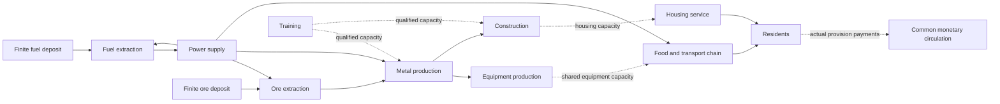

# Physical capabilities and monetary circulation

Added 7 November 2026. `examples/coupled_study.rs` now generates one coupled
five-year calculation instead of assuming that a successful money circuit proves
that goods, equipment or trained capacity exist. It is a bounded synthetic research
model, not a calibrated national plan or an autonomous production controller.

## What is connected

The schema-7 report retains a coupled model with 18 resource/capability dimensions, 17 processes and 1,825 daily
periods. A synthetic cohort of 1,000 residents is scaled by 100,000 to the stated
100-million population scale. This is aggregate arithmetic, not individual agents
or an estimate of actual Kazakhstan needs. Annual requirements grow by five
percentage points of the initial quantity, reaching 120% in year five. This
schedule is declared in advance; outages are not anticipated by the heuristic.

| Process | Main inputs | Output | Completion delay, periods |
| --- | --- | --- | ---: |
| Fuel extraction | Finite deposit, energy | Fuel | 1 |
| Power supply | Fuel, water | Energy available next period | 1 |
| Ore extraction | Finite deposit, energy | Ore | 1 |
| Metal production | Ore, energy | Metal | 2 |
| Equipment production | Metal, energy | Equipment units | 20 |
| Farming | Water, energy | Grain at farm | 5 |
| Grain transport | Grain at farm, energy | Grain at processing location | 1 |
| Cooking | Grain at processing location, energy | Meals at kitchen | 1 |
| Last-mile delivery | Meals at kitchen, energy | Delivered meals | 1 |
| Construction | Metal, energy | Housing-capacity places | 60 |
| Training | Eligible training places, energy, instructor capacity | Qualified work capacity | 180; stress case 720 |
| Housing service | Water, energy, available housing capacity | Housing-place days | 1 |
| Reserve grain transport | Grain at farm, energy, more shared capability | Grain at processing location | 2 |
| Reserve last-mile delivery | Meals at kitchen, energy, more shared capability | Delivered meals | 2 |
| Reserve generator construction | Metal, energy, shared equipment/work capacity | Reserve generator | 30 |
| Fuel storage construction | Metal, energy, shared equipment/work capacity | Storage unit | 30 |
| Reserve power | Fuel, water, completed generator capacity | Energy | 1 |

Delays and coefficients are experimental assumptions, not observed curricula,
engineering specifications or nutrition standards. The power process represents
committed next-period supply; it does not posit an unmodelled electrical battery.
Water is an external boundary supply. Deposits, initial material stocks, equipment,
housing and qualified capacity are explicitly declared. Buildings are represented
as housing-capacity places, not one whole building per resident. Training places
represent eligible voluntary capacity; people are neither owned nor traded.



## Equations and capability timing

The existing time-expanded stock equations retain each resource's unit. Explicit
withdrawals `w[k,t]` remove declared retired equipment or qualified availability:

```text
s[k,t] + d[k,t] + discarded[k,t] + sum_j A[k,j] * x[j,t]
 = s[k,t-1] - w[k,t] + external[k,t]
   + sum_j B[k,j] * x[j,t-lead[j]]
w[k,t] <= s[k,t-1]
```

An additional shared-use row prevents two processes from each assuming exclusive
use of the same equipment, skilled hours or housing capacity:

```text
sum_j U[l,j] * x[j,t] <= rate[l] * (s[resource[l],t-1] - w[resource[l],t])
```

For period zero, declared initial stocks replace the previous closing balance.
New equipment or qualifications completed in a period can supply capacity only
from the following period. This is an explicit conservative timing convention.
Skill capacity is retained during work; it is not consumed as a material input.
A withdrawal of work capacity never cancels a resident's basic needs.

The example includes an equipment retirement shock and a withdrawal of qualified
availability in period 400. Baseline replacement and training can prepare for these
declared events. Specific retirement quantities are scenario assumptions.

The coupled ordinary case has **129,575 variables and 138,702 rows**, including
four shared-capacity constraints per period, constructed fuel-storage constraints
and withdrawal guards. It has 393,841 nonzero terms. Daily storage-loss withdrawals
add 1,824 prior-stock guards; longer training delays also change the matrix. The
former 16-resource/14-process configuration had 113,150 variables and 118,627 rows;
its numerical service and circulation results are retained with inactive extension
columns in the current report.
Every physical row is checked with exact arithmetic. A separate replay checks
stock conservation and shared-capacity use directly from activities and timing.

## Link each goods payment to its physical basis

`CashLink` binds a payment to one of three sources:

1. An actual input consumed by a named process in a named period.
2. An actual final quantity delivered to residents.
3. An equipment/housing completion designated as public capital procurement.

For fixed normative measure `v[k]`, the linked amount must be exactly `q * v[k]`.
The checker requires every priced obligation once, and rejects missing, duplicate,
unsupported, wrong-quantity and wrong-amount links. Public capital cannot also be
billed as household provision in the same model. A completion cannot be paid as
completed capital before its lead time has elapsed. Natural deposits, water and
people have no commodity price in this example.

A resident's observed goods payment is funded through the common treasury and
settled to the corresponding provisioning unit. Input consumers pay the declared
source unit for actual input release. Completed equipment and housing enter common
capacity and are procured by the treasury; training inputs are publicly funded.
Missing goods remain missing in the needs report: the absence of a goods payment
is not a decision cancelling the person's entitlement.

Every priced single-output recipe has an exact common-entitlement coefficient:

```text
entitlement_per_output_unit = output_unit_measure
                           - input_measure_per_batch / output_quantity_per_batch
```

The example checks exact divisibility and nonnegative coefficients. On actual
receipt, the supplying unit circulates that declared share through the treasury;
the input-cost portion remains available for its own input obligations. This is
the previously stated common-ownership candidate, not a levy inferred for private
enterprises. The model does not add separate wages or dividends on top of the same
accounted amount. Additional contribution rewards remain an open policy design.

The baseline has **25,175 checked goods/payment links** and **54,000 monetary
movements**, including funding and entitlement movements. Transfer volume must not
be called GDP or added physical value. Exact prefix bounds calculate the opening
working measure at every account; residents require no opening balance and close
at zero. Productive units and the treasury may need working reserves before output
can be completed and paid. These reserves are explicit initial endowments in the
simulation, not loans or later issuance. The normative unit never changes.

## Results and negative cases

All values below are synthetic scaled quantities. First missed periods are
zero-based. A missed need in a heuristic trace is not generally proof that no
better plan exists.

| Scenario | First missed period | Unmet meals | Unmet housing-place days |
| --- | ---: | ---: | ---: |
| Baseline | None | 0 | 0 |
| Transport stopped for 30 periods | 369 | 2,755,000,000 | 0 |
| Power supply stopped for 15 periods | 602 | 1,180,000,000 | 1,575,000,000 |
| Equipment replacement disabled | 415 | 102,898,422,170 | 0 |
| Training completion delayed to 720 periods | 425 | 18,796,018,810 | 0 |

Baseline food delivery reaches the exact demand upper bound, so its food objective
has a valid primal/dual optimality certificate. Housing needs also receive full
coverage. Neither statement proves minimum waste, minimum expenditure or fair
individual allocation. The deterministic heuristic prioritizes core energy,
housing and the food chain, then expansion and training; other priorities can
change the distribution of shortages.

For the transport outage under the **fixed-route policy**, an additional Farkas
certificate proves a lower bound. Its explicit added rows forbid reserve meal
dispatch; this certificate does not apply when reserve routes are permitted:
maximum allowed opening delivered-meal stock plus maximum already-started incoming
output cannot cover the declared 30-period requirement. At least **2,050,000,000**
meals remain unprovided under those constraints. The heuristic's actual shortage
is larger. More money cannot remove that particular physical infeasibility.

Every reported monetary trace is prefunded by its exact opening bound and passes
its own accounting replay. This does not erase the physical shortages, prove that
all scenarios need the same money stock, or establish indefinitely stationary
circulation. Work in progress, inventory growth, retirement and waste affect the
working balances. The report retains discarded quantities; baseline full coverage
is not proof of efficient production. The next optimization must address these
losses and terminal inventories explicitly.

## Verification and remaining scope

The mathematical tests cover shared-capacity overbooking, premature use of a
qualification, retirement before production, insufficient withdrawal stock,
invalid/overflowing constraints, omitted or forged payments, double billing and
premature capital procurement. Each scenario also rejects a deliberately increased
payment. All reports are regenerated byte-for-byte by the full check.

```sh
cargo test --locked --test mathematics
cargo run --locked --example coupled_study
PG_BIN=/opt/homebrew/opt/postgresql@16/bin python3 scripts/check.py
```

This phase adds research verifiers and a coupled example. It does not replace the
live planner, introduce a national optimization service or grant an AI execution
authority. Main remaining work: calibrated sector coefficients and unit registry;
cohort demography and specific qualification pipelines; equipment maintenance and
lifetimes; inventory age/expiry; regional logistics and grid limits; individual
choice and priorities; objective-aware rolling optimization and sensitivity ranges;
accountable ownership, entitlement and transition rules. Water extraction and many
other upstream industries remain explicit external boundaries, rather than being
silently claimed complete.

## Reducing excess production while preserving provision

The next 7 November stage adds `optimization::trim_plan`, an exact integer
coordinate-improvement procedure. It takes a feasible seed plan and a declared
process order. It never changes deliveries, supply, normative values, process
recipes or capacity declarations. It only reduces the number of process starts,
recomputes affected inventories and overflow disposal, and preserves explicit
terminal reserve floors. In the coupled study those floors equal the seed plan's
closing stocks for **every** resource. Saved raw deposits can remain in the ground.

For a reduction `q` in process `j` started in period `t`, affected stock coordinates
are replayed as follows (all terms use the same resource unit):

```text
available'[k,u] = closing[k,u] + discarded[k,u] + delta[k,u-1]
               + A[k,j] * q * indicator(u=t)
               - B[k,j] * q * indicator(u=t+lead[j])
closing'[k,u]   = min(storage_cap[k], available'[k,u])
discarded'[k,u] = available'[k,u] - closing'[k,u]
delta[k,u]     = closing'[k,u] - closing[k,u]
```

Negative availability rejects a candidate. Closing stock must also cover the next
period's withdrawal and shared capability requirement, plus the terminal floor at
the end. Required capability stocks are computed using exact integer ceilings.
This prevents a seemingly economical reduction in training/equipment from
silently removing the capacity needed for a later promised service.

One-coordinate closing stock is a minimum of affine functions of `q`, hence
concave. Lower bounds on stock and capacity give a feasible interval containing
zero. Integer bisection finds the largest allowed reduction for that coordinate.
After each pass the original time-expanded matrix independently verifies the whole
plan, with no numerical tolerance. An independent full-stock replay and the
complete goods/payment checker then verify the published scenarios.

The procedure visits periods in reverse order and uses an explicit process order;
the study allows at most eight passes. `coordinate_irreducible` is set only after a
full pass makes no change. A pass-budget stop is reported without that label.
Neither label is a global optimum. A test supplies an unnecessary two-process round
trip that is irreducible one coordinate at a time while both operations can be
removed jointly. This is a documented counterexample to overclaiming the method.

All payment links and cash events are rebuilt from the changed physical plan.
Prefix-bound working measure is calculated again; a reduction in resource use does
not guarantee a reduction in the required opening measure at every account.
Neither transfer volume nor that opening measure is a national budget estimate.

The comparisons are **retrospective**: the trimming stage sees the seed's entire
five-year trajectory, including its realized outages. It is an improvement bound
for a supplied trace, not an online controller that can foresee future outages.
It preserves any seed shortage rather than solving it through changed priorities.
Intermediate safety stocks, spoilage, new choices and full rolling-horizon
optimization require further explicit constraints. The causal reserve-route
experiment below adds two alternatives without claiming that broader optimizer.

### Measured comparison inside the synthetic model

The retained original scenarios and their trimmed counterparts are in the same
`research/coupled-results.json` report (schema version 4). The unchanged seed
results were compared field-by-field after refactoring payment generation. All
five trimmed scenarios finish with a no-change second pass. This certifies only
irreducibility under the declared one-coordinate moves and reserve constraints.

| Scenario | Power starts before | Power starts after | Energy discarded before | Energy discarded after | Unmet needs changed? |
| --- | ---: | ---: | ---: | ---: | --- |
| Baseline | 40,128,000,000 | 22,439,163,342 | 175,292,200,000 | 172,717,085 | No |
| Transport outage | 40,128,000,000 | 22,160,880,519 | 178,047,200,000 | 172,717,138 | No |
| Power outage | 39,798,000,000 | 22,304,062,326 | 173,362,700,000 | 172,717,027 | No |
| Replacement disabled | 40,128,000,000 | 11,884,777,250 | 279,780,622,167 | 172,716,942 | No |
| Training delay | 40,128,000,000 | 20,540,575,535 | 194,088,218,810 | 172,716,606 | No |

A power start produces ten abstract energy units. Baseline power output falls by
**44.0810%** and its discarded energy by **99.9015%**, relative to the deliberately
simple fixed-output seed. Fuel extraction falls from 4,012,800,000 to 2,243,916,335
batches (ten fuel units each). All other activity counts remain unchanged in this
experiment. This is not a forecast of real-world savings or evidence of an optimal
construction/training schedule.

Baseline exact opening working measure falls from **2,005,344,000,000** to
**256,691,834,280** normative units (87.1996%). These are finite-schedule prefunding
bounds for each separately calculated trace, not public expenditure, real currency,
a reduction of personal entitlements or proof of indefinitely repeatable balances.
In stressed cases the treasury's own opening requirement can increase even while
the sum across accounts decreases. Every account's bound remains in the report.

Saved baseline fuel deposits increase the terminal in-ground stock from
59,872,000,000 to 77,560,836,650 units. No terminal resource falls below its seed
quantity. Unused external water increases because fewer power batches require it:
1,563,757,000,000 to 1,581,445,836,658 units. This boundary-supply surplus is not an
improvement in water abstraction: abstraction is not controlled by this model.
It illustrates why a single unqualified “total waste” percentage would mislead.

### Units and calibration gate

The report labels every case `synthetic_uncalibrated`. Its population scale is an
aggregate multiplier, not a demographic observation. Energy/fuel/material recipe
units are abstract and must not be relabelled as measured kWh or tonnes. The water
boundary supplies more than recipes consume; unused external water is reported
separately from avoidable energy output. Adding those quantities would be invalid.

Before presenting a calibrated five-year national plan, each input needs a source,
region, observation year, physical unit, uncertainty range and conversion rule:

| Input family | Required evidence before calibration | Current boundary |
| --- | --- | --- |
| Needs and population | Cohort counts, births/deaths, service norms, observed choice | Synthetic annual +5 percentage-point requirement schedule |
| Energy | Input/output balances by carrier, losses, grid capacity, dispatch and storage | Single abstract energy resource, no inter-period storage |
| Materials and equipment | Input-output recipes, extraction limits, maintenance, lifetimes | Aggregate recipes and one declared retirement shock |
| Transport | Distances, load factors, fleet schedules, fuel and route capacity | Two aggregate food transport legs, each with a slower reserve route |
| Construction | Bill of materials, commissioning phases, occupancy and maintenance | One abstract housing-capacity recipe |
| Qualifications | Voluntary eligible cohorts, instructor specialisms, curriculum and attrition | One aggregate qualification pipeline |
| Monetary norms | Approved fixed-unit registry and ownership/entitlement basis | Fixed experimental integers; no adoption decision |

No empirical coefficients have been substituted without this evidence. The
implemented result is an exact comparison within declared assumptions, ready for
calibration and challenge rather than evidence that those assumptions are true.


## Causal recovery through reserve routes

The next experiment adds a daily feedback policy and `replanning::ProductionPipeline`.
It observes today's capacities, completed arrivals, available inventory and already
committed outputs. It does not read tomorrow's outage or its recovery date. The
published annual needs schedule is known; that assumption is distinct from knowing
future failures. This is a causal inventory-target policy, not a solved rolling
multi-objective optimization problem.

Each primary food transport leg takes one period. Each declared reserve leg takes
two, uses four units each of shared equipment and qualified capacity per batch,
and has capacity 500 × the scaling factor per day. Primary legs use two equipment
units and two qualified-capacity units. Reserve recipes use the same two abstract
energy units per ten transported units as the primary recipes. These are explicit
experimental coefficients, not measured emergency-route performance. Both policy
comparisons have the same declared reserve infrastructure; the fixed-route policy
leaves it idle. No asset appears for free when an interruption occurs.

For a resource k, define committed output that has not arrived yet as P[k,t].
A primary route is attempted first; the reserve route sees the remaining target:

```text
P[k,t] = sum of recorded outputs due strictly after today's arrivals
requested_batches[j,t] = ceil(max(0, target[k] - available[k,t] - P[k,t]) / B[k,j])
starts[j,t] = min(requested_batches, observed route capacity,
                  input-limited batches, shared-capability-limited batches)
```

A newly accepted start immediately joins P. It cannot be delivered until its due
period. This prevents recovery of the primary route from triggering duplicate
orders for goods already travelling on a slower route. The pipeline releases each
commitment once; identical command retries are no-ops and changed retries fail,
even after the original completion. Overflow and malformed commands leave the
pipeline unchanged. A route closure blocks new dispatch; destruction of cargo in
transit is not modelled in this experiment and would need a separate loss event.

### Observed comparison

All periods are zero-based; quantities are synthetic aggregate meal units over the
whole 1,825-period trace. Previous missed meals are never erased by later delivery.

| Interruption | Fixed-route unmet meals | Reserve-policy unmet meals | First missed period, fixed / reserve |
| --- | ---: | ---: | --- |
| None | 0 | 0 | None / none |
| Primary routes closed in periods 365–394 | 2,755,000,000 | 0 | 369 / none |
| Primary routes closed in periods 365–454 | 9,055,000,000 | 2,513,917,060 | 369 / 421 |

The 30-period case starts the reserve legs in period 365, not before the failure.
Each reserve leg performs 315,000,000 batches over the trace. Initial stocks and
working capacity bridge the longer delivery delay. This proves feasibility for
these declared assumptions; it does not prove that any real disruption can be
absorbed. The 90-period case overlaps the period-400 equipment/qualification
withdrawal. Reserve routing reduces missed meals by **72.2372%** and delays the
first miss by 52 periods, but shared capability limits remain binding. Its residual
shortage is a result of this policy, not a proof that every other policy must fail.

The complete normal and 30-period-outage plans match exactly through period 364.
The complete 30- and 90-period-outage plans match through period 394, while their
future restoration dates differ. These prefix assertions cover activities,
deliveries, stocks and disposal, and run on every regeneration. They test the
specified scenarios against premature reactions, not every possible future.

Every recovery trace passes the same independent physical matrix, per-period stock
and capacity replay, exact goods/payment links and monetary conservation checks.
The monetary opening bound remains a **retrospective** calculation for each full
trace: causal physical decisions do not make that bound an online cash forecast.
No claim is made that one common starting balance supports all unknown futures.
The two routes share the corresponding provisioning unit's account and fixed
norms; additional accounting value is not invented for the reserve route.

Next work: jointly choose safety reserves, route capacity, service priorities and
capital/training schedules across multiple unknown disruption paths; add expiry,
in-transit losses and a fixed opening liquidity envelope. Report guaranteed service
bounds only for explicitly bounded uncertainty and independently verified plans.

## Common opening measure across bounded disruption scenarios

`mathematics::common_schedule_opening` now computes one opening balance vector for
a declared finite family of ordered schedules. It does not select a different
starting balance after learning which failure will occur. The current family uses
the same initial physical stocks, storage caps, recipes, shared capabilities,
withdrawals, normative units and account ownership, checked for equality in code.
The reserve-routing policy is the same in every member.

| Family member | Primary transport closure | Power closure |
| --- | --- | --- |
| normal | None | None |
| transport_30 | 365–394 | None |
| transport_90 | 365–454 | None |
| power_15 | None | 600–614 |
| compound_15 | 365–454 | 390–404 |
| compound_30 | 365–454 | 390–419 |

Periods are zero-based and endpoints inclusive. All members also have the same
previously declared equipment/qualified-capacity withdrawal in period 400. The
compound cases therefore combine transport, energy and capability stress. These
six paths are a bounded experimental set, not all combinations of failures, a
probability distribution or a worst-case claim over every possible future.

### Exact bound and proof scope

For account a, scenario ω and event prefix t, C[a,ω,t] is cumulative net inflow,
starting at zero. Let:

```text
E[a] = max(0, max_{ω,t} -C[a,ω,t])
E_total = sum_a E[a]
```

Sufficiency follows because every E[a] + C[a,ω,t] is nonnegative. Necessity follows
from an attaining prefix: a smaller opening for that account makes the balance
negative in its witness scenario, unless the schedule is changed. The result saves
that scenario, zero-based event index, period and exact cumulative net value for
each positive coordinate. An all-zero requirement has no negative witness.

This is componentwise minimal for the supplied fixed schedules, with their fixed
order and no extra rebalancing or later issuance. It is not a global minimum over
alternative plans. In general, E_total is **not** the largest scenario-specific
total: one schedule may require 7 units at account A, another 9 at account B. The
common vector is (7,9), total 16, although the larger individual total is only 9.
Keeping the total in the wrong accounts does not meet the obligation sequence.

The Rust routine validates the complete named family before calculation, rejects
ambiguous names, invalid schedules and unbounded input sizes, and uses checked
integer arithmetic. Decimal strings preserve mathematical values beyond runtime
account limits; a caller must separately validate its execution representation.
The coupled experiment's balances fit its replay representation. No ledger command,
monetary policy or issuance authority is added.

### Independent verification

Each scenario is replayed with the **same E**, preserving money exactly and checking
that every planned payment settles. All positive account requirements are then
reduced individually by one unit; the corresponding witness must fail at the saved
event. The mathematical tests also exhaustively enumerate initial vectors for 16
small three-scenario families using a separate transfer simulator, verify witness
prefixes and scenario-order invariance, and retain a counterexample for unavailable
payment edges. A cash reserve cannot make a disabled payment channel operate.

The existing physical matrix and goods/payment checks still apply. Identical
physical decision prefixes are checked for normal/power through period 599,
long-transport/compound through 389, and the two compound cases through 404,
in addition to the previous transport-prefix comparisons. Thus no advance reaction
to the tested future divergence is hidden in the reported physical policy.

A second cash-only replay uses the normal scenario's smaller opening balances on
each stress schedule. This is a diagnostic showing when payments would block; its
physical trace is not re-solved after underfunding. Do not present its original
physical deliveries as executed outcomes of a cash-blocked economy.

Physical reserve quantities are explicit and unchanged across the family; they
are not yet jointly optimized. The family envelope is designed offline and then
held fixed during all six replays. It protects these stated schedules, not unseen
failure paths or infinite repetition. Missing meals/housing remain missing even
when every payment for goods actually supplied succeeds. The next optimization
must jointly choose routes, reserves, production and capability renewal, and report
service deficits and resource costs separately from this monetary sufficiency bound.

### Measured common-funding result

The six-path common opening is **2,030,483,170,650 normative units**, compared with
**2,005,344,000,000** for the normal trace alone: an additional **25,139,170,650**
(**1.253609%**). This is a stock of opening working measure, not annual expenditure,
GDP, actual KZT or a forecast of required national issuance. It uses the untrimmed
causal reserve-route policy; the earlier retrospective production savings have not
been silently combined with it.

| Scenario | Unmet meal units | Unmet housing-place days | Payments blocked with common opening | First blocked period using normal-only opening |
| --- | ---: | ---: | ---: | --- |
| normal | 0 | 0 | 0 | None |
| transport_30 | 0 | 0 | 0 | None |
| transport_90 | 2,513,917,060 | 0 | 0 | 1795 |
| power_15 | 1,180,000,000 | 1,575,000,000 | 0 | None |
| compound_15 | 3,792,016,560 | 1,575,000,000 | 0 | 538 |
| compound_30 | 5,089,395,840 | 3,150,000,000 | 0 | None |

All 320,329 scheduled movements across the six separate replays settle with the
common opening; money is conserved and the resident account's closing balance is
zero. Ten positive opening coordinates have attaining witnesses, and every
one-unit reduction fails at its saved event. All 14 previously published physical
trace results and comparisons are unchanged; three additional physical traces
extend the same maintained report to schema 4.

The long-transport trace alone needs 2,030,483,170,600 units, the largest individual
total. It still misses **50 units at a different account** needed by compound_15
(account 4, period 538). The family therefore requires 50 more than that largest
total. This is exact integer arithmetic, not floating-point rounding. The report
retains the responsible prefixes instead of rounding away a small but real failure.

Normal-only funding produces 39 underfunded attempted payments in transport_90
and 13 in compound_15. The more severe compound_30 needs a smaller monetary stock
than compound_15 for its particular executed-goods schedule, because less physical
provision occurs. Lower required working measure must not be interpreted as better
welfare. Financial sufficiency and successful material provision remain distinct.


## Joint reserve, replacement and training policies

The schema-5 calculation exhaustively evaluates **eight precommitted feedback
policies across six disruption paths** (48 physical/cash traces, 1,825 periods
per trace). It expands the previous common-funding experiment; the earlier results
remain in the same report. No initial assets, deposits, recipes, transport routes,
process capacities, storage capacities or monetary norms are added for a candidate.
All candidates use the two existing slower reserve transport routes.

Three binary choices generate the eight policies:

| Choice | Reference | Alternative |
| --- | --- | --- |
| Food stock targets | Farm/city/kitchen/delivered: 12,000 / 5,000 / 5,000 / 5,000 | Existing storage ceilings: 15,000 / 6,000 / 6,000 / 6,000 |
| Equipment target | 400 | 580; additional machines must consume metal/energy and complete the existing 20-period process |
| Training priority | After food/material/capital starts | After energy, fuel and housing service, before food starts; same eligible places, instructors, inputs and 180-period lead |

Targets above are unscaled synthetic cohort quantities; multiply by 100,000 for
report quantities. They are inventory targets, not guaranteed available inventory.
Equipment production remains limited to one unscaled batch per period and uses
shared equipment/work capacity. The known period-400 equipment/skill withdrawal
still applies. Training is not manufactured labour: the 120 initial eligible
places and instructor constraints remain unchanged, with no invented trainees.
Construction retains its existing 1,300-place target, recipe and 60-period lead;
its resource competition and completed procurement are checked in every run, but
its design is not an additional search variable in this bounded experiment.

One policy is selected before the disruption path is known. Each day's decisions
use only current stocks, current capacities and committed completions. Five
same-observation prefix pairs per policy (40 checks) reject reliance on future
outage duration. The design is selected against a declared stress family; that is
not an out-of-sample forecast of unknown events.

All scenarios must end with at least the following common reserves: 300 equipment,
200 qualified-capacity units, 1,000 housing-capacity places, 6,000 farm grain,
4,000 city grain, 4,000 kitchen meals and 3,800 delivered meals, multiplied by the
same scale. Other resource floors are zero, with nonnegative balances checked at
every period. These are explicit terminal constraints, not indefinite resource
renewal. The delivered-meal floor reflects final-day consumption. All eight
candidates satisfy them, so improved service is not obtained by violating these
floors. Inventory ageing remains unmodelled.

### Objective and exact evidence

For policy p, scenario w and service k, let U[p,w,k] be unmet units and D[w,k]
total required units. The experimental criterion treats both services equally in
**fractional coverage**, without adding different physical units:

```text
min_p max_(w,k) U[p,w,k] / D[w,k]
```

Here all twelve denominators happen to equal **200,750,000,000**, allowing exact
integer comparison of the largest numerator. That simplification must not be
carried over to differently sized service demands. No monetary tie-break defines
social priorities. The report separately lists the nondominated alternatives in
worst meal shortage, worst housing-service shortage, maximum capital procurement
and common opening measure. Equal-score alternatives remain visible.

Every candidate is verified against the physical matrix and a separate stock/
capacity replay. All goods-payment links are rebuilt; every scenario is replayed
with its policy's common accountwise opening vector and no later issuance. The
initial physical basis is equal across policies; funding requirements are
recalculated and compared, not held artificially equal.

| Policy ID (early-training counterpart) | Changes | Worst unmet meals | Worst unmet housing-place days | Common opening measure | Maximum completed capital measure |
| --- | --- | ---: | ---: | ---: | ---: |
| 0 (4) | Reference | 5,089,395,840 | 3,150,000,000 | 2,030,483,170,650 | 580,000,000,000 |
| 1 (5) | Food buffers | 4,126,346,850 | 3,150,000,000 | 2,143,790,783,200 | 580,000,000,000 |
| 2 (6) | Equipment | 2,860,000,000 | 3,150,000,000 | 2,001,564,000,000 | 760,000,000,000 |
| 3 (7) | Equipment and food buffers | 2,760,000,000 | 3,150,000,000 | 2,121,164,000,000 | 760,000,000,000 |

The early-training counterparts have identical values in this table. Earlier
priority alone produces no measured advantage for these scenarios and objectives;
this is not a conclusion that education is unimportant. All eight are nondominated
on the four reported axes (equal metric vectors are retained). Extra equipment
improves worst food provision and working funds, but requires more completed
capital; extra food reserves further reduce food losses at higher opening measure.
Working funds and cumulative procurement are different quantities and must not be
added or advertised as national budget costs. Monetary units are synthetic norms,
not market prices or measured KZT.

For the 90-period transport-only interruption, equipment policies reduce missed
meals from **2,513,917,060 to zero** while retaining the same initial stock. For the
combined 90-period transport/30-period power event, the joint policy reduces missed
meals from **5,089,395,840 to 2,760,000,000**. Energy-dependent housing service still
loses **3,150,000,000 place-days**. A housing-service deficit here means an unmet
modelled service requiring energy; it is not a forecast of demolished buildings or
numbers of homeless people.

### Why the remaining gap cannot be removed by these schedules

The compound path disables power starts in periods 390–419. Power has a one-period
lead, energy storage is zero, housing-service starts require energy, the service
also has a one-period lead, and housing-service output cannot be stored. Therefore
housing service cannot be delivered in periods **392–421**, inclusive. These 30
periods require 105,000,000 units each, producing a lower bound of 3,150,000,000 on
the worst unmet numerator for **any feasible schedule under these assumptions**.

This is checked with an exact sparse dual certificate, not inferred from a failed
heuristic. Sum the housing balance rows for 392–421 with weight 1, the energy
balance rows for 391–420 with weight 10, the primary and disabled-backup
power-capacity rows for 390–419 with weight 100, and the initial-window storage rows `storage:391:15` and
`storage:390:3` with weights 1 and 10. The resulting row combination bounds total
housing delivery in the window by zero. Nonzero multipliers are published with
the report. Removing a required capacity multiplier or allowing one unit of energy
storage causes the verifier to reject the claimed exact zero optimum.

Policies **2, 3, 6 and 7** attain that lower bound:

```text
best worst unmet fraction = 3,150,000,000 / 200,750,000,000
                         = 63 / 4015 ≈ 1.5691158%
absolute numerator gap to the physical lower bound = 0
```

Thus this particular minimax coverage objective is optimal for the supplied
six-path physical model, not merely best among eight policies. It is **not** a
proof that every service is complete, that food shortage is minimized, that money/
capital is globally minimized, or that the model describes a real country.
A five-year aggregate fraction also conceals a severe consecutive interruption;
individual service/day outcomes and the outage window must remain visible.

The reserve experiment below tests energy continuity with constructed assets and
explicit loss constraints. Inventory expiry, in-transit losses and equipment
maintenance are tested later in a separate lifecycle submodel; their integration
into these coupled physical/cash traces remains open. Increasing cash alone cannot close the gap in the
reserve-free configuration. Unknown scenarios, demographic calibration and live
service integration remain open. No runtime authority or economic policy changes.


## Constructed reserve and recovery experiment

The author's moderate body-energy-reserve analogy is implemented as a bounded
shared physical stock, not personal money accumulation. Schema 6 adds **35
five-year traces**: four storage-aware designs (no new backup, 7, 30 and 60 periods)
and a retained defective 60-period design, each under seven scenarios. All begin
with the same deposits, materials, qualifications and other assets; **zero new
storage units and zero backup generators** exist initially. The historical cases
and joint-policy comparison remain in the same report with inactive extension
processes. Numerical legacy provision, activity totals and opening measure were
checked unchanged after padding the resource/account vectors.

A generator and a storage unit each require 10 metal, 10 energy and 30 periods;
construction is limited to one unscaled batch per process per period and consumes
shared equipment/work capacity. Twenty-two unscaled generators allow 220 backup
power starts per period; each start consumes one fuel and one water and produces
10 energy one period later. This deliberately uses the primary generator's
synthetic conversion recipe, so both have the same normative variable cost.
Standby infrastructure is accounted separately as completed public capital.
No real-world generator efficiency or building cost is inferred from these inputs.

Closing fuel stock is constrained by:

```text
fuel[t] <= 2,000 * scale + 1,000 * completed_storage_units[t]
fuel[t] <= 20,000 * scale
backup_starts[t] <= 10 * generators[t-1]
scale = 100,000
```

Storage can hold stock at the close of its completion period; generator capability
becomes usable the following period. `BuiltStorage` adds the storage inequality to
the exact physical matrix. Fuel must be extracted from the finite deposit, using
energy and productive capacity. Fuel storage has a declared daily **1,000 ppm
(0.1%)** loss rounded upward to the physical quantum. This is an experimental
parameter, not a measured property of a specified fuel. Losses are explicit
withdrawals before new arrivals; they cannot be spent or silently reconstructed.

### Sizing and causal replenishment

Let u be fuel used per period, F the retained restart stock and p the loss rate in
parts per million. For n periods without replenishment:

```text
L(s) = ceil(s * p / 1,000,000)
s_next = s - L(s) - u
B[0] = F
B[n+1] = ceil((B[n] + u) * 1,000,000 / (1,000,000 - p))
```

`required_reserve` returns the **minimum integer opening stock for this component
recurrence**. Its minimality is tested by independent exhaustive forward simulation,
including zero demand, zero periods, large integer inputs and overflow/invalid
rates. This is not a theorem that the entire economy remains supplied.

Here u = 22,000,000, F = 44,000,000 and p = 1,000. Exact minimum component stocks
are 198,927,093 (7 periods), 715,680,726 (30) and 1,407,827,562 (60). The operational
target rounds up to an unscaled cohort unit. The reserve keeps two nominal fuel-use
periods for restarting productive activity; that floor is protected from backup
dispatch, **not exempt from storage loss**. It does not promise indefinite survival.

The daily controller:

1. Uses backup generation when observed primary output capacity cannot supply the
   normal planned power starts; it never learns a future restoration date.
2. Prioritizes current food/housing production before reserve replenishment while
   sufficient restart stock exists. Below that floor, fuel recovery regains priority.
3. Limits new fuel commitments to **already completed** storage capacity and accounts
   for next-period loss before setting the refill quantity. Unbuilt space cannot
   justify extraction that will later overflow.
4. Replenishes from actual production after recovery, retaining all inputs, delays,
   stock losses, payments and finite-deposit depletion.

Twenty-five equal-observation prefix comparisons pass. Every scenario has an exact
physical matrix check, independent stock/capacity/loss replay and recalculated
physical-payment links. Each design uses one common accountwise opening vector
across its seven scenarios, without later issuance. All 1,862,357 scheduled payments
across the 35 traces settle. Cash settlement does not erase physical shortfalls.

### Coverage and cost comparisons

The prepared stress family includes ordinary operation; the previous combined
90-period transport/30-period power interruption; simultaneous fuel-extraction and
primary-power interruptions of 30 periods; and two such 30-period interruptions
separated by 20 recovery periods. Longer 60/90-period interruptions and an early
failure in periods 10–39 are reported separately as boundary tests.

| Storage-aware design | 30-period supply interruption | 60-period interruption | 90-period interruption | Two 30-period interruptions | Normal completed capital measure | Common opening measure across all seven paths |
| --- | --- | --- | --- | --- | ---: | ---: |
| No new reserve | Shortage | Shortage | Shortage | Shortage | 760,000,000,000 | 2,232,709,274,250 |
| 7 periods | Shortage | Shortage | Shortage | Shortage | 782,000,000,000 | 2,279,811,695,350 |
| 30 periods | Full provision | Shortage | Shortage | Full provision | 788,000,000,000 | 2,296,337,963,140 |
| 60 periods | Full provision | Full provision | Shortage | Full provision | 795,000,000,000 | 2,317,675,692,440 |

Full provision means both declared services on **every period** of that scenario,
not an average hiding days without service. All four storage-aware designs retain
the previous terminal food/equipment/qualification/housing floors and cause zero
fuel overflow. They do incur real storage losses and consume finite natural fuel.
The 30-period design uses six new storage units; the 60-period design uses thirteen,
with 22 standby generators in each (all multiplied by scale). These counts are
synthetic aggregate units, not engineering specifications for 100 million people.

Thirty periods is the **smallest adequate tested target** for the prepared family,
not a global minimum over all reserve sizes, alternative power sources or schedules.
The 30-period design reaches its fuel target after the first outage in period 422
(restoration begins 420), and after the second in period 472 (restoration begins
470). The 60-period design refills after its 60-period outage by period 453
(restoration begins 450). Target attainment does not imply zero ageing or perpetual
adequacy; it is an observed result of these declared inputs and priorities.

For a 90-period supply interruption, even the 60-period design misses 2,639,998,700
meal units and 3,045,000,000 housing-place days. All four designs miss services
when interruption begins before infrastructure construction is complete. These
failures are retained, not removed by changing the denominator or cancelling needs.

Normative capital flows and the opening circulation stock are different measures;
they must not be summed or described as estimated national budget expenditure.
No interest, tax, deposit income or speculative money trading is introduced.

### Retained counterexample: fill before storage exists

The fifth design keeps the same 60-period target but disables capacity-aware filling
and service-first refill priority. In normal operation it discards **63,396,705,601**
fuel units, exhausts the finite fuel deposit, misses 30,649,818,970 meal units and
29,400,000,000 housing-place days, and violates the terminal meal floor. It is marked
inadmissible; its mathematical conservation remains verified. The same target with
the corrected feedback rule supplies both services fully in normal operation,
discards no fuel and retains 56,096,964,530 units in the natural fuel deposit.

This isolates a planning failure rather than establishing that a 60-period reserve
is inherently harmful. Both the failed and corrected variants remain executable
regression cases. A sufficient reserve must be **constructed, filled, protected,
delivered and renewed**; a larger target alone proves none of these properties.

Remaining work includes optimizing emergency power use and reserve size jointly
with service needs (the current 220-start target is fixed), perishable food lots
and expiry, in-transit losses,
maintenance/correlated backup failures, changing needs, water-supply failures,
calibrated coefficients and live reviewed-plan integration. The current loss law
models fuel-storage depletion only; it does not implement every resource lifecycle
or confer autonomous control on the runtime service.

## Dated food, transport loss and standby maintenance

The next bounded stage (7 November 2026) is implemented in `src/lifecycle.rs` and
`examples/support/lifecycle_study.rs`, called by the existing coupled example.
Results are kept in `research/coupled-results.json` under `food_asset_lifecycle`
(schema 7). The previous 18-resource calculations remain intact. This is a
**separate lifecycle submodel**, not a claim that expiry and repair have already
been integrated into every physical matrix, monetary replay or live endpoint.

### Explicit state and timing

A food lot has an immutable identity and exclusive expiry period `e`. It is usable
only for `t < e`. Its age is preserved when split, dispatched, damaged or received;
transport cannot create a fresh expiry date. Each contiguous day begins by removing
expired stock at the source, destination and in transit. Observed arrivals then
precede consumption; new boundary supplies and dispatches follow consumption.
The example uses first-expiring-first-out (FEFO). A dispatch with a planned arrival
at or after expiry is rejected. An unexpected late arrival can still expire in
transit. Shipment identities cannot be reused and closed shipments cannot be
received twice. Invalid commands leave state unchanged.

For one physical commodity, every period checks:

```text
cumulative supply = consumption + expiry + transport loss
                  + source stock + destination stock + in-transit stock
```

Destroyed units are classified once. They cannot subsequently become receipts or
expiry. Inventory at the horizon is explicitly retained, not treated as delivered.
The tests also track individual units independently of the aggregated lot model,
including unequal expiry dates, split shipments and maximum integer quantities.

A standby asset produces no usable capacity while overdue, undergoing service,
or affected by a declared external failure. Service needs a spare at its start
and labour on **each** service day. Missing labour pauses work; it does not
magically complete maintenance. Completion restores capacity from the following
period. Calendar ageing and the service interval are synthetic engineering
assumptions. With unrestricted service resources, an independent closed-form
oracle checks available capacity over repeating `interval + duration` cycles.

### Five-year sensitivity experiment

Four designs × eight paths × 1,825 periods = **58,400 verified periods**. Twenty-eight
comparisons ensure the first 390 days of decisions are identical before future
scenario observations diverge. This prevents a hidden forecast of the outage from
entering the feedback policy.

Daily demand is 1,000 food units; explicit boundary supply is 1,200. The destination
and transit target is 4,000 units, transit takes two periods and dispatch capacity
is at most 2,000. Two pre-existing standby units each offer 1,200 capacity, require
service after 20 calendar days, and need two service days at two labour units per
day. Only two maintenance labour units are available daily. Each service consumes
one spare. Baseline opening spares are 200 and backup fuel 5,000; backup dispatch
uses `ceil(dispatched / 10)` fuel, without refill in this submodel.

These are synthetic units, not tonnes, engineering norms or a calibrated population.
Food production, preservation, fuel production and new asset construction are
boundary assumptions here. The earlier constructed-reserve experiment addresses
some of those mechanisms separately; joining the two models is still required.

| Path | Unmet food after the initial 10 periods, maintained fresh-food design | Without spares |
| --- | ---: | ---: |
| Normal | 0 | 0 |
| Primary power unavailable for 30 days | 0 | 28,800 |
| 10% loss on arrivals for 30 days | 0 | 0 |
| Power outage plus transport loss | 0 | 28,820 |
| Route unavailable for 15 days | 13,800 | 13,800 |
| Arrivals held for 10 days | 8,800 | 8,800 |
| Primary and both backup units fail together for 10 days | 8,800 | 28,800 |
| Two 30-day power interruptions, no fuel refill | 17,000 | 57,600 |

Every design also records 2,000 initially unmet units while the initially empty
pipeline fills. Initial unmet needs are included in totals, not erased by the
post-startup comparison. The delayed-arrival case expires 10,600 units in transit.
The repeated-power case exhausts the maintained design's 5,000 fuel units: surviving
the first outage does not establish readiness for the second.

The baseline has 362,000 expired units after five years: fixed supply exceeds
consumption, and expiry is now visible rather than hidden in an undated total.
Extending shelf life from 5 to 30 periods lowers recorded expiry to 332,000 but
leaves more stock at the horizon and does not improve the tested service shortages.
That is not evidence of equivalent long-run waste reduction or cost-free
preservation. This stage deliberately retains the fixed-supply counterexample;
production and replenishment must next respond to usable age-qualified stock,
not simply to total inventory. Aligned versus staggered initial asset ages do not
change the measured service outcome under the tested buffer and service policy;
no general scheduling advantage is claimed.

Receipt measure is calculated as `700 × actual consumed units`, using exact integer
arithmetic. This value is not a new ledger simulation, financing certificate or
payment for destroyed/expired goods. Existing economic norms are not changed.

### Remaining integration work

Connect dated inventories, transport events and maintenance inputs to the full
resource matrix and rebuild its associated monetary schedules. Test adaptive
production, cold-chain/preservation costs, spare manufacture and replenishment,
maintenance energy, quality/recall, dispatch/receipt attestations, and different
repair priorities. Service availability, finite shared inputs and physical
shortfalls must remain separate from sufficient accounting balances. The live
runtime remains unchanged and receives no automatic allocation or issuance power.
