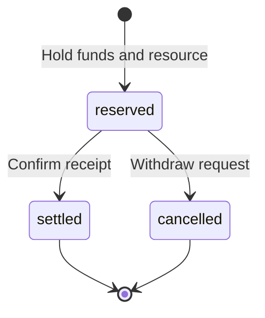

# Allocations, resources and resident provisioning

The provisioning module links accounting measure to explicit physical stock. It does not calculate monetary policy or treat an account balance as proof of physical availability.

## Allocations

`POST /v1/allocations` accepts `treasury`, `resident`, `period` (YYYY-MM-DD), `category`, `amount` and `basis`. It transfers existing measure from the treasury to a resident. Categories are `food`, `water` and `energy`; one allocation is allowed per resident, day and category. The treasury must have enough available measure. There is no implicit issuance, interest or fee.

The operator supplies the amount and experimental basis; an allocation is not automatically calculated from a needs norm. Corrections to an existing allocation require a future explicit reversal workflow.

## Physical lots

`POST /v1/resources` accepts `id`, `producer`, `category`, `unit`, `quantity`, `unit_measure` and `basis`. For example, quantity `"10"`, unit `"meal"` and unit_measure `"20"` mean ten portions with an experimental accounting norm of 20 per portion. The basis must describe both declared stock and the norm. This is an operator declaration, not independently verified growth.

Physical quantities are positive integer strings in the selected smallest unit; use milliliters if whole liters are too coarse. Physical dimensions and accounting minor units are independent. A reservation's quantity multiplied by its accounting norm must fit i64. Lots and their norms are immutable. Replenishment and norm changes require new explicit records.

`GET /v1/resources/{id}` returns `on_hand` (remaining stock), `reserved` (all active holds) and `available` (free stock). Since 0.4, physical holds include both resident and [production](production.md) reservations. Since 0.5, completed production inputs count as consumption. One stock remainder cannot be promised twice.

## Reservation and receipt

`POST /v1/reservations` accepts `resident`, `resource`, `quantity` and `basis`. It checks free stock and the resident's available measure together. The complete reservation succeeds or nothing is recorded. Reserving does not post money.

`GET /v1/accounts/{id}` separates `balance`, `reserved` and `available`. Ordinary transfers also respect held funds. `GET /v1/reservations/{id}` returns the reservation state.

`POST /v1/reservations/{id}/settle` with `{"basis":"Confirmed receipt"}` records receipt, consumes stock, releases the hold and transfers accounting measure from resident to producer atomically. `/cancel` with a basis releases both holds without postings. A settled reservation cannot be cancelled; post-receipt returns need a separate future workflow. Reservations do not expire automatically.

State derives from immutable history and a single terminal event. Concurrent settlement and cancellation have one winner. An injected posting failure leaves the reservation active and preserves money and stock.

## Idempotency and errors

Mutating provisioning routes require an operator token and `Idempotency-Key`. Keys are shared across the ledger. Identical retries return the initial receipt; changed content or a different route with the same key conflicts. Replaying creation after settlement still returns the original reserved receipt; use GET for current state.

| HTTP | Code | Meaning |
| --- | --- | --- |
| 409 | `allocation_exists` | The resident/day/category allocation already exists |
| 409 | `insufficient_funds` | Insufficient available accounting measure |
| 409 | `insufficient_stock` | Insufficient physical stock in the selected lot |
| 409 | `reservation_closed` | Already settled or cancelled |
| 409 | `idempotency_conflict` | The key belongs to different parameters |
| 409 | `balance_limit` | An accounting numeric limit was exceeded |
| 404 | `resource_not_found` / `reservation_not_found` | Unknown object |
| 503 | `storage_unavailable` | Operation not confirmed; retry with the original key |

Physical and accounting shortages are separate signals. They do not invalidate a person's need: the [needs module](needs.md) preserves unmet quantities and shortage observations. Automatic replanning remains future work. Production reservations and completion do not reserve money or create postings.
