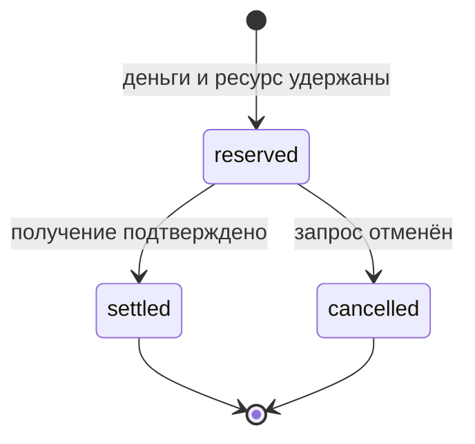

# Назначения и резервирование

Этот модуль связывает учётную меру и фактическое обеспечение в модели [организма](organism.md). Он работает с тремя категориями: `food`, `water`, `energy`. Житель пока определяется синтетическим счётом типа `resident`; реестр подтверждённых личностей ещё не подключён. Обеспечивающее подразделение использует счёт типа `producer`.

## Назначение

`POST /v1/allocations` принимает `treasury`, `resident`, `period` в формате действительной даты `YYYY-MM-DD`, `category`, `amount` и `basis`. Сумма — положительная целочисленная строка. Одна комбинация жителя, дня и категории допускает одно назначение, даже при запросах с разными ключами. При недостатке доступных средств назначение и проводки целиком откатываются. Повтор с прежним ключом возвращает исходную квитанцию.

Оператор задаёт сумму и основание. Пример экспериментальной записи:

```json
{"treasury":"00000000-0000-0000-0000-000000000002","resident":"00000000-0000-0000-0000-000000000003","period":"2026-11-02","category":"food","amount":"200","basis":"Экспериментальный норматив обеспечения, версия 1"}
```

Средства переводятся из существующего остатка казны. Назначение не создаёт новых единиц, не сгорает автоматически и не связывается с занятостью или рейтингом. Категория назначения не вводит ограничение на дальнейшее использование остатка; целевые лимиты требуют отдельного экономического решения. Исправление уже выполненного назначения должно стать отдельным сценарием обратной проводки.

## Ресурсная партия

`POST /v1/resources` принимает `id`, `producer`, `category`, `unit`, `quantity`, `unit_measure`, `basis`. Например, `quantity = "10"`, `unit = "meal"`, `unit_measure = "20"` означают десять порций с экспериментальной учётной мерой 20 на порцию. Основание должно описывать объявленный запас и применённый норматив. Это операторская декларация, не независимое подтверждение реального роста.

Физические количества — целые положительные строки в указанной минимальной единице. При необходимости дробного количества выбирается меньшая единица, например миллилитр. Размерность ресурса и денежная минимальная единица независимы. `quantity × unit_measure` проверяется на переполнение i64. Партия и её норматив неизменяемы; пополнение, изменение нормы и распределение мощности услуг будут отдельными операциями.

`GET /v1/resources/{id}` показывает `on_hand` — оставшееся количество, `reserved` — обещанное обеспечение и `available` — свободное количество. Нельзя выдавать один и тот же остаток нескольким получателям.

## Резерв и подтверждение

`POST /v1/reservations` принимает `resident`, `resource`, `quantity`, `basis`. Система проверяет одновременно свободное количество ресурса и доступную меру жителя. Резерв записывается целиком или не записывается вообще. Денежные проводки при резервировании не создаются.

`GET /v1/accounts/{id}` возвращает три отдельные величины: `balance`, `reserved`, `available`. Обычный перевод тоже учитывает резерв. Состояние резерва доступно через `GET /v1/reservations/{id}`.



`POST /v1/reservations/{id}/settle` с `{"basis":"Основание подтверждения получения"}` атомарно регистрирует получение, уменьшает физический остаток, снимает удержание и проводит учётную меру от жителя подразделению. `POST /v1/reservations/{id}/cancel` с основанием освобождает оба резерва без проводок. Подтверждённый резерв нельзя отменить этой операцией: возврат после получения требует отдельного сценария. Автоматического истечения резервов пока нет.

Статус выводится из неизменяемого резерва и единственного конечного события. При одновременном подтверждении и отмене может завершиться только одно действие. Искусственный сбой при записи проводок проверяется тестом: он оставляет резерв активным, деньги и ресурс — без изменений.

## Повторные запросы и ошибки

Все новые изменяющие маршруты требуют `Idempotency-Key` и операторский токен. Ключ един для всех команд в книге учёта. Повтор с тем же содержимым возвращает первоначальную квитанцию, а другое содержимое или другой маршрут с тем же ключом даёт конфликт. Поэтому повтор создания уже завершённого резерва возвращает исходное состояние `reserved`; текущее состояние нужно получать через GET.

| HTTP | Код | Смысл |
| --- | --- | --- |
| 409 | `allocation_exists` | Назначение за день и категорию уже существует |
| 409 | `insufficient_funds` | Недостаточно свободной учётной меры |
| 409 | `insufficient_stock` | Недостаточно реального ресурса в партии |
| 409 | `reservation_closed` | Резерв уже подтверждён или отменён |
| 409 | `idempotency_conflict` | Ключ использован с другими параметрами |
| 409 | `balance_limit` | Превышен числовой предел учёта |
| 404 | `resource_not_found` / `reservation_not_found` | Объект не существует |
| 503 | `storage_unavailable` | Операция не подтверждена; повторять с прежним ключом |

Нехватка ресурса и недостаток доступной меры отражаются раздельно. Они не объявляют потребность человека недействительной: модуль [потребностей](needs.md) сохраняет неудовлетворённое количество и причины попытки; автоматическая корректировка плана остаётся следующим этапом.

Начиная с 0.4.0, свободный физический остаток учитывает также [производственные резервы](production.md). Они не резервируют учётную меру и не создают проводки.
