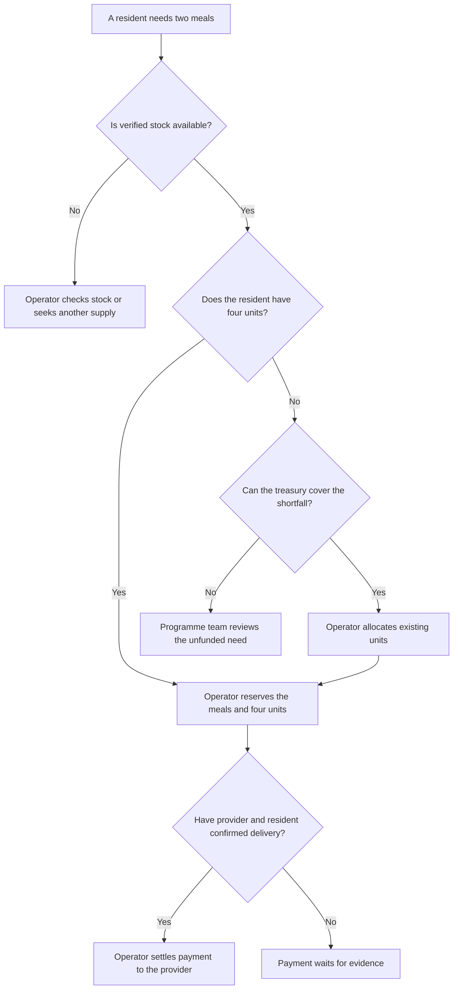
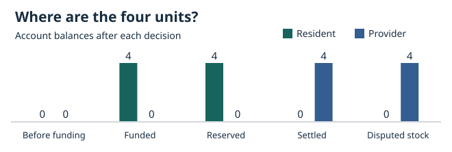

# Can a family receive two meals when its balance is zero?

Imagine a town where a kitchen can still prepare lunch after automation has reduced some residents' paid hours. The town wants people to keep eating while work changes. Qazna proposes a common treasury that can cover a person's need from funds already available. A town considering Qazna would want to know whether this rule gets lunch to more families on time than its current programme does.

Follow one resident and one operator through the working prototype. The exercise starts with **1,000 accounting units in the treasury**, **zero in the resident's account** and a request for **two meals**. Each meal carries a measure of **two units**. You can check every figure in the [record from the demonstration](../research/meal-decision.json).

### How a meal request reaches the provider



### 1. Which food can the operator promise?

One supplier entry says **100 meals**. Nobody has confirmed that batch. When the operator tries to reserve even one meal, the system reports insufficient usable stock. An inspector disputes the declaration. A separate batch contains **10 meals**. The first inspector confirms the count. A second inspector confirms it from a separate account. Only then do ten meals appear as available for reservation.

### 2. Who pays if the resident has no balance?

The operator now tries to reserve two of those ten meals. This time the stop is financial. The resident has zero units. The exercise first tries an allocation of 10,000 units to test the budget limit. The treasury rejects it and still holds 1,000. The operator then allocates the four units needed for lunch, leaving **996** in the treasury. The reservation holds two meals for the resident. All four units came from the opening budget.

### 3. When does the provider get paid?

The provider confirms handing over the meals. The operator tries to settle the payment. The system keeps the reservation open because the resident's confirmation is missing. Once the resident confirms receipt, the operator settles four units to the provider. The resident's closing balance is **zero**, just as it was at the start. The completed receipt tells us what happened between those two balance readings.

Later an inspector disputes the batch. The record still shows **eight meals on hand** but **zero available** for the next reservation. The previous receipt stands. Someone responsible for the programme would need to investigate the eight meals and arrange continuity for anyone waiting. The prototype tests how records behave when people disagree. The physical accuracy of either statement requires evidence outside the software.

### Follow the four units



The first four numeric columns below use accounting units. “Of which held” is the part of the resident's balance set aside for this order. The final two columns count meals in the verified batch.

| Stage | Treasury | Resident | Of which held | Provider | Meals on hand | Meals available |
| --- | ---: | ---: | ---: | ---: | ---: | ---: |
| Before funding | 1000 | 0 | 0 | 0 | 10 | 10 |
| Funded | 996 | 4 | 0 | 0 | 10 | 10 |
| Reserved | 996 | 4 | 4 | 0 | 10 | 8 |
| Settled | 996 | 0 | 0 | 4 | 8 | 8 |
| Disputed stock | 996 | 0 | 0 | 4 | 8 | 0 |

Read across the **Reserved** row. The kitchen still has ten meals on hand, two are held for this order, and the provider's balance is still zero. Read down the **Provider** column to see when the transfer takes place. At every stage the treasury, resident and provider balances add to 1,000.

### What decision can a town take from this?

The run shows where an operator can act. Extra funding can release a reservation when suitable food exists. Extra funding alone cannot confirm stock or establish that a resident received lunch. The exercise demonstrates these distinctions for one case. To learn whether Qazna improves access, the town would need to replay its actual meal programme, including benefits it already pays, against the proposed rule with the same stock, deadlines and budget. The outcome of interest is how many people receive suitable meals on time and who still waits. [Partner proposal and comparison criteria](pilot-charter.md#comparison-and-decision).

### Try it with a first-time reader

Give the reader this page without a briefing. Ask them to point to the evidence for their answer. Record the reader's words and the passage where they hesitated.

| Reader | Question | What a clear explanation should let them identify |
| --- | --- | --- |
| Programme director | Where did the four units come from? What would justify a pilot? | The existing treasury budget and a comparison with the local programme under equal constraints. |
| Operator or resident representative | If the provider says it handed over lunch and the resident disagrees, what happens? | The provider alone cannot trigger payment. A person needs a way to challenge the record and obtain help. |
| Independent evaluator | At the end, why can the next family use none of the eight remaining meals? What would you check in the field? | A dispute blocked further reservations. A stock count and delivery evidence are needed to establish what happened. |

If a reader concludes that Qazna issued new money, observed real deliveries or demonstrated superiority to the local programme, mark the passage that led to that conclusion and revise it before recruiting a pilot. No reader interviews are reported here.

### Reproduce the record

From the Qazna project directory, build the server and run the existing exercise. It starts its own temporary database. Set `PG_BIN` to your PostgreSQL binary directory if needed. [Build requirements](../README.md#run-the-checks).

```sh
cargo build --locked --bin qazna
python3 scripts/evidence_exercise.py
```

The command prints the result directory. Open `meal-decision.json` there to compare the figures above. The adjacent `events.jsonl` gives each request, the role that made it and the service's response. For example, the two failed reservations record `insufficient_stock` and `insufficient_funds`. The attempt to settle with only the provider's confirmation records `evidence_required`. The [full project check](../scripts/check.py) compares the fresh decision record with the published copy.
