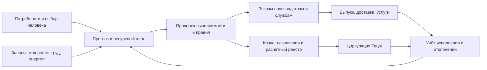

# Рабочая математическая модель экономики Теңге

## Пятилетний демографический и отраслевой план: 100 млн жителей

### 1. Назначение и уровень готовности

Модель объединяет возрастные группы, рождение и смертность, детские сады, школы, дальнейшее образование, здравоохранение, жилищное строительство, десять секторов и предварительные бюджетные показатели. Цель — обеспечение по потребности независимо от занятости и возможность дополнительного обеспечения за согласованный вклад, при общественном управлении природными ресурсами и единой Казне. Сценарий синтетический, все параметры и цены, кроме указанных ориентиров, выбраны для иллюстрации; он не описывает реальную страну и не является завершённым бюджетом или оптимизацией. Конкретные персональные потребности, инвалидность, беременность и региональные различия в агрегированной модели пока не рассчитаны.

### 2. Поколения и услуги

Старт: 25 млн человек 0–14 лет, 65 млн 15–64 года, 10 млн 65–100 лет. Внутри каждого диапазона население распределено равномерно по возрастам, что является демонстрационной конструкцией, а не возрастной пирамидой реальной страны. 100-летние включают также возраст старше 100; никакого принудительного ограничения продолжительности жизни нет. На ежегодных шагах:

```
Pₜ = Σₐ Nₐₜ; Bₜ = 0,018 Pₜ; Dₜ = 0,008 Pₜ
qₐₜ = (0,008 Pₜ) wₐ / Σᵦ(Nᵦₜ wᵦ)
N₀,ₜ₊₁ = Bₜ
Nₐ₊₁,ₜ₊₁ = Nₐₜ(1−qₐₜ), a=0…99
N₁₀₀,ₜ₊₁ = N₉₉,ₜ(1−q₉₉,ₜ)+N₁₀₀,ₜ(1−q₁₀₀,ₜ)
```

Миграция в примере нулевая. w₀=1,5; w₁₋₁₄=0,3; w₁₅₋₆₄=0,6; w₆₅₊=6 — искусственные веса смертности, нормируемые к 8 на 1000. Числа 18 рождений и 8 смертей на 1000 — выбранные коэффициенты, а не мировые средние; их можно заменить возрастными показателями конкретного государства. Модель не выводит рождаемость из числа женщин по возрастам и не моделирует возрастную/половую структуру беременностей; для настоящего плана требуется когортная рождаемость. Доступные исходные ряды — [ООН WPP 2024](https://population.un.org/wpp/) и [таблицы Всемирного банка](https://wdi.worldbank.org/table/2.1).

Детский сад — население 3–5 лет, школа — 6–17 лет; дополнительное образование — условно 55% группы 18–22, при праве выбирать любое направление и возрасте. Результат — плановые места при 100% охвате указанной возрастной группы сада и школы, без учёта неполного дня, географии и особых потребностей. Преподаватели — сад/20 + школа/23 + дальнейшее образование/15: это принятые проектные нормативы, а не универсальный стандарт. Для сопоставления: [ЮНЕСКО](https://unesdoc.unesco.org/in/rest/annotationSVC/DownloadWatermarkedAttachment/attach_import_02686c60-51c5-4704-8eac-4bc489231fa3?_=388832eng.pdf) приводит мировой показатель 22,8 ученика на учителя начальной школы за 2022 год; он не доказывает пригодность выбранных отношений для всех уровней. Медицинский персонал — 49 врачей, медсестёр и акушерок на 10 000 человек, ориентир медианы в работе [ВОЗ](https://www.who.int/publications/i/item/9789240069787), не норма достаточности и не разделение по специальностям.

| Год | Население, млн | Рождения, млн | Смерти, млн | Сад 3–5, млн | Школа 6–17, млн | Дальнейшее образование, млн | 65+, млн | Преподаватели, млн | Медработники, млн |
|---|---:|---:|---:|---:|---:|---:|---:|---:|---:|
| 1 | 100,000 | 1,800 | 0,800 | 5,000 | 18,900 | 3,575 | 10,000 | 1,310 | 0,490 |
| 2 | 101,000 | 1,818 | 0,808 | 4,989 | 19,218 | 3,559 | 10,852 | 1,322 | 0,495 |
| 3 | 102,010 | 1,836 | 0,816 | 4,978 | 19,539 | 3,544 | 11,678 | 1,335 | 0,500 |
| 4 | 103,030 | 1,855 | 0,824 | 4,953 | 19,862 | 3,529 | 12,481 | 1,347 | 0,505 |
| 5 | 104,060 | 1,873 | 0,832 | 5,064 | 19,823 | 3,716 | 13,261 | 1,363 | 0,510 |

Число 65+ — возрастная группа, а не фактическое число пенсионеров; возраст выхода, инвалидность и трудовые решения различаются. Рост доли старших во многом обусловлен искусственной начальной пирамидой. Потребность в строительстве жилья приближённо: 0,5 млн замен в год плюс прирост населения, делённый на три человека в домохозяйстве; это не прогноз количества домохозяйств, очереди, ветхого жилья и площади. В модели получается 0,500; 0,833; 0,837; 0,840; 0,843 млн жилищ по годам.

Проверка чувствительности при тех же исходных когортах и смертности: 15, 18 и 21 рождение на 1000 дают к началу пятого года соответственно 102,830; 104,060 и 105,302 млн жителей. Это три механических сценария, а не интервалы достоверного прогноза. Изменение 65+, образования и потребностей можно получить повторным запуском функции с соответствующим параметром.

### 3. Производственные балансы

Десять секторов: пища F, энергия E, вода W, строительство H, здоровье M, образование U, транспорт T, промышленность I, цифровая инфраструктура D, уход C. Все отраслевые выпуски — миллионы условных стандартных наборов в год; строительство — миллионы условных жилищ. Показатели не являются киловатт-часами, литрами или медицинскими посещениями. Конечный спрос принят как (P,1,2P,P,жильё,P,сад+школа+учащиеся,P,0,6P+10,P,0,5×65+). Например, 10 дополнительных промышленных наборов — заранее выбранное направление на общественное развитие; само по себе оно ещё не доказывает создание заданного объёма школ и оборудования.

Матрица A хранится в функции `demographic_five_year_state`: строки — затраченный сектор, столбцы — производящий. Спрос на энергию, воду, промышленность, цифровые услуги и транспорт есть как у людей, так и у производства. Выпуск вычисляется из `(I−A)x=f`; для каждого сектора проверяется `xᵢ−Σⱼaᵢⱼxⱼ−fᵢ=0`. В год 1 результат: пища 100; энергия 178,855; вода 113,951; строительство 0,5; здоровье 100; образование 27,475; транспорт 111,985; промышленность 126,357; цифровая инфраструктура 118,048; уход 5 млн условных наборов. Промежуточные поставки не прибавлены второй раз к конечному спросу. Матрица условна, цены разных физических наборов не сопоставлены с национальными таблицами.

Природный запас: Z₁=2500 млн единиц, ежегодная добыча `0,20×выпуск промышленности + 0,05×выпуск энергии`, Zₜ₊₁=Zₜ−Dₜ. В конце пятого года остаток 2325,630 млн. Окружающая среда, вода по регионам, восстановление и экологические лимиты должны быть добавлены до практического использования; общественная собственность сама не гарантирует экологической устойчивости. Стандарт раздельного учёта физических потоков и запасов описан в [SEEA ООН](https://seea.un.org/en/methodology/seea-central-framework).

### 4. Пример финансовой оценки

Для демонстрации выбраны условные цены конечных наборов в Теңге: F=200, E=100, W=40, H=1000, M=180, U=150, T=120, I=130, D=60, C=120. Стоимость `Σpᵢfᵢ` измеряется в **млн Теңге за год**; суммы не взяты из тарифов или смет реальной страны. В год 1 оценка: питание 20 000; энергия 12 000; вода 4000; жильё 500; здоровье 18 000; образование 4121,25; транспорт 12 000; промышленность 9100; цифровая инфраструктура 6000; уход 600 млн Теңге. Всего 86 321,25 млн; по годам 87 547,41; 88 450,56; 89 358,62; 90 269,68 млн, за пять лет 441 947,51 млн.

Это **оценка конечного потока**, а не бюджет Казны в строгом смысле: здесь ещё не отделены начисления гражданам от прямого предоставления, стоимость закупок между общественными производствами, содержание мощностей, выплаты за вклад, погашение незаконченного строительства и кассовый график. Нельзя складывать эту сумму с денежной оценкой промежуточного выпуска и называть её общими затратами — товары будут посчитаны дважды. Цены за наборы приняты произвольно, а не выведены из себестоимости; отсюда нельзя утверждать, что система финансово обеспечена. Потребуются поквартальные/ежедневные проводки Казны и проверка кассовых остатков, а также правила стабильной эталонной корзины, эмиссии и внешних расчётов.

### 5. Математическое программирование и дальнейшая проверка

Постановка LP в разделе ниже применима к 10 секторам и 5 годам после замены четырёхмерных векторов десятикомпонентными. Дополнения: матрицы труда по специальностям, мощности детских садов и школ, медицинские специальности, жильё, инфраструктура и задержки ввода, экологические и региональные ограничения, отдельные гарантированные потребности и дополнительные блага, а также бюджетные потоки по периодам. Начисление не должно зависеть от статуса занятости. Решатель не запущен; расчёт выше решает только систему линейных отраслевых уравнений, без оптимизации, проверки реальных мощностей и доступности работников за пределами двух кадровых индикаторов.

Исполнение `python3 research/scripts/tenge_circulation_model.py`; функция `demographic_five_year_state` использует стандартную библиотеку и проверяет демографическое и межотраслевое равенства. Для полноценного плана ещё необходимы возрастные данные, фактические физические единицы и снабжение, участие и свободный выбор людей, технологические матрицы и реальная экономика времени. Исследовательская модель не представляет собой рекомендации по внедрению без независимой оценки.

## Пятилетняя модель государства с населением 100 млн: межотраслевой расчёт и постановка оптимизации

Эта версия — воспроизводимый синтетический расчёт, а не данные какой-либо страны. Единицы выпуска — миллионы условных стандартных годовых наборов соответствующей отрасли; один набор пищи, энергии, услуг здоровья и промышленных благ различается по содержанию. Население в начале первого года — 100 млн; рост на 1% в год задан для примера. Ресурсные и трудовые коэффициенты условны и требуют замены реальной статистикой. Рассчитана выполнимость одного заранее заданного плана. Математическая задача оптимизации ниже сформулирована, но решатель в доступной среде отсутствует, поэтому оптимум не заявляется.

### Межотраслевая технология

Строка матрицы A — ресурс, столбец — производимый набор; коэффициент aᵢⱼ — объём i на единицу выпуска j. Отрасли по порядку: пища F, энергия E, здоровье H, промышленность M:

```
          F     E     H     M
F       0     0     0     0
E      0,20   0    0,20  0,15
H       0     0     0     0
M      0,10  0,08  0,05  0,10
```

Финальный спрос fₜ = (Nₜ, 1,2Nₜ, Nₜ, 0,4Nₜ+10), где Nₜ = 100×1,01^(t−1) млн человек, t=1…5. Последние 10 млн условных промышленных наборов ежегодно направлены на развитие и обслуживание. Они уже включены в конечный спрос и не прибавляются повторно к промежуточному потреблению. Отдельного энергетического спроса ИИ в этом числовом наборе нет: его нужно ввести в f или в технологические коэффициенты при наличии данных, не считая дважды. В первом приближении: **(I − A)xₜ = fₜ**, xₜ ≥ 0. Расчёт ведётся прямым решением системы, остаток каждой строки проверяется с точностью 10⁻²⁰ млн наборов. Нулевые запасы и внешняя торговля — допущения примера.

Ограничения: начальные мощности K₁=(140,200,120,110), годовые множители (1,05; 1,05; 1,03; 1,04); xⱼₜ ≤ Kⱼₜ. Это заданные траектории, а не результат расчёта строительства: расходы в 10 наборов пока не связаны технической нормой с приростом мощностей. Труд Σ(0,07; 0,04; 0,10; 0,08)ⱼ xⱼₜ ≤ 80 млн условных рабочих дней в год; квалификации и доступность работников пока объединены. Добыча Dₜ=0,05xEₜ+0,25xMₜ ≤80 млн условных единиц, невозобновимый запас Z₁=1000, Zₜ₊₁=Zₜ−Dₜ, Zₜ₊₁≥700. Это демонстрационный лимит, не экологическая оценка реального месторождения.

| Год | Население, млн | Пища | Энергия | Здоровье | Промышленность | Запас на конец |
|---|---:|---:|---:|---:|---:|---:|
| 1 | 100,000 | 100,000 | 173,142 | 100,000 | 87,613 | 969,440 |
| 2 | 101,000 | 101,000 | 174,856 | 101,000 | 88,376 | 938,603 |
| 3 | 102,010 | 102,010 | 176,588 | 102,010 | 89,147 | 907,487 |
| 4 | 103,030 | 103,030 | 178,337 | 103,030 | 89,926 | 876,088 |
| 5 | 104,060 | 104,060 | 180,104 | 104,060 | 90,713 | 844,405 |

При снижении энергетической мощности первого года на 50, с 200 до 150, вычисленный выпуск 173,142 превышает её на 23,142; заданный план не проходит проверку. Код не вычисляет альтернативное распределение. Проверка повышения конечного спроса на 10% проходит при остальных исходных допущениях, но не устанавливает устойчивость к любым сбоям.

### Постановка линейной программы на пять лет

Переменные по каждому t: выпуск xₜ∈R⁴₊, распределение базовых благ cₜ∈R⁴₊, дополнительных благ eₜ∈R⁴₊, запасы sₜ∈R⁴₊, мощность kₜ∈R⁴₊, ввод мощностей bₜ∈R⁴₊ и добыча dₜ≥0. Наборы конечных потребностей nₜ и желаемых дополнительных благ qₜ задаются отдельно; m≥0 — общий минимальный коэффициент удовлетворения базовых потребностей, ограниченный 0≤m≤1. При необходимости групп людей индексы c и n расширяются по группам: в текущем агрегате индивидуальное равенство доказать нельзя.

При фиксированных A, матрице затрат B на ввод мощностей, коэффициентах износа δ и параметрах имеем строки ограничений:

```
(I−A)xₜ − cₜ − eₜ − B bₜ + sₜ − sₜ₊₁ = 0
xₜ − kₜ ≤ 0
kₜ₊₁ − diag(1−δ)kₜ − bₜ = 0
Lxₜ + Hbₜ ≤ ℓₜ
gᵀxₜ + hᵀbₜ − dₜ ≤ 0
zₜ₊₁ − zₜ + dₜ = 0
0 ≤ dₜ ≤ dmaxₜ; zₜ ≥ zmin
0 ≤ cₜ ≤ nₜ; cⱼₜ ≥ m nⱼₜ; 0 ≤ eₜ ≤ qₜ
```

Здесь L и H — матрицы труда по квалификациям; g и h — природный ресурс для работы и строительства. Промежуточные и строительные коэффициенты согласуются без двойного счёта. Матрица B связывает реальный ввод с ресурсами, однако её числовые коэффициенты пока не заданы; поэтому приведённый выше расчёт с фиксированными мощностями не является решением этой задачи. В первом периоде s₁, k₁ и z₁ заданы. Импорт и экспорт, сроки строительства более года, выбросы, медицинские нормы, индивидуальные запросы и право выбора должны добавляться явными ограничениями.

Лексикографическая цель: сначала максимизировать m; затем при зафиксированном оптимальном m минимизировать суммарный неудовлетворённый базовый спрос; затем, не ухудшая предыдущих результатов, максимизировать согласованное дополнительное обеспечение и показатели долгосрочной устойчивости. Для сопоставления разных благ нужны открыто утверждённые веса и приоритеты; они не являются оценкой достоинства человека. При m<1 модель показывает, что введённые ограничения не позволяют обеспечить все заданные потребности. Для построения матрицы LP каждая строка приведена к виду Aeq v=beq или Aub v≤bub; компоненты v объединяют все x,c,e,s,k,b,d,z,m за пять лет. Постановка позволяет использовать, например, [HiGHS через SciPy](https://docs.scipy.org/doc/scipy/reference/optimize.linprog-highs-ds.html); решение и проверка остатков ещё предстоят.

### Финансирование и пределы вывода

Предварительная кассовая оценка: условные цены пищи 2, энергии 1, промышленного набора 3 Теңге. Людям выделяется 2N+1,2N+3×0,2N = 3,8N млн Теңге; прямое общественное обеспечение здоровья и промышленных наборов — N+3(0,2N+10) млн. В первом году это 380 и 190 млн. При последовательном полном возврате каждого потока Казне 500 млн позволяет осуществить оба платежа, хотя их сумма 570 млн; это условие о скорости возврата, а не доказанный финансовый план. Программа проверяет размер каждого платежа и не выполняет проводки по этой пятилетней модели. Межотраслевые денежные расчёты, расходы производителей, зарплаты и кассовые задержки в ней не реализованы; отсюда нельзя заключать, что страна уже обеспечена финансированием.

Межотраслевую запись и экологические счета можно проверять по [методике ONS](https://www.ons.gov.uk/economy/nationalaccounts/supplyandusetables/articles/inputoutputanalyticaltables/guidanceforuse) и [SEEA ООН](https://seea.un.org/en/methodology/seea-central-framework). Пример исполняется через `python3 research/scripts/tenge_circulation_model.py`, функция `five_year_state`; старые демонстрации сохраняются. Следующие необходимые работы: калибровка реальными данными, численная матрица B и решение LP, раздельные профессии и потребности, ИИ и энергия, проверка временных лагов, балансов Казны, природопользования и международных взаимных поставок.

## Трёхлетняя модель условного государства: версия 1

**Назначение.** Согласовать ежедневное обеспечение людей, поддержание и развитие производства, общественное управление природными ресурсами и обращение Теңге в единой Казне. Это проверяемый сценарий с условными параметрами и заранее заданным планом, не доказательство оптимальности и не готовая модель реального государства. Годовые итоги агрегируют операции внутри года; устойчивость ежедневной ликвидности и доставка по отдельным адресам в примере не рассчитаны. Действующие законы, технологии и данные страны здесь не заменяются предположениями.

### Уравнения плана

1. **Потребности и выбор:** nᵢⱼₜ — запрос человека i на благо j в период t, включая гарантированную основу и согласованные дополнительные блага. Nⱼₜ = Σᵢ nᵢⱼₜ. Прямые услуги учитываются отдельно от покупок. Общий объём потребностей не зависит от занятости; индивидуальный выбор, обучение и посильное участие добровольны.
2. **Поток ресурсов:** Sⱼₜ + xⱼₜ + Iⱼₜ = Nⱼₜ + Σₖ aⱼₖxₖₜ + zⱼₜ + mⱼₜ + Wⱼₜ + Xⱼₜ + Sⱼ,ₜ₊₁. Здесь x — выпуск, a — промежуточные затраты на выпуск, z — ИИ, m — обслуживание и развитие мощностей, I и X — ввоз и вывоз, W — потери. Каждая строка — один продукт в своих натуральных единицах. Запасы и зарубежная торговля в числовом примере равны нулю; природный ресурс учитывается отдельным балансом ниже.
3. **Мощности и труд:** xⱼₜ ≤ Kⱼₜ; Kⱼ,ₜ₊₁ = Kⱼₜ − dⱼₜ + bⱼₜ, где d — износ, b — ввод нового оборудования к следующему году. Σⱼ lⱼₛₜ xⱼₜ + hₛₜ ≤ Lₛₜ по каждой специальности s. В примере использована одна условная категория труда; реальному плану необходимы отдельные профессии и графики.
4. **Общественный природный ресурс:** Zₜ₊₁ = Zₜ − Dₜ, при 0 ≤ Dₜ ≤ Zₜ и экологическом пределе Dₜ ≤ Dmax. Затраты на восстановление среды должны войти в ресурсный план; они не рассчитаны в примере. Запас не следует смешивать с годовым выпуском. Разведочное переоценивание также учитывается отдельно.
5. **Мера Теңге:** при установленных ценах на блага, выдаваемые через счёт, Pₜ = Σᵢⱼpⱼnᵢⱼₜ. Казна перечисляет P людям; за предоставленные блага средства поступают общественным производствам, которые по правилу данного примера полностью возвращают их Казне. Для прямых услуг и обслуживания Казна также производит отдельные выплаты. K + H + F = M; Mₜ₊₁ = Mₜ + Eₜ − Rₜ. В примере E = R = 0 и проводки идут последовательно; при иных сроках нужно проверять каждый платёж. Постоянная стоимость эталонной корзины — общественное правило и цель, а не физическая константа и не гарантия наличия благ.
6. **Цель планирования:** вначале стремиться к полному обеспечению согласованных основных потребностей каждого; затем, при физической возможности, обеспечивать дополнительные блага и утверждённое развитие. Общество определяет приоритеты, ИИ рассчитывает варианты и ограничения, человек может оспорить решения. Подробная оптимизационная постановка с данными и разрешением конфликтующих целей ещё не реализована.

### Параметры демонстрации

В начале — 100 жителей, в последующие годы 105 и 110; годовое потребление каждого — 1 условная единица пищи и 1 энергии, дополнительно 5 единиц пищи на всё общество. Лечение — 0,1 условной единицы на человека, предоставляется напрямую. Энергия: 0,2 на единицу пищи, 0,5 на единицу лечения, 10 для ИИ и 4 на обслуживание и развитие. Трудочасы: 0,2 на пищу, 0,1 на весь выпуск энергии, 2 на лечение и 10 на обслуживание и развитие; доступно 80 часов. Эти величины и одинаковые потребности лишь иллюстрируют механизм, не предполагают одинаковых потребностей в действительности.

Начальные годовые мощности: пища 110, энергия 150, лечение 12. В конце года они меняются соответственно на +10−5, +10−5 и +1−0,5 за счёт развития и износа; в модели ввод доступен только в следующем году. Минеральный запас 100, расход 9 ежегодно: 5 на работу и 4 на обновление и расширение. Нормативный максимум добычи для примера — 9 в год. Энергия, минерал и труд для развития включены в указанные выше потребности, но другие материалы, строительство, загрязнение и транспорт ещё не представлены.

| Год | Жители | Пища | Энергия всего | Лечение | Часы | Минерал на конец | Мощность пищи / энергии на начало |
|---|---:|---:|---:|---:|---:|---:|---:|
| 1 | 100 | 105 | 140 | 10 | 65 | 91 | 110 / 150 |
| 2 | 105 | 110 | 146,25 | 10,5 | 67,625 | 82 | 115 / 155 |
| 3 | 110 | 115 | 152,5 | 11 | 70,25 | 73 | 120 / 160 |

Дробные значения — расчётные агрегаты, например тысячи услуг или часов, не утверждение, что отдельного человека делят на части. План проходит контроль заданных мощностей, труда и запаса в каждый год. Он расходует невозобновимый запас и потому не доказывает устойчивость после третьего года. Цены условны: пища — 2 Теңге, энергия для людей — 1. Начальная Казна 400; выплаты людям составляют 310, 325 и 340 по годам, а отдельные выплаты за лечение и обслуживание/развитие — 50 ежегодно. Проводки организованы последовательно, поэтому 400 хватает на каждый платёж; в конце каждого года Казна вновь имеет 400, у людей и производств нулевой остаток, эмиссия равна нулю. Развитие реально отражено через материальные ресурсы и изменение мощности, но 50 — заранее заданная учётная оценка, не расчёт полной себестоимости. Внутренние расчёты за энергию и минералы, заработная плата, денежное финансирование поставщиков, ремонт, внешняя торговля и недельная кассовая последовательность пока не моделируются. По правилу примера производственные поступления полностью возвращаются Казне, а физические ресурсы выделяются по общественному плану; это допущение ещё требует работоспособного механизма для всех участников.

**Проверка нарушения плана.** При уменьшении мощности энергии во втором году на 20, с 155 до 135, расчётная потребность 146,25 превышает мощность на 11,25. Код прекращает расчёт до выдач и не заявляет, что потребности удовлетворены. Правила перестройки плана, распределения при дефиците и защиты прав людей пока требуют отдельного проектирования; этот тест не означает, что система должна допускать нехватку как норму.

### Кооперация государств

Для партнёров A и B необходимо отдельно учитывать физические поставки каждого блага q(A→B) и q(B→A), их качество, сроки, транспорт и экологические последствия. Денежные расчётные записи ведутся по взаимно согласованной методике; равенство сумм в выбранной единице само по себе не подтверждает равноценность или выполнение поставок. Права и свобода сторон, способ урегулирования разницы потоков, ограничения внешней конвертации и неисполнения обязательств определяются соглашением. Демонстрационный код представляет закрытую систему и не доказывает осуществимости международного расчёта.

Учёт потоков и запасов природной среды сопоставим с подходом [SEEA ООН](https://seea.un.org/en/methodology/seea-central-framework), а межотраслевые зависимости — с [таблицами затрат и выпуска](https://www.ons.gov.uk/economy/nationalaccounts/supplyandusetables/articles/inputoutputanalyticaltables/guidanceforuse); эти методы используются как инструменты проверки, без принятия существующих финансовых институтов. Воздействие ИИ на задачи не является само по себе прогнозом увольнений ([МОТ](https://www.ilo.org/publications/workers%E2%80%99-exposure-ai-what-indicators-tell-us-%E2%80%93-and-what-they-dont)).

Запуск проверки: `python3 research/scripts/tenge_circulation_model.py`. Требуется следующий этап: реальные данные, несколько отраслей и квалификаций, объективные границы среды, обработка неопределённости и событий, многоэтапная касса и независимая проверка. Существующие проекты Qazna не реализуют этот сценарий автоматически; текущая базовая операция Transfer не поддерживает обычную выплату со счёта типа treasury. Рукопись и печатный PDF не изменены.

## Природные ресурсы и два уровня обеспечения

Природные ресурсы — общественное достояние: земля, вода, полезные ископаемые и другие природные блага учитываются и управляются в интересах всех поколений. Право эксплуатации не даёт отдельному человеку права присвоить сам природный ресурс или исключить других из получения достойного обеспечения. В конкретном государстве переход к такому устройству требует отдельных законных процедур, договорённостей и экологических гарантий; данная формулировка — принцип модели, а не описание действующего права.

Для ресурса r и периода t натуральный баланс: Zᵣ,ₜ₊₁ = Zᵣ,ₜ + Gᵣ,ₜ − Dᵣ,ₜ − Wᵣ,ₜ, где Z — установленный запас, G — естественное восстановление, D — добыча, W — потери и деградация. Все величины измеряются в одних физических единицах; для невозобновимого ископаемого G обычно принимается равным нулю на практическом горизонте. Оценка запаса может пересматриваться при разведке: изменение знаний учитывается отдельно от физического восстановления. Добыча ограничена подтверждёнными запасами, безопасной мощностью и утверждёнными экологическими пределами. Вода, восстановление природы, утилизация и энергия учитываются как реальные затраты; нельзя раздать один и тот же ресурс одновременно будущим и нынешним потребителям.

**Гарантированная основа.** Каждому человеку i полагается обеспечение по индивидуальным потребностям Bᵢ = Σⱼpⱼnᵢⱼ для тех благ, которые предоставляются через начисление; услуги прямого предоставления учитываются отдельно. Достойное обеспечение не зависит от возраста, инвалидности, здоровья, занятости, востребованности и способности внести вклад. Потребности разных людей могут различаться: равное достоинство не означает одинаковой суммы. Уход, воспитание, творчество и неоплачиваемая помощь также имеют общественную ценность.

**Дополнительное признание.** Сверх гарантии общество может предоставлять Dᵢ ≥ 0 за востребованную профессиональную деятельность, творческий вклад или талант. Общая плановая мера человека Aᵢ = Bᵢ + Dᵢ, без уменьшения Bᵢ из-за отсутствия Dᵢ. Добавка может быть как начислением на выбранные человеком дополнительные блага текущего периода, так и непосредственно предоставленными возможностями, например оборудованием, обучением или условиями для творчества. Одни и те же блага нельзя одновременно учитывать и как денежную выплату, и как прямую услугу. Эта мера не является депозитом или правом на накопление; как именно согласуется запрос на дополнительные блага и период предоставления, ещё необходимо определить.

Пример общественно утверждаемого правила — Dᵢ = αVᵢ + βCᵢ при α, β ≥ 0, где V и C представляют проверяемые показатели добровольного профессионального и творческого вклада, приведённые к согласованным единицам, а коэффициенты выражают общественный выбор. Формула демонстрирует структуру и не устанавливает, что талант или человеческое достоинство измеряются одной цифрой. Реальные критерии должны учитывать разные профессии, коллективное авторство, качество и доступность творчества; популярность, алгоритмический рейтинг и текущий спрос не могут автоматически выступать единственным мерилом таланта. Нужны публичные правила, участие людей и обжалование; ограниченные физические ресурсы требуют проверки до обещания дополнительных благ.

**Проверка.** Три человека имеют базовые потребности по 10 условных Теңге; двум дополнительно предусмотрено 3 и 2. Начисления: 10, 13 и 12; суммарно 35. При наличии 35 единиц одного условного блага и его цене 1 Теңге за единицу Казна перечисляет 35, люди получают 35 единиц, общественное производство возвращает 35 в Казну. Новая эмиссия не нужна. Это упрощение с одинаковыми потребностями и полным снабжением: на практике индивидуальная основа различается, а расходы на производство, восстановление природной среды и будущие мощности рассчитываются дополнительно. Если ресурсов на базовые и дополнительные блага одновременно недостаточно, пример не доказывает их доступность; приоритет гарантий и дальнейшие правила определяются обществом.

Числовая проверка добавлена в `universal_and_extra_example` рабочего скрипта. Она не оценивает реальную востребованность специалистов и не назначает человеку вознаграждение алгоритмом. Для перехода к применению необходимо разработать публичную процедуру признания, физические балансы природопользования, показатели среды и механизм добровольного согласования запросов.

## Единая расчётная модель: потребности, ресурсы, Теңге и автоматизация

Этот раздел объединяет расчётные правила в исследовательский прототип. Период t может быть днём, месяцем или годом; все составляющие одного уравнения должны относиться к одинаковому периоду и территории. Обеспечение человека не зависит от наличия работы, а участие в труде и обучение остаются свободным выбором. Нет частного кредита, процента, депозитов, налогов и торговли единицей Теңге. ИИ предлагает план, люди утверждают правила и могут оспорить ошибку; здоровье и персональные запросы защищены. Это проект модели, а не доказанная схема экономики целой страны.

**1. Потребности.** nᵢⱼₜ ≥ 0 — согласованное с человеком количество блага j для человека i; Nⱼₜ = Σᵢnᵢⱼₜ. Человек изменяет запросы; для общественных услуг, например скорой помощи, потребность оценивается отдельно, чтобы не считать одну услугу дважды. Выданное количество cᵢⱼₜ, остаток uᵢⱼₜ = max(0, nᵢⱼₜ − cᵢⱼₜ). Цель — uᵢⱼₜ = 0 для установленных потребностей, в том числе людей с инвалидностью и без работы. Разные категории срочности определяются открытым общественным правилом, а не рейтингом полезности человека.

**2. Производство.** xⱼ — выпуск блага j в его физических единицах; aⱼₖ — количество j, необходимое для выпуска одной единицы k; zⱼ — отдельные расходы на работу, обслуживание и обучение ИИ, не включённые в коэффициенты a, чтобы исключить двойной счёт. При нулевом изменении запасов и без внешней торговли условие обеспечения: xⱼ ≥ Nⱼ + Σₖaⱼₖxₖ + zⱼ. В общем случае добавляются начальные и конечные запасы, ввоз, вывоз и потери согласно натуральному балансу ниже. Промежуточные затраты измеряются в единицах каждого ресурса; их нельзя складывать напрямую. Межотраслевые коэффициенты — известный способ выразить зависимость выпуска от поставок, адаптируемый здесь к натуральным единицам ([ONS](https://www.ons.gov.uk/economy/nationalaccounts/supplyandusetables/articles/inputoutputanalyticaltables/guidanceforuse)).

**3. Мощности и труд.** 0 ≤ xⱼ ≤ Kⱼ; Σⱼlⱼₛxⱼ + hₛ ≤ Lₛ для каждой специальности s: K — доступная мощность, l — трудоёмкость, h — обслуживание инфраструктуры, L — добровольно доступные часы с нужной квалификацией. При автоматизации l и K могут измениться, а z и h увеличиться. Часы врачей, строителей и педагогов не взаимозаменяемы без подготовки. План должен учитывать сроки строительства, доставки и обучения, а также техническое обслуживание и запасы. Результат не определяет, кому жить или где работать.

**4. Денежное обращение и стабильная мера.** При установленных учётных ценах pⱼ потребность человека Pᵢ = Σⱼpⱼnᵢⱼ для благ, предоставляемых через расчётный счёт. Прямая общественная услуга не учитывается второй раз как денежная покупка. Выплата Казны человеку, оплата полученного блага и внутренний возврат средств производства — отдельные проводки; сумма M = Kказна + Hлюди + Fпроизводства меняется только на санкционированный выпуск минус изъятие, не на перевод. Выплата требует наличия Казны в соответствующий момент, а не только равенства сумм в конце периода. Эквивалент эталонной корзины определяется общественным правилом; постоянная номинальная стоимость сама не гарантирует наличия благ. Расходы на обслуживание, обновление мощностей и снабжение производств требуют отдельного бюджета и графика, они не исчезают при внутреннем обороте.

**5. Автоматизация и право на обеспечение.** Для заданного производственного плана сокращение необходимых часов ΔL = Lдо − Lпосле может дать время для образования, ухода, искусства, отдыха или иной добровольной деятельности. Счёт обеспечения Pᵢ рассчитывается по потребности, а не по отработанному времени; поэтому сокращение рабочих часов само по себе не уменьшает обеспечение человека. Снижение трудозатрат не гарантирует роста выпуска: оно зависит от оборудования, электроэнергии, сырья и доступности специалистов. Подверженность профессии воздействию ИИ не равна предсказанному увольнению: [МОТ, 2026](https://www.ilo.org/publications/workers%E2%80%99-exposure-ai-what-indicators-tell-us-%E2%80%93-and-what-they-dont).

**6. Проверенный числовой сценарий.** За один условный период 100 людям нужно 100 единиц пищи и 100 единиц энергии. На изготовление одной единицы пищи требуется 0,2 единицы энергии. До внедрения ИИ общий выпуск энергии должен быть 100 + 20 = 120, а условная потребность в труде — 80 часов. После внедрения ИИ, если его обслуживание дополнительно потребляет 10 энергии, потребуется 130 единиц энергии и по сценарию 55 часов труда. При мощности 100 пищи и 135 энергии оба варианта обеспечивают потребности; экономия труда составляет 25 часов, дополнительный расход энергии — 10. Эти числа — допущения, а не измеренный эффект ИИ.

Если пища учитывается по 2 Теңге, энергия для людей по 1 Теңге, Казна перечисляет людям 300 имеющихся Теңге; люди получают блага на 300, сумма возвращается в Казну через общественные производства. Остаток в системе — те же 300, новая эмиссия не нужна. Для простоты внутренняя передача энергии производству и энергия ИИ отражены только в натуральном балансе, без отдельной денежной проводки. Производственные затраты, восстановление оборудования и сроки поступлений в этом однопериодном примере не закрыты расчётом.

При снижении доступной мощности энергии до 115 потребность 130 превышает её на 15: одновременно выполнить все заданные условия нельзя. Программа фиксирует этот разрыв и не выдумывает, кому урезать предоставление. Практическое решение требует заранее согласованных правил срочности, восстановления снабжения и корректировки плана. Этот сценарий проверяет качество планирования, а не предлагает считать дефицит нормой.

**7. Контур управления.** На каждом пересчёте: обновить добровольно предоставленные запросы и обезличенные показатели → рассчитать физический план и сроки → проверить мощности и кассовую последовательность → предоставить блага и записать фактическое выполнение → пересчитать план. Показатели: доля потребностей, обеспеченных в срок; максимальная задержка жизненно важных услуг; натуральные запасы и мощности; доступные средства Казны; трудочасы и сроки восстановления; число исправленных ошибок. Опубликованные агрегаты не должны раскрывать медицинские данные.

**Готовность и следующий этап.** Расчёт проверен исполняемым примером `automation_economy_example` в `research/scripts/tenge_circulation_model.py`. Для государственной модели нужны реальные данные по регионам и социальным группам, расширенная матрица производственных связей, многошаговый учёт мощностей и сроков, правила снабжения и финансирования производства, внешние расчёты, общественное управление и независимое тестирование. В частности, автоматическое начисление и операция Казны → человек пока не заявлены действующей функцией Qazna: в базовом Transfer такой перевод запрещён. Книга и PDF этим исследованием не менялись.

## Принцип непрерывной заботы и планирования

Цель системы — обеспечить каждого человека необходимыми благами на протяжении жизни, независимо от его способности участвовать в производстве. Единая Казна учитывает обращение меры Теңге; проценты, кредиты, депозиты и торговля денежной мерой в предлагаемой системе отсутствуют. Планирование начинается с потребностей людей, их свободного выбора и физических возможностей общества. Система должна стремиться предупреждать нехватку, а выявленную нехватку считать сигналом для исправления плана, а не нормальным результатом.

ИИ непрерывно сопоставляет согласованные потребности с запасами, производством, транспортом и временем подготовки специалистов. Для каждого блага j на момент t и горизонт h: прогнозная потребность N̂(j,t+h), подтверждённый доступный объём Â(j,t+h), планируемый разрыв G(j,t+h) = max(0, N̂ − Â). Задача планирования — заранее подобрать допустимые выпуск, закупки, доставку и подготовку так, чтобы G = 0 для необходимых благ на всех проверяемых горизонтах. Наличие средств отдельно проверяется по срокам; объём на счёте не заменяет реальный продукт. Прогноз и доступность пересчитываются при новых сведениях, а решения утверждаются людьми.

Пример: если прогноз показывает потребность в 1 000 детских мест через три года и подтверждено 900, план должен обеспечить 100 дополнительных мест к нужному сроку, включая помещение, педагогов и оборудование. Если семьи меняют выбор или возникают новые обстоятельства, прогноз и план обновляются. План не назначает ребёнку профессию: интересы и способности помогают предлагать возможности, но человек волен отказаться или изменить выбор. Сведения о здоровье и семье используются с согласия и с защитой частной жизни.

Организм даёт полезный образ взаимной поддержки и обратной связи. При этом реальные организмы сталкиваются с болезнями и непредсказуемыми событиями, а будущие решения людей заранее неизвестны. Поэтому нулевой разрыв — требование к системе, не доказанная способность ИИ всегда предвидеть всё. Проверка разных обстоятельств нужна для улучшения плана; успешный расчёт отдельных примеров ещё не доказывает осуществимость для всей страны. Ответственность за решения и защиту прав остаётся у людей.

## Постоянная единица и измерение обеспеченности: расчётный прототип

**Цель.** Теңге — единица общественного учёта и обращения, без продажи денег как финансового товара, процентов, депозитов и частной эмиссии. Внутреннее название Теңге в этой работе обозначает проектную единицу; оно не означает, что действующий казахстанский тенге изменён. Казна обслуживает счёт и выпуск, общество утверждает правила и контролирует их исполнение. Индивидуальное обеспечение не зависит от трудоспособности; планирование профессий сохраняет свободный выбор.

**Определение меры.** В контрольном периоде принята эталонная корзина B = 2 кг определённого продукта + 3 кВт·ч энергии. Определим стоимость корзины как 10 Теңге и выберем для примера цены 2 Теңге за кг и 2 Теңге за кВт·ч. Одного условия 2p₁ + 3p₂ = 10 недостаточно, чтобы однозначно определить обе цены; выбранные цены — дополнительное общественное решение. Состав, качество, единицы измерения и версия корзины фиксируются открыто. 1 Теңге соответствует одной десятой стоимости эталона, а не одной десятой килограмма или кВт·ч по отдельности. При изменении корзины следует публиковать старую и новую версии и способ сопоставления.

Это нормативный ориентир стоимости, а не физическая константа: метр определён через постоянную природы, состав же экономической корзины выбирают люди. Удерживать стоимость корзины можно лишь при правилах цен или обеспечении соответствующих количеств; само определение не создаёт товаров. Стабильная корзина также не означает неизменных цен на каждый иной товар, постоянного курса к внешним валютам или одинаковых возможностей разных семей. Свободная внешняя конвертация и отсутствие торговли валютой — разные режимы, выбор пока не сделан.

**Натуральный баланс за период.** Для каждого продукта j: Sⱼ + Xⱼ + Iⱼ = Cⱼ + Aⱼ + Wⱼ + Eⱼ + S′ⱼ, где S и S′ — запасы на начало и конец, X — выпуск, I — ввоз, C — предоставление людям, A — промежуточное потребление производства, W — потери, E — вывоз. Все величины относятся к одной единице продукта и одному периоду. Дополнительно X ограничен мощностями, рабочим временем, оборудованием, сырьём и энергией. Цифры из разных физических единиц нельзя складывать без явно заданных оценок. Невыполненная потребность Uⱼ = max(0, Nⱼ − Cⱼ) отражается отдельно; её обнуление является целью, а не предположением.

**Денежный баланс.** Mₜ = Kₜ + Hₜ + Fₜ, где K — доступная Казна, H — счета людей, F — счета производств; здесь не учитываются зарубежные счета и средства в пути. Mₜ₊₁ = Mₜ + Eₜ − Rₜ: E — выпуск, R — изъятие, а обычные переводы сумму не меняют. Денежная запись в реестре не доказывает существования продукта. Точное определение того, какие производственные остатки подлежат возврату и когда, и как учитывать затраты на производство и обновление оборудования, ещё необходимо установить; считать всю выручку свободной Казной нельзя. Выпуск при росте требует согласованного определения реального роста, расчёта кассовой потребности и верхнего предела; модель не утверждает, что рост автоматически требует эмиссии.

**Проверка на двух людях.** При ценах выше человеку A требуется 2 кг пищи и 2 кВт·ч: 8 Теңге; человеку B — 3 кг и 3 кВт·ч: 12 Теңге. Казна выдаёт 20 из существующих средств; при наличии 5 кг и 5 кВт·ч оба получают всё, 20 возвращаются через производство; итоговая сумма на счетах — 20, эмиссия — ноль. Пример замыкает денежный круг внутри одного периода и не отражает расходы производства, последовательность реальных поставок, износ и внешнюю торговлю.

**Сбой энергии.** Если доступно лишь 4 кВт·ч, недостача — 1 кВт·ч при той же цене и том же определении корзины. В показанном агрегированном сценарии людям перечислено 20, за фактически выданные 5 кг и 4 кВт·ч уплачено 18, Казна получила 18, у людей остаётся 2; все счета дают 20. Это не решение о персональном распределении энергии и не разрешение личного накопления: как поступать с остатком при сбое автор ещё не определил. Очередность обеспечения и восстановление поставки требуют отдельной открытой процедуры с приоритетом жизненно необходимых услуг. Система должна показать сбой и устранить его, а не выдавать стабильную цену за удовлетворённую потребность.

**Источники для проверки механизмов.** Таблицы межотраслевых затрат: [британское статистическое ведомство, методика input-output](https://www.ons.gov.uk/economy/nationalaccounts/supplyandusetables/articles/inputoutputanalyticaltables/guidanceforuse). Эталонная корзина и сопоставление качества: [руководство по индексу потребительских цен](https://www.imf.org/-/media/Files/Data/CPI/cpi-manual-concepts-and-methods.ashx). Физические единицы: [определения единиц СИ, NIST](https://www.nist.gov/si-redefinition/definitions-si-base-units). Современный банковский механизм для сравнения: [Bank of England, Money creation in the modern economy](https://www.bankofengland.co.uk/quarterly-bulletin/2014/q1/money-creation-in-the-modern-economy). Использование отдельных методов не означает принятия всех институтов или экономических взглядов этих организаций.

**Границы готовности.** Это проверяемая учебная модель, не рассчитанная экономика государства и не законченная программа реформ. Для следующей стадии нужны данные по потребностям, выпуску и мощностям, таблица технологических связей, бюджет времени и ресурсов, механизм выбора при ограничениях, правила внешней торговли, версия правил учёта и независимые испытания. Прототип исполняется командой `python3 research/scripts/tenge_circulation_model.py`; он не подключён к реальным счетам и не реализует выплаты Qazna.

Дата: 29 октября 2026. Назначение: проверить авторскую концепцию равной меры, одной Казны и обращения денег без ссудного процента, налогов и коммерческих денежных посредников. Модель исследовательская: данные демонстрационные, численные результаты не являются прогнозом Казахстана или другой страны. Версия книги и её PDF этой работой не изменены.

## 1. Правило и границы

Каждому — по потребности, от каждого — по способности. Первое означает обеспечение потребностей, а не требование купить право жить. Второе означает добровольный, посильный вклад с учётом возраста, здоровья, ухода, образования и личного выбора. Условия обеспечения не должны зависеть от занятости, мнения коллег, инвалидности или положения человека. Потребности различаются; единый прожиточный минимум — исходное право, но не единственный размер необходимой помощи.

Модель использует единую Казну и расчётную сеть, не вводит налоги, коммерческие банки, процентные долги, инвестиционные фонды и частную эмиссию. Плата за выбранный человеком товар не называется налогом: в примере ниже это расчёт за получение товара общественного производства; если участие или платёж обязательны вне покупки, их нельзя переименованием считать неналоговыми. Организационная обратная связь служит координации, не устанавливает человеческую ценность и не отключает человека от жизненных благ.

Математика не определяет сама, что именно считать потребностью или справедливым выбором при нехватке. Это решает общество открытыми процедурами с правом пересмотра и обжалования. Индивидуальные медицинские и семейные данные защищены; публикуются обезличенные итоги и общие операции Казны.

## Уточнение автора: ежедневные потребности и помощь ИИ

Актуальная авторская модель не предусматривает денежные депозиты и накопление личной меры. Обеспечение человека определяется его текущими потребностями и обновляется ежедневно. Беременность, рождение ребёнка и последующее развитие меняют не ценность человека, а состав и сроки необходимых ему благ. Все основные права и индивидуальная помощь сохраняются независимо от способности трудиться и полезности для других. Подразумевается обеспечение людей с инвалидностью, хроническими заболеваниями, детей, пожилых и людей, осуществляющих уход.

Более ранние сценарии со сбережениями в этом исследовании сохранены как контроль работоспособности предыдущего допущения: они не являются предложением вернуть депозиты или текущим принципом Теңге. По уточнению автора, целевая система должна заблаговременно обеспечивать наличие необходимых благ; отсутствие лекарства или иного необходимого блага означает недостаток планирования. Для проверки этого требования расчёт отмечает неудовлетворённые потребности как сбой, требующий срочного исправления. Нехватку нельзя записывать как удовлетворение; конкретный порядок обращения с неиспользованной мерой при сбое пока не определён.

**Предлагаемый цикл учёта, без утверждения о готовой реализации:** человек сообщает о потребностях и может исправить запись; ИИ составляет предложение по текущему обеспечению и будущим ресурсам; общественные производства подтверждают наличие и возможности; Казна обеспечивает согласованную меру или прямое предоставление услуги; после получения фиксируется фактическое удовлетворение, а остающиеся потребности переходят в план. Для помощи требуется как денежный баланс, так и наличие людей, энергии, транспорта, лекарств, оснащения и других реальных ресурсов. Предоставление прямой услуги не должно одновременно считаться отдельной денежной покупкой, если её не было.

Пусть nᵢⱼₜ — согласованная потребность в благе j у человека i на день t, cᵢⱼₜ — реально полученное, uᵢⱼₜ = max(0, nᵢⱼₜ − cᵢⱼₜ) — неудовлетворённое количество. Итоговый денежный расчёт на день Pₜ = Σᵢⱼ pⱼₜ nᵢⱼₜ для благ, предоставляемых именно через денежный счёт, используя расчётные p и не смешивая с бесплатными услугами. Это оценка необходимого потока в выбранных единицах, не оценка достоинства и не автоматическая норма потребления; персональные обстоятельства, доступность и воля человека имеют значение. Если Kₜ — деньги, доступные Казне в начале дня, достаточно для непосредственной выплаты Pₜ лишь при Kₜ ≥ Pₜ; при поступлении на протяжении дня требуется учёт точного времени поступлений и выплат. Вся выдача существующих средств не создаёт новой эмиссии.

**Двухдневный проверочный пример:** Казна располагает 35 единицами. В первый день потребности двух людей оцениваются в 10 и 20; оба полностью получают нужные товары или услуги, а 30 единиц через общественное производство возвращаются Казне. Во второй день согласованная потребность одного человека остаётся 10, а другого возрастает с 20 до 25; общий поток 35. При полной доступности благ и полном возврате средств Казна после каждого дня снова располагает 35 единицами, личные денежные остатки равны нулю и выпуск новых денег не требуется. Проверка условна: поступления производства после оплаты реальных затрат должны фактически быть доступны Казне; не показаны их кассовые остатки, износ, запасы и внешняя торговля. Успех этого примера не гарантирует жизнеспособность страны.

**Беременность и ребёнок:** при добровольном предоставлении необходимых сведений человек совместно с медицинскими специалистами указывает предполагаемые даты и потребности. План оценивает текущие услуги, питание, помощь, транспорт и вероятные будущие потребности, а затем корректируется вместе с человеком и специалистом. При рождении ребёнка добавляются самостоятельные потребности ребёнка и поддержка семьи, включая уход, воспитание, жильё и образование. Это иллюстрация планирования, не индивидуальный медицинский план и не предположение, что каждый человек желает передать диагноз или сведения о беременности в общую систему.

**Роль ИИ и подотчётность:** ИИ помогает оценивать агрегированный спрос, предлагать обеспечение, выявлять задержки и строить прогнозы, но право на помощь, медицинские решения и разрешение спорной ситуации не могут зависеть только от его вывода. Человек имеет доступ к понятному объяснению, исправлению данных, пересмотру решения и независимому специалисту. Доступ к интимным медицинским сведениям должен быть минимальным и разграниченным; открытый учёт совокупных ресурсов не означает публикации персональных историй. Нужны альтернативные каналы без ИИ и цифрового устройства и механизмы помощи при ошибке или отказе системы. Прогнозы и ограничения мощностей — не гарантия доступности, их нужно регулярно перепроверять.

Проверка: `python3 research/scripts/tenge_circulation_model.py` выполняет два полных дня при разных потребностях и проверяет сохранение общего денежного остатка. Случай незадействованной меры и исправления сбоя пока не реализован в новой ежедневной модели; целевой показатель неудовлетворённых потребностей равен нулю.

## Планирование на протяжении жизни: от будущего человека к мощностям общества

Авторское условие: общество не ждёт, когда нехватка уже возникла, а заранее готовит услуги, продукты, специалистов и инфраструктуру для каждого этапа жизни человека. План строится начиная с беременности, затем учитывает рождение, уход, обучение и меняющиеся потребности в течение жизни. Человек участвует в выборе образования, места проживания и образа жизни; его право на заботу не зависит от выполнения заранее заданного жизненного маршрута.

Биологическое кровообращение — полезный образ непрерывной обратной связи. Организм, однако, тоже реагирует на болезни, травмы, внешнюю среду и изменяющиеся условия: будущие потребности не заданы с абсолютной точностью. Поэтому математическая модель стремится заранее обеспечить потребности, но кроме основного плана учитывает варианты, резерв и быстрое исправление прогноза. Резерв — не ненужный излишек, а часть способности выполнить обещание при непредвиденном событии. Планирование — не назначение каждому ребёнку профессии или судьбы.

### Учёт поколений и жизненных этапов

Пусть Nₐᵣₜ — число жителей возраста a в регионе r на начало года t. В простейшей годовой модели: Nₐ₊₁,ᵣ,ₜ₊₁ = Nₐᵣₜ + Iₐᵣₜ − Oₐᵣₜ − Dₐᵣₜ, где I и O — въезд и выезд, D — число умерших в группе. Для N₀ учитываются рождения и миграция детей с явной временной границей; чтобы избежать двойного счёта, при реальных данных нужно определить, к какому году относятся рождения и миграция. Учёт будущих беременностей, их исходов и сроков — прогноз по доступным добровольно переданным и надёжно защищённым данным, а не заранее известный факт. Сводный план основан на обезличенных данных и может работать без предоставления человеком личной медицинской информации.

Для услуги j в регионе r плановая потребность Dⱼᵣₜ = Σₐ Nₐᵣₜ·uⱼₐᵣₜ + Sⱼᵣₜ, где u — доля или количество услуги на человека соответствующего возраста, S — дополнительные потребности, которые не включены в u. Например, u для школы выражается в местах на человека соответствующего возраста; потребность в инклюзивном обучении и сопровождении учитывается с достаточным объёмом ресурсов без повторного включения одних и тех же расходов. Для продуктов, воды и энергии u определяется в их собственных физических единицах. Для медицинских услуг используют диапазоны и данные специалистов, а не жёсткую одинаковую норму.

Мощность Qⱼᵣₜ определяется не только зданием: это минимально доступный результат с учётом помещений, специалистов, энергии, материалов, транспорта, доступности для людей с инвалидностью и допустимой нагрузки. Для условного детского сада, если требуется один сотрудник на каждые 20 детей, Q ≤ 20·число сотрудников и Q ≤ доступные места; значение 20 в примере ниже — условие расчёта, не медицинская или правовая норма. Подготовка сотрудников, зданий и поставок имеет собственные сроки и ресурсы.

Если создание мощности занимает L лет, то решение о начале подготовки в году t должно учитывать потребность на t + L: **новая мощность ≥ max(0, целевая потребность Dₜ₊ᴸ с резервом − прогноз доступной мощности Qₜ₊ᴸ)**. Это условие не учитывает нехватку материалов и работников для строительства: их также нужно обеспечить. При сроке подготовки два года место, которое впервые понадобится в году 3, нужно начать готовить не позднее года 1; при сигнале ещё в году 0 есть один год запаса, если сведения и условия не изменились.

### Числовой пример: сигнал о рождении и будущий детский сад

Предположения только для проверки: в регионе каждый год рождается 1 000 детей; миграции и смертности в примере нет. Каждому ребёнку при необходимости доступно место в саду с 3 до 5 лет включительно, в школе — с 6 до 16 лет, в дальнейшем образовании условно рассматривается верхняя граница возраста 17–20 лет. Последняя строка не означает, что все обязаны поступить в институт: фактические потребности определяются выбором людей и доступностью разных программ.

| Плановая группа | Расчёт | Возможная потребность |
|---|---:|---:|
| Детский сад, 3–5 лет | 3 поколения × 1 000 | 3 000 мест |
| Школа, 6–16 лет | 11 поколений × 1 000 | 11 000 мест |
| Образование 17–20 лет | 4 поколения × 1 000 | до 4 000 мест при выбранных условиях |

С резервом 5% план детского сада составляет 3 150 мест. Для вместимости 3 150 при условном соотношении один сотрудник на 20 мест необходимо не менее 158 сотрудников; одновременно должны быть пригодные помещения и остальные ресурсы. Размер резерва 5% взят для примера, а не доказан как достаточный.

Предположим, в году 0 рождается 1 200 детей вместо 1 000, а два предшествующих поколения сохраняют численность по 1 000. В году 3 потребность возрастёт до **3 200 мест**: это на **50 мест больше** ранее подготовленных 3 150. Для восстановления условного резерва 5% цель составит **3 360 мест**, то есть требуется добавить **210 мест** к прежнему плану, а также довести число сотрудников до не менее **168** при принятом соотношении. Недостача для фактических детей (50) и дополнительная мощность для цели с резервом (210) — разные показатели, складывать их нельзя. Реальные возрастные группы, спрос, выбор семей, миграция и норма обеспеченности требуют местных данных.

**Где деньги:** все потребности в местах, материалах, сотрудниках и времени сначала выражены в физических единицах. После этого Казна составляет календарь выплат из уже доступной меры и, если это соответствует отдельно утверждённым правилам, учитывает допустимую эмиссию. Сам расчёт 210 мест не устанавливает стоимость строительства или объём эмиссии. Нужны отдельная смета, проверка наличия работников и материалов, поэтапное выполнение и недопущение повторного учёта одного результата.

### Свобода развития и планирование направлений

Люди могут проявлять интерес и способности к искусству, музыке, спорту, наукам, ремёслам и другим занятиям. Задача системы — заранее создавать возможности для знакомства и обучения по выбору человека, а не назначать ему предназначение. Интересы и способности могут раскрываться в разном возрасте и изменяться; личный выбор можно изменить. Отсутствие ранних достижений, инвалидность, состояние здоровья или прошлые оценки не лишают человека права попробовать новое и получить необходимую поддержку.

ИИ может по добровольным, доступным и исправляемым сведениям помогать искать занятия и оценивать совокупную потребность в преподавателях, инструментах, оборудовании, помещениях, доступной среде и транспорте. При работе с детьми особенно важно участие самого ребёнка и его законных представителей, защита личных данных и возможность не участвовать в профилировании. Алгоритмическая рекомендация не является диагнозом, оценкой достоинства или окончательным решением; человек может отказаться и выбрать другое направление. Система не должна вынуждать ребёнка сообщать о своих предпочтениях ради доступа к образованию или основной заботе.

Проверка на условных числах: 100 человек выбирают одну из двух программ. Имеется 50 мест по искусству и 50 по наукам, а фактический выбор — 60 и 40 соответственно. В сумме мест достаточно — 100, но по искусству не хватает 10, тогда как на научной программе остаются 10 свободных. Это не основание принуждать людей перейти на другое направление. План показывает потребность в дополнительных местах и выясняет, можно ли подготовить преподавателей и оборудование, предложить доступный альтернативный формат и когда он появится. Свободное помещение или место нельзя автоматически считать местом по другому направлению без проверки ресурсов и компетенций. Практическая модель должна учитывать самостоятельный выбор нескольких занятий, расписание, возрастные условия и существующие группы, а не только две категории примера.

Расчёт: спрос Sⱼ = Σᵢ xᵢⱼ, где xᵢⱼ = 1 обозначает добровольно выбранное человеком i направление j за заданный период; в более полном варианте x может выражать желаемую нагрузку. Отдельный прогноз нехватки по направлению — max(0, Sⱼ − Qⱼ), где Qⱼ — реально доступные места с учётом людей, времени, пространства и оборудования. Итоговое число свободных мест по другим направлениям не уменьшает нехватку автоматически. ИИ обновляет агрегированные оценки при изменении предпочтений и показывает неопределённость; обучение по выбранному направлению не становится условием права на базовое обеспечение.

Проверка этого примера включена в `research/scripts/tenge_circulation_model.py`; реальные предпочтения и данные детей не используются.

### Работа ИИ по времени

ИИ регулярно пересчитывает текущие запасы и доступность услуг на горизонте дней и недель; мощности поставок и подготовки работников — на месяцы; поколения детей и инфраструктуру — на годы. Он показывает основной, повышенный и сниженный сценарии, сроки начала подготовки, ресурсные ограничения и отклонения факта от плана. Изменение потребности, миграция, внезапная болезнь, сбой оборудования или несогласие человека с назначенным решением запускают пересмотр. При прогнозе дефицита система должна заранее предложить, какие реальные мощности подготовить и кто может помочь; целевой показатель неудовлетворённых необходимых потребностей — ноль.

ИИ не должен принимать персональные медицинские решения без человека, принуждать к сообщению беременности или назначать образование и профессию. Объяснение и исправление данных, альтернативный канал обращения и независимое рассмотрение сохраняются. Такие ограничения помогают планированию заботиться о человеке и проверять ошибки, а не превращают его в объект плана.

Проверка примера выполняется командой `python3 research/scripts/tenge_circulation_model.py`; вычисления используют искусственные данные и не подключены к Qazna или реальным персональным записям. Жизненный подход к услугам: https://www.who.int/teams/maternal-newborn-child-adolescent-health-and-ageing/life-course ; пример того, почему в прогнозировании поставок учитывают запасы, сроки и доставку: https://www.unicef.org/supply/market-update-childhood-cancer-medicines-available-through-unicef .

## 2. Четыре разных слоя

1. **Люди и потребности:** сколько человек, какие им необходимы пища, жильё, вода, энергия, уход и другие услуги.
2. **Физический организм:** рабочее время, материалы, энергия, вода, оборудование, мощности, транспорт и экологические пределы.
3. **Движение Теңге:** остатки участников, платежи, поступления Казны и ограниченная дополнительная эмиссия.
4. **Общественное управление:** выбор приоритетов, обратная связь снизу, прозрачность, проверка безопасности, право на исправление решения.

Деньги дают возможность направить уже существующие ресурсы, но не создают их автоматически. При дефиците воды дополнительные единицы учёта не заменят воду. Благополучие и неоплачиваемый уход не сводятся к денежному объёму произведённого.

## 3. Баланс предметов и ресурсов

Период t может быть месяцем или годом. Товары и услуги имеют отдельные физические единицы; не складываем килограммы с киловатт-часами.

* nᵢⱼ — обоснованная потребность человека i в благе j за период; cᵢⱼ — фактически предоставленное количество, 0 ≤ cᵢⱼ ≤ nᵢⱼ для расчёта покрытия основных потребностей.
* sⱼ,ₜ — остаток пригодного запаса на начало периода; qⱼ,ₜ — новый выпуск; mⱼ,ₜ — поступление извне; aⱼₖ — расход j-го ресурса на единицу выпуска k-го продукта; lⱼ,ₜ — потери, просрочка и списания; xⱼ,ₜ — передача вовне.

Баланс каждого физического продукта:

**sⱼ,ₜ₊₁ = sⱼ,ₜ + qⱼ,ₜ + mⱼ,ₜ − Σₖ aⱼₖqₖ,ₜ − Σᵢ cᵢⱼ,ₜ − xⱼ,ₜ − lⱼ,ₜ ≥ 0.**

Выпуск ограничен мощностью: **0 ≤ qⱼ,ₜ ≤ Q̄ⱼ,ₜ**. По каждому ресурсу r необходимо, чтобы **Σⱼ bᵣⱼqⱼ,ₜ ≤ Rᵣ,ₜ**, где b — потребность на единицу, R — доступный ресурс с учётом резерва. Если ресурс уже учтён в матрице a, его нельзя повторно вычитать вторым способом. Труд, энергия, вода и экология задаются ограничениями в собственных единицах. На практике нужны затраты на содержание, сезонные запасы, износ, замену оборудования и импортные ограничения.

Это схема межотраслевого учёта, а не расчёт для реальной страны: коэффициенты a и b должны быть измерены и сверены с предприятиями и общинами. Показатели охраны природы устанавливаются отдельно от денежных цен.

## 4. Как распределять дефицит без потери равной меры

Простейший показатель покрытия потребности i в благе j: **rᵢⱼ = cᵢⱼ / nᵢⱼ**, если nᵢⱼ > 0; если потребность равна нулю, отношение для этой пары не вычисляется. Среднее покрытие не заменяет сведения о людях ниже минимума.

Пример общественного правила при нехватке — сначала обеспечить безопасность и сохранение жизни, затем максимизировать минимальное покрытие основных потребностей: **max z**, при **cᵢⱼ ≥ z·nᵢⱼ** для выбранных основных благ и реальных ограничениях ресурсов. Так обеспечивается не одинаковое количество всем, а одинаковая доля от признанной потребности. После этого можно уменьшать оставшиеся различия и учитывать особую срочность. Для медицинских нужд и других неодинаковых рисков могут понадобиться отдельные правила; формула сама не устанавливает, что считать приоритетом.

При отсутствии дефицита z = 1 не означает бесконечного снабжения: дополнительные потребности и выбор между ними учитываются отдельно. Если дефицит возник, система показывает его физический объём и варианты устранения, а не скрывает его назначением денег.

## 5. Денежная система как замкнутый баланс

Пусть H, F и K — совокупные денежные остатки людей, общественных производств и Казны. Внутренние переводы меняют владельца меры, но не создают её:

**Mₜ = Hₜ + Fₜ + Kₜ** и **Mₜ₊₁ = Mₜ + Eₜ − Wₜ**,

где E — выпуск новых единиц, W — их изъятие из обращения; обе величины неотрицательны и должны быть явно отражены в учёте. Если в конкретном варианте W не допускается, положить W = 0 и изучить последствия накопления и падения производства. Если Казна перечисляет 100 существующих единиц человеку, её остаток падает на 100, а остаток человека растёт на 100: новая эмиссия равна нулю. При оплате уже обращающейся мерой сумма всех остатков сохраняется.

При выплате из Казны Kₜ₊₁ = Kₜ + поступления − выплаты + направленная в Казну новая эмиссия − изъятие. При прямой эмиссии человеку или производству она отражается на их счёте, а не вторично в Казне. В каждой операции проверяется, чтобы отправитель имел средства, если соответствующий контур не предусматривает эмиссию. Источники поступлений Казны — общественные решения о движении средств от общественных производств и иные открыто утверждённые механизмы; точная структура ещё требует разработки. Внутреннее движение не является процентом или кредитом.

Регулярное обеспечение может финансироваться обращением уже существующей меры. При передаче Казной повторно полученной меры новый выпуск не возникает. Прямые общественные услуги в натуральном виде учитываются в физическом балансе и не превращаются искусственно в денежный платёж.

## 5б. Повторяющийся круг без налогов: условия и границы

Условный закрытый контур: 100 человек, одна Казна и общественное производство. Денежный запас — 1 000 Теңге, весь первоначально у Казны; выпуск, кредит, процент, налог и принудительное списание отсутствуют. Каждый человек получает 10 Теңге жизненного пульса за период. Общество организует производство товаров и одновременно обеспечивает необходимую медицинскую и иную поддержку в натуральной форме; необходимый труд, оборудование, энергия и материалы должны быть реально доступны. Денежные величины ниже искусственные.

| Действие в одном периоде | Казна | Люди | Общественное производство |
|---|---:|---:|---:|
| Начало | 1 000 | 0 | 0 |
| Казна перечисляет 100 людям по 10 | 0 | 1 000 | 0 |
| Люди выбирают товары и оплачивают их на 1 000 | 0 | 0 | 1 000 |
| Производство перечисляет участникам труда 600 | 0 | 600 | 400 |
| Получившие оплату выбирают товары на 600 | 0 | 0 | 1 000 |
| Общественное производство перечисляет остаток общих поступлений Казне | 1 000 | 0 | 0 |

По окончании Казна снова располагает 1 000 Теңге. Суммарные оплаты товаров в периоде — 1 600 при запасе денег 1 000: одна и та же мера участвовала в нескольких операциях. Это не 1 600 новых единиц и не ссудный процент. На эти продажи должны быть фактически изготовлены товары, а медицинская помощь требует отдельно учтённых ресурсов. Денежный трудовой поток 600 включает оплату всех учтённых занятых в примере, включая труд по уходу; неоплачиваемый домашний уход учитывается в системе потребностей и планировании, а право на помощь от этого не зависит.

Возвращение 1 000 в Казну здесь возможно только при специально заданной организации общественного производства, выпуске достаточного количества нужных товаров, оплате всех расходов и том, что людям не требуется сохранять часть поступлений. Это не автоматический закон и не доказательство масштабируемости. В примере все товары проданы в одном контуре; необходимо отдельно учесть сырьё, импорт, амортизацию, образование, ремонт, деятельность разных форм собственности и доступность реального ассортимента. Цена и ассортимент не должны становиться принудительным способом изъятия средств у людей. Система прямых услуг также должна предусматривать выбор, доступность, персональную поддержку и возможность обращения без цифрового устройства.

Контроль сбережений. Если во втором таком круге люди по собственной воле сохранят 100, а прочие действия и оплата труда прежние, Казне вернётся 900, у людей сохранится 100. Сумма остатков по-прежнему 1 000, однако Казна не сможет в начале следующего периода перечислить 1 000 из имеющихся 900. Хранить сбережения — право человека, не ошибка. Поэтому замкнутость учёта не гарантирует достаточного остатка Казны. Необходимо исследовать прозрачные способы поддержать следующий пульс без обязательных платежей и долгов: исходный запас Казны, возможность выбора между прямыми услугами и деньгами, поступления от действительно востребованного общественного производства, добровольный обмен и, только если авторское правило позволяет, выпуск при подтверждённом росте. Одного переименования обязательного платежа в «возврат» недостаточно; перечисление доступных вариантов само по себе не доказывает, что любой из них устойчив.

Код `research/scripts/tenge_circulation_model.py` проверяет первый полный круг, второй круг со сбережением 100 и отказ начинать третий при остатке Казны 900. Это модель на двух денежных группах и Казне, а не программа Qazna: текущее стандартное ограничение исходящих операций treasury описано в разделе 5а.

## 5а. Сопоставление с вашими проектами Qazna и ORDA

Проверены локальные документы и отдельные участки кода, а не произведён полный аудит безопасности или независимое подтверждение производительности. Qazna в текущем README описана как нейтральный стандарт для учёта и расчётов; стандарт прямо не определяет денежную политику, выпуск национальной валюты, вознаграждения или общественное устройство. Экономика Теңге — отдельный набор общественных правил, который потенциально можно реализовать над учётным ядром, а не функция, уже доказанно присутствующая в нём. См. `/Users/dake/project/qazna.org/README.md`, `STANDARD/NON_GOALS.md`, `STANDARD/GOVERNANCE_NEUTRALITY.md`.

Идеи проекта, которые усиливают модель: двойная запись, атомарность переводов, неизменяемая история операций, контроль достаточности, повторное выполнение по идентификатору без двойного перечисления, а также публичность специально обозначенных общественных счетов при отдельной защите личной информации. Это требования и описания репозитория; отдельные реализации и условия эксплуатации должны проверяться тестами, угрозами и правами доступа. Подпись и журнал не доказывают, что решение об эмиссии справедливо или что за поступлением стоят реальные товары.

**Пример выпуска с двойной записью.** Вначале все счета нулевые. Выпуск 100 учитывается как −100 на техническом счёте эмитента и +100 в Казне: сумма проводок равна нулю, а выпущенная мера на счетах участников и Казны равна 100. Затем Казна перечисляет людям 40; люди передают производству 30; производство возвращает Казне 30. Конец: эмиссионная запись −100, Казна 90, люди 10, производство 0. Сумма всех подписанных остатков равна нулю; сумма положительных денежных счетов без технического эмиссионного счёта равна 100. Это разные показатели, поэтому в 5-м разделе M — сумма остатков держателей и Казны, исключая техническую отрицательную запись. Она не является долгом человека или ссудным процентом. Пример реализован в `research/scripts/tenge_circulation_model.py` и проверяет арифметику, а не запускает Qazna.

**Существенная граница реализации:** `STANDARD/TRANSACTION_SEMANTICS.md` запрещает обычный Transfer со счёта типа treasury; такое же условие есть в `internal/ledger/service.go` и `internal/store/pg/pgstore.go`. Значит, перечисление Казна → человек в примере выше является предлагаемым поведением экономики Теңге, а не операцией, которую можно утверждать работающей в базовом Transfer. Нужно отдельно спроектировать разрешённую защищённую выплату, полномочия и неизменяемые проводки либо другую совместимую модель счетов, затем проверить её для каждой реализации. Просто обозначить уже работающим нельзя. При этом в демонстрационном сценарии прежней модели название «Казна» было абстрактным и не соответствовало автоматически типу treasury в Qazna.

В исходных материалах Qazna `web/docs/true-economics.md` рассматриваются налог, демередж и репутация для кредитных решений, тогда как ORDA `web/src/agents/Governor.ts` описывает управление процентной ставкой, а `web/docs/BANKING.md` — двухуровневую банковскую архитектуру. Это возможности и направления других профилей проектов, не обязательный выбор автора для Теңге. В исследуемой системе необходимо явно выбрать политику без процентов, коммерческих банков, кредитования и принудительного автоматического списания, а не переносить эти возможности по умолчанию. В ORDA `PROJECT_MANIFESTO.md` описывает участие работников и оценку пользы; гарантированное обеспечение по потребности не должно зависеть от рейтинга, если сохранять установленный автором принцип.

**Симулятор ORDA — полезная заготовка, но не модель всей экономики.** В `internal/kernel/simulator.go` снимок берёт только положительные балансы; переводы выбираются случайно, а шок добавляется одному случайному счёту. Потребности людей, товары, запасы, производство, энергию и здоровье этот код не моделирует. Указанная в `docs/CHAOS_SIMULATOR.md` «скорость» в операциях в секунду — техническая пропускная способность, а не макроэкономическая V = денежные расходы за период / соответствующий денежный запас. Без сумм, классификации операций и подходящего периода они не взаимозаменяемы.

Показатель `gini_index` в текущем коде — как там же указано, грубое приближение через отклонение от среднего, а не точный коэффициент Джини; кроме того, выборка исключает нулевые балансы. Контроль для балансов 1, 2, 3: формула кода даёт 1/6 ≈ 0,1667, точная попарная формула — 2/9 ≈ 0,2222. Для равной меры нужен и корректный показатель распределения, и прямые данные об удовлетворении разных потребностей; равные остатки не гарантируют равного обеспечения.

Следующий технический шаг — отдельный изолированный профиль Теңге: правила эмиссии и выплат Казны, двойная запись и сверка запасов, физическая модель потребностей и ресурсов, проверяемые агрегированные показатели, защита личных данных и независимый контроль. Только затем имеет смысл оценивать, какие части Qazna/ORDA можно использовать после тестирования. Изменения проектов и подключение реальных счетов в ходе этой работы не выполнялись.

## 6. Рост, обращение и проверка формул книги

В книге используется **M·V = P·Y**. Если определить V как номинальные расходы P·Y, делённые на M, это балансовое тождество для согласованных определений и одного периода, а не самостоятельный закон, который предсказывает цены. Скорость может меняться, а её прогноз ненадёжен. Цена P и Y — не сама жизнь; бесплатный уход, состояние природы и распределение благ требуют отдельного учёта.

При M = 30 трлн и росте Y на 4% при неизменных P и V целевой объём равен 31,2 трлн, расчётная разница — 1,2 трлн. Это иллюстрация при выбранных допущениях, а не доказательство, что необходимо выпустить эту сумму.

Контрпример: M = 30 трлн, Y и P неизменны, V падает с 2 до 1,8. Прежняя формула даёт целевой M = 30 × 2 / 1,8 = 33,33 трлн; положительная разница 3,33 трлн возникает без роста Y. Следовательно, утверждение главы «если организм не вырос, E = 0» не следует из формулы. Если запрет эмиссии без роста принципиален, возможный вариант правила — установить E = 0 и искать решение внутри существующего потока, но само наличие денег и перераспределение не гарантируют достаточную ликвидность, доступность благ или стабильность цен. При падении Y, V, сбоях снабжения и высокой инфляции нужны заранее оговорённые решения и испытания.

Второе ограничение: формула Eᵢ ≤ ΔYᵢ имеет смысл только если величины приведены к сопоставимым денежным единицам и периоду; нельзя складывать новый дом (запас капитала) с годовым потоком производства без соответствующей схемы учёта. Одно и то же строительство нельзя учесть дважды: и как оплату этапов, и как отдельную эмиссию полной стоимости готового объекта.

Третье: оплата строительства только после подтверждения готового дома может оставить строителей и поставщиков без средств до завершения. Вариант без долгов и предварительного создания денег — использовать существующие остатки Казны и производств, поэтапно оплачивать подтверждённые работы и заранее предусмотреть запас материалов. Если таких остатков нет, общество должно выбрать источник действующей меры либо пересмотреть правило выпуска; само строительство не создаёт уже имеющихся ресурсов.

## 7. ИИ, автоматизация и жизненный пульс

Пусть qⱼ растёт за счёт автоматизации, но оборудование требует энергии, обслуживания, воды и материалов. Рост определяется не заявленной мощностью роботов, а проверенным устойчивым выпуском с вычетом затрат, простоев и потерь. Выгоды должны достигать людей, включая тех, кто не занят на оплачиваемой работе.

Для общего жизненного пульса выделим из доступного потока Aₜ. Простейшая равная денежная часть: **Jₜ = Aₜ/Nₜ**, где N — число получателей. Дополнительная поддержка по потребности обозначается dᵢ; тогда **Jᵢ = Aₜ/Nₜ + dᵢ**, а совокупные перечисления составляют Aₜ + Σᵢdᵢ. Они должны быть обеспечены поступлениями и остатком Казны, или явно разрешённой эмиссией, и реальной доступностью благ. Это проект общественного выбора, а не утверждение, что одинаковая выплата покрывает разные потребности.

Связывать каждую регулярную выплату только с приростом Eᵣ ошибочно: при отсутствии нового прироста Eᵣ = 0 люди всё равно нуждаются в пище и уходе. Поэтому повторяющийся поток может использовать деньги, возвращающиеся в Казну, а право на обеспечение — сохраняться при нулевом росте. Введение ИИ не гарантирует исчезновения всех профессий или равного прироста выпуска. Оценка МОТ указывает на затронутость задач и вероятное преобразование многих профессий, а не на неизбежную автоматическую замену всех работников: https://www.ilo.org/publications/generative-ai-and-jobs-2025-update .

## 8. Числовая проверка: 100 человек, без новой эмиссии

Исходные остатки: люди 2 000, производства 3 000, Казна 5 000 Теңге; всего **10 000**. Блага: пища 1 000 единиц, энергия 1 000 единиц; выпуск пищи требует 200 единиц энергии. Потребности: 8 единиц пищи и 5 энергии на человека. Расчётные цены: 3 и 2 Теңге за единицу соответственно. Доход, полученный людьми, и доступ к товарам здесь заданы как условия модели, а не как результаты реальной экономики.

| Шаг | Люди | Производства | Казна | Всего |
|---|---:|---:|---:|---:|
| Начальные остатки | 2 000 | 3 000 | 5 000 | 10 000 |
| Казна перечисляет людям 2 000 | 4 000 | 3 000 | 3 000 | 10 000 |
| Производства перечисляют людям 1 000 | 5 000 | 2 000 | 3 000 | 10 000 |
| Люди получают 800 пищи и 500 энергии за 3 400 | 1 600 | 5 400 | 3 000 | 10 000 |
| Производства перечисляют в Казну 2 000 | 1 600 | 3 400 | 5 000 | 10 000 |

Пища: 800 из 800 необходимых; 200 остаётся. Энергия: 200 на пищевое производство + 500 людям = 700 из 1 000; 300 остаётся. Остатки — только завершающие балансы одного периода, а не доказательство устойчивости последующих периодов. Детальные встречные расчёты между пищевым и энергетическим производством и стоимость хранения здесь не моделируются; общественные производства объединены в один счёт.

**Стресс-сценарий:** энергия падает до 400 единиц. При заранее принятом предположении, что 200 единиц направлены на сохранение заданного выпуска пищи, людям остаётся максимум 200 из 500 необходимых: 2 единицы на человека при равной потребности, покрытие 40%. Пища по предположению остаётся 800 из 800. Модель не утверждает, что такой приоритет всегда правильный или что выпуск пищи не зависит от иных ресурсов. Если людям доступно только 200 единиц энергии и они платят 400 вместо 1 000, конечные остатки людей 2 200, производств 2 800, Казны 5 000; сумма остаётся 10 000. Это показывает, что денежная сохранность не устраняет физическую нехватку.

Код воспроизведения: `python3 research/scripts/tenge_circulation_model.py`. Он проверяет баланс переводов и физических ограничений для двух заданных сценариев; оптимизатор, статистические оценки и модель поведения людей в нём отсутствуют.

## 9. Что ещё проверить до применения

* Достоверные распределения потребностей с добровольным и защищённым сбором; право на получение услуг без наблюдения за каждой покупкой.
* Производственные матрицы и межрегиональные запасы; сезонность, логистика, износ, природные пределы, надёжность оборудования.
* Источники регулярных поступлений Казны и её баланс на многие периоды; отсутствие двойного счёта эмиссии и того же результата в разных формах.
* Цены или иные правила распределения, когда спрос выше возможностей, стимулы качества, неоплачиваемый уход, добровольность и права тех, кто не может работать.
* Сценарии нулевого роста, сокращения выпуска, накопления средств, сбоя расчётной сети, быстрого роста потребности и внешнего ограничения поставок.
* Разделение полномочий Казны, публичный аудит, независимая экспертиза, возможность обжалования и непрерывный доступ к необходимым услугам при отказе цифровой системы.
* Пилот на ограниченном добровольном контуре с измеримыми показателями: доля удовлетворённых базовых потребностей, время ожидания, реальные запасы и потери, доступность, конфиденциальность и надёжность, а не только денежный оборот.

Источники: денежное тождество и роль скорости обращения — https://www.imf.org/external/region/tlm/rr/pdf/Nov4.pdf ; ограниченность прогноза скорости — https://www.elibrary.imf.org/display/book/9781557756282/C05.xml ; экспериментальные данные о влиянии ИИ на труд — https://www.ilo.org/publications/impact-genai-jobs-productivity-and-work-organization-review-empirical . Использование балансов и общественного учёта не требует принимать авторитет источника без проверки исходных данных и определений.

## 10. Технологическая реализация единой экономики: проект архитектуры, 1 ноября 2026

Это инженерное предложение на основе требований автора, а не готовая государственная система. Выбор стека не ограничен языками прежних проектов: Qazna/ORDA используются как материал для требований и проверок, но не как обязательная кодовая основа. Для нового расчётного ядра выбран Rust как основной кандидат; преимущество на целевой нагрузке должно быть измерено. Повторный запуск `research/scripts/tenge_circulation_model.py` прошёл встроенные проверки; он проверяет демонстрационные допущения, не доказывает реализуемость всей экономики. Исходный код Qazna/ORDA в этом этапе не изменялся. Версии компонентов выбираются после совместимости и нагрузочных испытаний, а не по принципу самой новой версии.

### 10.1. Принципы, которые задают устройство системы

- Единая общественная Казна; без процентов, кредитов, депозитных продуктов, торговых операций с денежной единицей, налогов и комиссий с человека в данном профиле.
- Природные ресурсы учитываются как общественные; отдельно фиксируются доступный запас, разрешённая добыча, восстановление и экологические пределы.
- Базовое достойное обеспечение зависит от потребностей, а не от занятости, рейтинга или производительности. Дополнение за вклад учитывается отдельно и не отнимает базу у другого.
- Теңге служит расчётной мерой. Денежный остаток, товарный запас и право на получение блага — разные объекты учёта.
- Одна Казна означает единые правила и консолидированный баланс. Технически она распределяется между площадками и региональными узлами без права самостоятельной эмиссии.
- ИИ прогнозирует, предлагает план и объясняет его. Исполнение допускается проверяемыми правилами и математическими ограничениями. Генеративная модель не подписывает эмиссию и не имеет прямой записи в денежный реестр.

Аналогия с кровообращением полезна как требование постоянного снабжения и обратной связи. Из неё не следует безошибочность датчиков, доставки или прогнозов. Регистрация факта исполнения — внутренний сигнал самой системы: заказ, произведённая партия, отгрузка, приёмка и предоставленная услуга должны связываться идентификаторами. Это не передача ответственности постороннему посреднику.

### 10.2. Три взаимосвязанных контура



Физический контур отвечает, что, где, когда и кому можно произвести и доставить. Расчётный — кто и на каком основании получает или перечисляет меру. Контур ответственности хранит версии решений, основания, проверки и исправления. Ни один из них не заменяет другой.

### 10.3. Рекомендуемый стек

| Слой | Выбор для первой работающей версии | Расширение при доказанной необходимости |
|---|---|---|
| Прикладное ядро | Rust, Tokio, Axum; REST/OpenAPI для клиентов | tonic/gRPC/Protobuf между внутренними службами; одинаковые типы и правила расчёта |
| Реестр операций и обязательств | PostgreSQL + SQLx, точные целые минимальные единицы, транзакции и неизменяемый журнал проводок | Разделение по доменам учёта, репликация и проверенный протокол межузлового расчёта |
| География и доставка | PostgreSQL/PostGIS; адреса, мощности, зоны обслуживания | Специализированные маршрутизаторы и OR-Tools для распределения транспорта |
| Производство и запасы | Собственные модули партий, спецификаций состава, смен, заказов, складов | Адаптеры к существующим MES/WMS/ERP; OPC UA для оборудования, MQTT для телеметрии |
| Длительные процессы | Temporal для заказа, строительства, ухода и сроков исполнения | Разделённые очереди и исполнители по секторам и регионам |
| События | Транзакционная таблица outbox в PostgreSQL и обработчик | Apache Kafka для больших потоков; не источник окончательного денежного остатка |
| Расчёт планов | Python, NumPy/SciPy, HiGHS для LP/MIP; OR-Tools для расписаний и дискретных задач | Декомпозиция по регионам, отраслям и временным горизонтам |
| Прогнозирование | Статистические базовые прогнозы и сценарии, затем сравнение с ML | PyTorch и реестр версий моделей; локальное развёртывание выбранной языковой модели |
| Аналитика | Отдельная реплика PostgreSQL на пилоте | ClickHouse; Parquet в объектном хранилище для истории и воспроизводимости |
| Доступ и правила | Keycloak/OIDC; типизированные правила Rust и отдельный версионируемый слой политики | OPA при необходимости общего межсервисного слоя; не два конкурирующих источника политики |
| Защита ключей | Разделённые полномочия, HSM/KMS, mTLS, подписи разрешённых решений | Несколько независимых подписантов эмиссии, контролируемая смена ключей |
| Интерфейсы | React/TypeScript/PWA; доступные рабочие места учреждений | Мобильные приложения, терминалы и канал помощи без смартфона |
| Эксплуатация | Контейнеры, автоматизированные поставки, OpenTelemetry/Prometheus, резервные копии | Kubernetes после появления команды эксплуатации и необходимости нескольких площадок |
| Межотраслевой обмен | Версионируемые API, единый каталог единиц, услуг и объектов | HL7 FHIR для совместимых медицинских сообщений; отраслевые адаптеры, а не копирование всей медкарты в Казну |

Это состав проектируемого решения, а не список уже установленных или протестированных компонентов. Блокчейн, торгуемый токен и обязательная зависимость от одного коммерческого облака не требуются. Существующие общественные учреждения и производства подключаются к общей системе поэтапно.

Документация ключевых компонентов: [PostgreSQL, изоляция](https://www.postgresql.org/docs/current/transaction-iso.html), [HiGHS](https://highs.dev/), [OR-Tools](https://developers.google.com/optimization/mip), [Temporal](https://docs.temporal.io/), [Kafka, гарантии обработки](https://kafka.apache.org/41/design/design/), [Keycloak](https://www.keycloak.org/documentation), [ClickHouse](https://clickhouse.com/docs/intro), [OpenTelemetry](https://opentelemetry.io/docs/), [OPA, журнал решений](https://www.openpolicyagent.org/docs/management-decision-logs), [FHIR](https://fhir.hl7.org/fhir/overview.html). Рекомендации по остальным компонентам — проектный выбор; интеграция и нагрузочная пригодность здесь не проверены.

### 10.4. Минимальная модель данных

`Person` хранит идентичность отдельно от экономики; `NeedProfile` — необходимые виды обеспечения и выбранные варианты; `Entitlement` — основание и период права; `ContributionAward` — отдельно утверждённое дополнение за вклад. Для расчёта учреждению передаётся минимально необходимый набор данных. Диагнозы и медицинские подробности не входят в публичный журнал.

`Resource`, `Unit`, `Location`, `Facility`, `CapacityCalendar`, `Recipe/BOM`, `InventoryLot`, `LabourSkill`, `ServiceSlot` описывают реальное обеспечение. Количество всегда сопровождается единицей, качеством, сроком годности и местом. Тонна зерна не суммируется с киловатт-часом энергии; место в школе не равно часу преподавателя.

`PlanVersion`, `Scenario`, `DemandForecast`, `ProductionOrder`, `Allocation`, `Delivery`, `Acceptance`, `ServiceCompletion` связывают план и исполнение. `Account`, `Transaction`, `Posting`, `Reservation`, `EmissionAuthorization` — денежный учёт. `PolicyVersion`, `Decision`, `Appeal`, `Correction` — основания, контроль и исправления.

Для каждого назначения фиксируются: кто или какое правило его сформировало, версия входных данных, срок, расчёт, утверждение, товарный/сервисный заказ, статус исполнения и причина изменения. У человека есть понятный ответ о своём обеспечении и возможность исправить ошибочные данные. Публичная отчётность содержит агрегаты, а не списки диагнозов и покупок жителей.

### 10.5. Математика и место ИИ

Для региона r, блага k и периода t физический баланс:

`S[r,k,t+1] = S[r,k,t] + Q[r,k,t] + F_in[r,k,t] − F_out[r,k,t] − U[r,k,t] − Loss[r,k,t]`.

Здесь Q — выпуск, U — конечное и промежуточное использование с раздельными метками, S — физический запас. Услуги моделируются мощностями и временем, а не фиктивным складом. Для производств `A*x + f <= x + допустимое использование запасов + внешние поступления` с явным учётом каждого направления; полный многопериодный баланс предпочтительнее этой сокращённой записи. Ограничения включают труд по квалификациям, транспорт, энергию, строительные сроки, экологию и совместимость материалов.

Цель задаётся последовательно: сначала защищённые жизненно важные потребности, затем остальное базовое обеспечение, затем согласованные дополнительные возможности; среди допустимых планов сокращаются потери, задержки и расход ресурсов. Если обязательные ограничения несовместимы, решатель возвращает невыполнимость и объяснение узкого места. Он не отмечает потребность исполненной. Для анализа можно ввести переменную недообеспечения, но её положительное значение означает нарушение цели и запуск процедуры исправления, а не норму допустимого отказа.

Пятилетний план рассчитывает мощности; годовой и месячный — согласованные объёмы; суточный — выпуск и маршруты; событийный — изменения внутри дня. Сначала прогнозы проверяются на истории и сценариях. Один гигантский расчёт всех покупок 100 млн людей на пять лет не нужен: индивидуальные потребности агрегируются с сохранением различий, затем распределяются обратно. Для больших задач действуют временные пределы поиска, оценка качества решения и заранее проверенный действующий план. Прерывание решателя не превращается в остановку питания и лечения.

ИИ оценивает спрос, выявляет отклонения и помогает человеку разобраться. Решатель проверяет ресурсы. Правила проверяют полномочия. Реестр исполняет разрешённую операцию. Все четыре роли имеют разные права доступа.

### 10.6. Постоянная мера и непрерывная циркуляция

У единицы фиксируются определение, масштаб минимальной части и правила оценки. Двоичная плавающая точка для суммы запрещена; выбор между int64 и decimal128 делается после расчёта максимальных агрегатов и защиты от переполнения. Неизменное название единицы не гарантирует неизменной доступности благ. Если мера определяется эталонным набором b, условие `Σ p[k,t]*b[k] = 1 Теңге` фиксирует его оценку, но не создаёт недостающий товар. Состав и качество эталона, замены и пересчёт других благ требуют отдельного решения. В существующей модели условные p пока не образуют готовый государственный стандарт меры.

Для обычного перемещения `Σ Δbalance = 0`. Эмиссия отдельно увеличивает обращающуюся сумму на утверждённую величину; служебная встречная проводка сохраняет бухгалтерское равенство и не считается доступными деньгами граждан. Дневное назначение не равнозначно ежедневной новой эмиссии.

Для каждого узла проверяется порядок потоков: `B_i(t+1)=B_i(t)+In_i(t)−Out_i(t)+Issue_i(t)`, с недопустимостью отрицательного доступного остатка и двойного расходования зарезервированной суммы. Годового равенства потоков недостаточно: проверяется обеспеченность каждой операции внутри дня.

Единая Казна может вести консолидированные средства общественных производств и распределённые операционные счета. Поступления от потребления участвуют в следующих расходах, но суммы уже назначенных поставок и дополнений за труд резервируются один раз. Это внутреннее движение общего фонда, а не налог или процент. Нельзя одновременно считать один остаток доступным и Казне, и предприятию. Детальный договор управления средствами, собственность предприятий и права распорядителей пока должны быть определены; код не заменяет этот общественный выбор.

Базовое обеспечение и дополнительное вознаграждение входят в единую ведомость назначения. Если производство начисляет дополнение за востребованную работу, эта сумма не выплачивается повторно Казной под другим именем. Если оно оплачивает часть уже обеспеченной базы, ведомость показывает источник исполнения той же обязанности, а не вторую базу. Требуется согласовать этот порядок до пилота.

При отсутствии депозитов нужно отдельно решить судьбу неиспользованного назначения. Предложение для обсуждения: срок конкретного заказа может меняться, но неудовлетворённая потребность не считается выполненной и право не исчезает из-за сбоя. Не внедрять автоматическое ночное обнуление по умолчанию. Это ещё не согласованная автором политика, и финансовый пилот не должен сам выбирать её за людей.

### 10.7. Надёжность операций и доставки

Одна денежная операция хранится с уникальным ключом, отпечатком полного запроса и неизменяемыми проводками. Повтор того же запроса возвращает прежний результат; тот же ключ с другим содержанием отвергается. Остатки проверяются на совокупное списание всех проводок операции. Списание, зачисление, журнал и outbox фиксируются одной транзакцией БД. Уровень Serializable либо доказанный протокол блокировок требует обработки конфликтов и повторов. Сообщения во внешние системы могут повторяться; получатели также выполняют дедупликацию. Kafka и Temporal сами по себе не гарантируют единственную выдачу реального товара.

Состояния заказа: сформирован → обеспечен ресурсами → принят исполнителем → произведён/подготовлен → отгружен → принят → закрыт. Подтверждение доставки и перевод не являются одной физически атомарной операцией: нужны промежуточные состояния и исправление расхождений. При ошибке выполняется связанная исправительная запись с причиной; история не стирается. Термин экономического движения — циркуляция; техническая коррекция учёта не является ссудой.

Для государства нужны несколько площадок, независимые зоны отказа, резервное питание и связь, проверяемое восстановление из копий и режим работы учреждений при разрыве сети. Внутри расчётного узла право записи выдаётся только стороне с действующим кворумом, старый лидер блокируется. Между узлами нужен отдельно проверенный протокол окончательности, резервирования и сверки. До его испытаний пилот остаётся в одном расчётном домене. Офлайн-назначения ограничиваются заранее выделенной суммой и сроком; невозможность одновременно гарантировать неограниченные автономные траты и отсутствие двойного расходования учитывается явно. Жизненно важные услуги имеют отдельный порядок непрерывного предоставления при недоступности цифрового расчёта.

### 10.8. Предварительная нагрузка на 100 млн жителей

Иллюстративное допущение: 6 расчётных операций на человека в день, включая выбранные типы перемещений. Получается 600 млн операций/сутки, в среднем 6944 операции/с. При условном десятикратном пике — около 69444/с. Если дополнительно начислить 100 млн индивидуальных назначений за один час, это 27778 назначений/с; эта нагрузка прибавляется, если назначения не включены в исходные шесть операций. Реальные производственные, складские и сенсорные события считаются отдельно.

Минимум две проводки даёт 1, 2 млрд проводок/сутки. При трёх событиях на операцию и размере 2 кБ получается 3, 6 ТБ/сутки сырых событий; три копии за 30 дней —324 ТБ до индексов, резервных копий и без вычета сжатия. Это арифметика заданных допущений, не измеренная нагрузка и не спецификация закупки серверов.

Один глобальный счёт Казны, блокируемый каждой оплатой, станет точкой конкуренции. Нужны заранее ограниченные региональные операционные пулы с единым консолидированным балансом и запретом двойного назначения средств. Нельзя обещать нужную производительность, умножив показатели одной БД на число узлов: горячие счета, межрегиональные операции, репликация и отчётность проверяются совместно.

### 10.9. Что учитывать из существующих проектов при новом ядре на Rust

Предыдущая рекомендация выбирать Go из-за уже написанного кода заменена. Сохраняются предметные требования и проверяемые инварианты; код не переносится механически. Обнаруженные ограничения прежних проектов нужны как примеры того, чего нельзя повторить в новой реализации.

Проверены выборочно `qazna.org/README.md`, `STANDARD/LEDGER_MODEL.md`, `STANDARD/NON_GOALS.md`, `internal/ledger/service.go`, `internal/store/pg/pgstore.go`, манифесты зависимостей; `orda/README.md`, `go.mod`, `web/package.json`, `internal/kernel/standard_engine.go`. Полный аудит безопасности и запуск тестов этих репозиториев не выполнялись.

Qazna уже описывает проводки, типы счетов, идентификаторы и техническую идемпотентность. Но стандарт намеренно не определяет денежную политику; treasury в базовом профиле получает комиссии, а обычный Transfer запрещает ему списание. Следовательно, нужен явный профиль Теңге с защищённым назначением средств Казны; переименование treasury недостаточно. В просмотренном InMemory.Execute предварительная проверка каждой исходящей суммы производится отдельно относительно прежнего остатка: две выплаты по 70 при остатке 100 проходят эту часть проверки. Это обнаруженный по коду сценарий для регрессионного теста, а не выполненная проверка эксплуатационного контура.

ORDA даёт заготовки Go/PostgreSQL, React/TypeScript, CEL и ключевой инфраструктуры. В StandardEngine обнаружены float64 для сумм и динамическая комиссия. Для профиля Теңге требуется точная арифметика, нулевая комиссия и отделение защитных ограничений от произвольного отказа в базовом обеспечении. Существующий код не следует объявлять готовой реализацией новой экономики.

Рекомендуется один основной прикладной проект ORDA и один стандарт Qazna, а не два конкурирующих денежных ядра. Исследовательский Python-код остаётся проверяемой расчётной моделью с синтетическими параметрами до загрузки реальных данных. Лицензии и совместимость зависимостей проверяются перед объединением кода.

### 10.10. Порядок внедрения и критерии перехода

1. Зафиксировать правила меры, ежедневного обеспечения, дополнений, эмиссии, неисполненных потребностей и общественного контроля. Создать профиль и схемы данных без реальных денег.
2. Построить воспроизводимый цифровой макет: 10 тыс. синтетических жителей, несколько населённых пунктов, пища/энергия/вода/уход/транспорт. Показать полный повторяющийся круг, а не одну выплату.
3. Провести теневой пилот с согласованными реальными данными: система составляет предложения, но не заменяет существующее обеспечение. Сопоставить прогноз и факт, проверить географию и крайние случаи.
4. Ограниченный добровольный пилот 50–100 тыс. жителей возможен только после проверки ресурсного обеспечения, полномочий и механизма помощи/обжалования; установленный объём здесь — предложение для проектирования, не рассчитанный оптимум.
5. Расширение по регионам и отраслям — после испытаний межузлового учёта, отказоустойчивости и независимой проверки результатов.100 млн жителей не являются первым промышленным запуском.

Обязательные сценарии приёмки: повтор начисления, два параллельных списания, потеря узла во время фиксации, восстановление из копии, повреждённый входной файл, недоступный поставщик, скачок потребности, лекарство с ограниченным сроком годности, изменение выбора человеком, рождение/смерть/переезд, ошибочное назначение, восстановление доступа без смартфона. Проверяется отсутствие повторного начисления, согласованность проводок, достижимость поставок, продолжение базовых услуг и объяснимость изменения плана. Правила приоритета и допустимые сроки выбираются по видам помощи до запуска, а не после сбоя.

### 10.11. Кооперация государств

Каждое государство ведёт собственные реестры и полномочия; обмен происходит по договорённым единицам, каталогам благ, качеству и срокам. Пограничные шлюзы сверяют поставки и расчётные требования. Разница потоков не превращается автоматически в процентный долг. Способ её устранения, пределы дисбаланса и условия остановки новых обязательств должны быть согласованы заранее. Единая ИИ-модель не получает права распоряжаться данными и ресурсами другого государства без отдельного основания.

Главный критерий результата: система обеспечивает жизнь и выбор человека и даёт обществу проверять собственные решения. Красивый баланс, высокая скорость переводов и название «ИИ» сами по себе этого не удостоверяют.


### 10.12. Выбор языка для нового ядра и пределы решения

Уточнение архитектуры от 1 ноября 2026: Rust — основной выбор для нового реестра Теңге, резервирования, проверки операций и сетевых служб критического пути. Основания: управление памятью без обязательного сборщика мусора, проверка владения и заимствований, выражение состояний типами, контроль расходов памяти. Это инженерный выбор под требования, не установленное сравнительным экспериментом первенство Rust во всех задачах.

| Вариант | Сильная сторона для проекта | Ограничение выбора |
|---|---|---|
| Rust | Контроль памяти, отсутствие GC в обычной модели языка, безопасная работа с памятью в safe-коде | Требуются опытная команда, аудит unsafe/FFI и зависимостей; не предотвращает логические ошибки распределения |
| Go | Простота разработки и эксплуатации сетевых служб; существующий опыт команды | GC требует управления выделением памяти и настройки; наличие GC само по себе не доказывает непригодность или меньшую производительность |
| C++ | Высокая производительность и существующая экосистема численных решателей | Для нового денежного ядра больше обязанностей по обеспечению безопасности памяти; готовые проверенные решатели сохраняются как отдельные компоненты |
| Python | Исследования, сценарии, оптимизация через нативные библиотеки | Не основной обработчик каждого расчётного события; тяжёлые вычисления выполняются нативными решателями/GPU, а не циклом интерпретатора |
| TypeScript | Пользовательские интерфейсы и инструменты операторов | Не источник точного денежного остатка; суммы передаются строками или согласованным целочисленным представлением, без потери точности JavaScript Number |

В Rust денежная сумма — отдельный тип с фиксированным масштабом, проверяемой арифметикой и однозначным сериализованным представлением. i128 допустим как кандидат после анализа диапазона, в PostgreSQL соответствует согласованный NUMERIC с нулевой дробной частью для минимальных единиц. Тип состояния операции ограничивает переходы: создана, зарезервирована, подтверждена, отменена. Окончательное состояние защищено также условиями БД — одного enum в памяти недостаточно. Safe Rust не гарантирует отсутствие утечек памяти, взаимоблокировок, ошибок прав доступа и неправильных экономических правил. Аллокатор, сеть, диск и асинхронный исполнитель продолжают влиять на задержки; отсутствие GC не означает реального времени.

Базовая связка: Rust + Tokio + Axum + tonic + SQLx + PostgreSQL. Kafka передаёт события после подтверждённой транзакции через outbox; не заменяет атомарный денежный реестр. Temporal координирует длительные операции, но не проводит финансовую операцию отдельными независимыми заданиями без протокола атомарности. На момент проверки разработчик объявляет Rust SDK Temporal общедоступным; для проекта всё равно требуется проверка выбранного выпуска, миграций и восстановления. Для планирования сохраняются HiGHS/OR-Tools и Python; переписывать зрелые математические решатели на Rust ради единого языка не предполагается.

Источники: https://rust-lang.org/ ; https://doc.rust-lang.org/book/ch04-01-what-is-ownership.html ; https://go.dev/doc/gc-guide ; https://tokio.rs/ ; https://docs.rs/axum/latest/axum/ ; https://docs.rs/tonic/latest/tonic/ ; https://docs.rs/sqlx/latest/sqlx/ ; https://temporal.io/blog/build-durable-applications-rust-temporal-rust-sdk-now-generally-available . Документация подтверждает возможности компонентов, но не производительность предлагаемой системы.

### 10.13. Миллиарды пользователей: домены расчёта и проверяемая нагрузка

Пользователь получает устойчивый идентификатор и назначенный расчётный домен. Домены разделены прежде всего по территории и правовому режиму, затем по нагрузке. Внутри домена операции исполняются с сильной согласованностью; копии обслуживают чтение только там, где допустима задержка данных. Авторизация расходов выполняется по актуальному реестру, а не по аналитической реплике или кэшу. Масштабирование приложения отдельно от базы не устраняет пределы горячих счетов и дисков.

Единая Казна имеет ограниченные операционные пулы: нельзя блокировать один глобальный счёт при каждой покупке. Право расходования общего объёма распределено без дублирования. Междоменная операция требует явного протокола резервирования, долговечного решения и окончательности: при обрыве сети она не должна показываться получателю как доступная окончательная сумма до выполнения условий. Неопределённый исход восстанавливается по идентификатору; повтор не создаёт вторую выплату. Такой протокол может ждать при разрыве связи. Для критических физических услуг действует отдельно утверждённый режим непрерывности, а не создание неограниченных офлайн-денег.

Планетарная кооперация не означает одну БД с персональными данными всех стран. У каждой страны могут оставаться своя Казна, ключи и личные данные при согласованных единицах, форматах и межгосударственном протоколе. Общие планы используют необходимые агрегаты. Распределённая SQL/KV-система рассматривается как кандидат внутри домена, если PostgreSQL не проходит испытание. Например, FoundationDB требует собственной модели поверх KV и имеет ограничения размера и длительности транзакций. Она не принимается автоматически как готовый денежный реестр, и её выбор не отменяет протокол между независимыми доменами.

Допущение для сравнения масштабов: 6 расчётных операций на жителя в сутки; условный пик в 10 раз выше среднего. Это не число всех API-запросов, записей, датчиков и производственных событий.

| Жителей | Операций/сутки | Среднее операций/с | Условный пик/с | Назначения за один час, если отдельная нагрузка |
|---|---:|---:|---:|---:|
| 100 млн | 600 млн | 6 944 | 69 444 | 27 778 |
| 1 млрд | 6 млрд | 69 444 | 694 444 | 277 778 |
| 8 млрд | 48 млрд | 555 556 | 5 555 556 | 2 222 222 |

По допущению предыдущего раздела (3 события на операцию по 2 кБ) сырые события составят 3,6 / 36 / 288 ТБ в сутки соответственно. Это ещё до индексов и реплик. Минимум две проводки означает 1,2 / 12 / 96 млрд проводок в сутки. Расчёт использует десятичные кБ/ТБ; сжатие и фактическая структура записи здесь не измерены. Долговременная история, текущие остатки и аналитические представления имеют разные правила хранения. Требования к срокам хранения и защите информации нужно согласовать до выбора мощности и стоимости инфраструктуры.

Синхронное начисление всей планете в одну полночь не требуется: используется местное время и график подготовки назначений. Планирование также иерархично: пятилетние мощности, годовые и месячные объёмы, суточные маршруты, корректировки по событиям. Не рассчитывается одна гигантская матрица всех индивидуальных действий на пять лет вперёд.

### 10.14. Как подтвердить выбор Rust и масштабируемость

Нужен измеряемый прототип одного расчётного домена, затем нескольких. Для сравнительного теста Rust/Go должны совпадать схема БД, прочность записи на диск, уровень изоляции, репликация, проверки доступа, подписи, доля конфликтующих счетов, междоменных операций, размер сообщения и оборудование. Тест HTTP-ответа без реальной проводки не считается проверкой Казны.

Измеряются: число окончательно подтверждённых корректных операций/с; p50/p95/p99 и тайм-ауты; CPU, память и диск; стоимость и энергия на миллион операций; повторные попытки; время восстановления; отсутствие потери подтверждённых операций при заданной модели отказа. Отдельно задаются сбой процесса, отказ площадки и потеря региона — они требуют разных схем репликации и имеют разные последствия. Целевые RPO/RTO фиксируются для каждой модели отказа до испытания, а не объявляются нулевыми для любых катастроф.

Набор сценариев включает обычные покупки, массовое назначение, горячий счёт, повтор и неизвестный исход запроса, разрыв сети, смену лидера, восстановление копии, перенос счёта между доменами и повторную обработку событий. Проверяются инварианты: сохранение меры вне разрешённой эмиссии, отсутствие двойного расходования и двойного назначения, неизменность подтверждённой истории, корректное освобождение резервирования. Формальная модель TLA+/TLC используется для протокола и ограниченных моделей состояний; она не заменяет проверку реализации, а тест реализации не доказывает всю математическую модель общества.

Первые результаты оформляются как измерения с условиями, а не обещание обслуживания миллиардов. Срок, бюджет и состав команды определяются после прототипа и перечня интеграций. До этого архитектура задаёт направление реализации, но не готовность запуска государства.

Дополнительные первичные технические источники: https://apple.github.io/foundationdb/known-limitations.html ; https://proofs.tlapl.us/doc/web/content/Home.html ; https://dl.tlapl.us/tlatoolbox/doc/model/model.html .


## 11. Выполненные расчёты для дополнения книги — 1 ноября 2026

Результаты: `research/tenge_calculations.json`. Воспроизведение: Python с NumPy и SciPy, команда `python research/scripts/tenge_circulation_model.py --extended`. В этом запуске NumPy 2.5.4, SciPy 1.18.1; окружение `/private/tmp/tenge-research-venv`. Старый режим без `--extended` не требует новых библиотек и сохранён. Временное окружение не часть постоянного проекта.

Предыдущая запись об отсутствии запущенного решателя относится к прежнему четырёхсекторному примеру. Новая десятисекторная задача решена HiGHS. Это отдельное расширение с явной заменой экзогенной статьи развития на Bb. Она не задним числом делает прежний расчёт оптимальным.

Порядок секторов: food, energy, water, housing, health, education, transport, industry, digital, care. Единицы — миллионы отраслевых годовых наборов; жильё — миллионы домов. Коэффициент строки i и столбца j содержит отношение соответствующих единиц. Услуги нельзя механически суммировать с вещами.

Матрица A:
```text
0.000 0.000 0.000 0.000 0.000 0.000 0.000 0.000 0.000 0.000
0.080 0.000 0.080 0.080 0.040 0.030 0.080 0.080 0.150 0.020
0.050 0.010 0.000 0.020 0.020 0.010 0.010 0.020 0.010 0.010
0.000 0.000 0.000 0.000 0.000 0.000 0.000 0.000 0.000 0.000
0.000 0.000 0.000 0.000 0.000 0.000 0.000 0.000 0.000 0.000
0.000 0.000 0.000 0.000 0.000 0.000 0.000 0.000 0.000 0.000
0.040 0.010 0.010 0.050 0.010 0.010 0.000 0.020 0.010 0.010
0.060 0.050 0.040 0.120 0.050 0.030 0.080 0.080 0.100 0.020
0.010 0.020 0.010 0.010 0.040 0.040 0.020 0.020 0.020 0.020
0.000 0.000 0.000 0.000 0.000 0.000 0.000 0.000 0.000 0.000
```

Матрица B (ресурсы для единицы новой годовой мощности):
```text
0.050 0.000 0.000 0.000 0.000 0.000 0.000 0.000 0.000 0.000
0.050 0.100 0.050 0.050 0.050 0.050 0.050 0.050 0.050 0.050
0.000 0.000 0.050 0.000 0.000 0.000 0.000 0.000 0.000 0.000
0.000 0.000 0.000 0.050 0.000 0.000 0.000 0.000 0.000 0.000
0.000 0.000 0.000 0.000 0.050 0.000 0.000 0.000 0.000 0.000
0.000 0.000 0.000 0.000 0.000 0.050 0.000 0.000 0.000 0.000
0.000 0.000 0.000 0.000 0.000 0.000 0.050 0.000 0.000 0.000
0.250 0.500 0.250 1.000 0.400 0.400 0.300 0.300 0.350 0.300
0.000 0.000 0.000 0.000 0.000 0.000 0.000 0.000 0.050 0.000
0.000 0.000 0.000 0.000 0.000 0.000 0.000 0.000 0.000 0.050
```

Износ по всем секторам2%; годовой предел b —20% первоначальной мощности сценария; эксплуатация b начинается в следующий год. Обычная цель конечной мощности K5≥1,05x4. Ограничение труда Lx+Hb≤0,72×(взрослые18–64 минус студенты18–22), в млн полных ставок. Студенты исключены из потенциального труда условно; это не утверждение об их неспособности или запрет работать. L=[0.03, 0.01, 0.015, 4.0, 0.02, 0.055, 0.025, 0.08, 0.015, 0.35]; H=[0.01, 0.02, 0.01, 1.0, 0.02, 0.02, 0.01, 0.02, 0.02, 0.02]. Начальные подготовленные мощности K0=[108.0, 192.13375809656665, 122.81416720940015, 1.0, 108.0, 29.673000000000002, 120.69159295197441, 124.60840090938365, 127.22156807270663, 5.4]. Неподготовленные K0=[108.0, 192.13375809656665, 122.81416720940015, 0.54, 108.0, 29.673000000000002, 120.69159295197441, 124.60840090938365, 127.22156807270663, 5.4]. Дополнительная жилищная мощность подготовленного сценария считается созданной до горизонта, её строительство не оплачено внутри показанных пяти лет.

Добыча g·x: gE=0,05, gIndustry=0,2, остальные0; годовой предел50, начальный запас2500, нижний предел2300. В базе конец=2 327,961493. Это условный один минеральный запас, не оценка устойчивости всех ресурсов. Матрица не моделирует сокращение биологического воспроизводства, воду по бассейнам или углеродный бюджет.

Полная задача: фиксировать λ=1, минимизировать Σpᵀx при (I−A)x−Bb−λf=0 и остальных ограничениях. При невыполнимости — отдельно максимизировать общую λ∈[0,1], затем при найденном λ минимизировать ту же оценку выпуска. λ — коэффициент пропорционального набора, не доля удовлетворённых людей и не приоритетная политика медицины. Параметры p=[200.0, 100.0, 40.0, 1000.0, 180.0, 150.0, 120.0, 130.0, 60.0, 120.0] постоянны и условны. Это не готовый ценовой стандарт.

Размер задачи:161 переменная,110 равенств,71 неравенство и границы переменных. Размерность не включает отдельные географические узлы или целочисленные здания. Линейное решение допускает дробные полные ставки и мощности; отдельные числа зданий округляются вверх вне LP и потребуют включения в смешанную целочисленную модель. Остаток равенств базы 8.53e-14, нарушение неравенств 0.

| Сценарий | Полный спрос | Общая λ |
|---|---|---:|
| Начальная жилищная мощность 540 тыс. домов/год | Нет | 76,37% |
| Подготовленный исходный план | Да | 100,00% |
| Спрос выше на 10% | Нет | 94,65% |
| Начальная энергетическая мощность ниже на 20% | Нет | 86,01% |
| Доступный труд ниже на 50% | Нет | 67,05% |
| Резерв мощности к концу пятилетия 15% вместо 5% | Да | 100,00% |

Для отделения экономических сумм от технологических единиц полный книжный текст дополнения помещён в каноническую рукопись, одно приложение, без новых файлов глав. Пятилетние конечные назначения: 435447.511692 млн; мощности: 5934.161704 млн; валовой выпуск: 524356.517985 млн. Промежуточные суммы не складываются с конечным обеспечением повторно. Обновлённая сумма конечных назначений и строительства отличается от старого расчёта с фиксированными10 промышленными наборами ежегодно.

Демографическая граница: начало года5=104,060401млн; конец года5=105,10100501млн. Нормы мест, кадров и коек — явные допущения. Кадровая деталь медицинских примеров пока не связана с LP по специальностям.

Формула M=Fτ(1+r) — предварительная оценка средней потребности в циркуляции; не достаточный тест денежной выполнимости расписания. F в JSON связан с конечным обеспечением плюс строительством первого года LP, а не с несвязанной произвольной выплатой10 на человека. Для полного денежного расчёта нужны почасовой график, межотраслевые перечисления, отдельные резервирования и базы+дополнения без повторного счёта.

Инфраструктура в JSON: сценарии100млн/1млрд/8млрд и2/6/12операций в сутки; технический пик10×; три события по2000байт. Хранение:90дней×3копии +1735дней×0,30сжатие×1,5избыточность; нет роста населения внутри этого инженерного сценария, индексов и иных наборов данных. Число серверов — функция гипотетической производительности, не измерение. Условная стоимость вычислительного экземпляра20тыс.$, носителя70$/ТБ;200FTE×120тыс.$/год; сопровождение15% аппаратной суммы/год;0,4кВт/экземпляр,0,002кВт/ТБ, PUE1,4;0,1$/кВт·ч. Это заданные параметры, не рыночные котировки. TCO ограничен перечисленными статьями и не означает бюджет создания новой государственной экономики.

Проверены сохранение демографической суммы, межотраслевые равенства, мощность, труд, природный запас, отделение конечного и промежуточного выпуска. Нагрузочный тест Rust, реализация распределённого реестра и проверка реального государства не выполнялись.


Редакционная интеграция 1 ноября 2026: основные результаты и стек включены в главу26, подробный числовой материал оставлен в приложении; ПБ расшифрован как петабайт (10^15байт,1000ТБ). PDF пересобран на361страницу, оглавление проверено. Модель и числовые сценарии при распределении текста по главам не менялись.


## 12. ИИ, мировые риски и пятилетие 2027–2031

Дата среза: 1 ноября 2026. Это расширение существующего расчёта, а не новая независимая модель страны. Воспроизведение: `research/scripts/tenge_circulation_model.py --extended` (NumPy/SciPy, HiGHS). Результаты находятся в ключе `ai_transition` файла `tenge_calculations.json`.

### 12.1. Конструкция опыта

Сохранены демография, базовые потребности f, матрицы A и B, начальные мощности, постоянные условные оценки p и ограничения труда, строительства и природных ресурсов. Сценарии различаются внедрением a, экономией s и добавкой g на работу ИИ и оборудование. Вектор долей затронутых задач e: [0.15, 0.12, 0.1, 0.1, 0.3, 0.4, 0.35, 0.4, 0.75, 0.08]. Все коэффициенты авторские синтетические допущения; из МОТ или Stanford они не оценивались.

Производственный баланс: (I−A)x = f + Bb + g. Трудоёмкость l_it = l_i0(1−e_i a_t s). Строительные коэффициенты труда уменьшаются по e промышленности. Мощности дают x_it ≤ u_it K_it; все исходные ограничения сохранены. Добавка g не уменьшается в диагностике λf. Это сознательно фиксированная технологическая программа, а не оптимальное распределение помощи во время чрезвычайной ситуации.

| Сценарий | a по годам | s | Энергия в 2031, доля x_energy_reference | Цифровые услуги, доля f_digital | Оборудование, доля f_industry |
|---|---|---:|---:|---:|---:|
| gradual | [0.1, 0.18, 0.25, 0.32, 0.4] | 0.5 | 0.01 | 0.05 | 0.01 |
| accelerated | [0.15, 0.3, 0.45, 0.6, 0.75] | 0.7 | 0.025 | 0.1 | 0.02 |
| rapid | [0.2, 0.4, 0.6, 0.8, 0.95] | 0.85 | 0.05 | 0.2 | 0.04 |

В год t три ресурсные добавки умножаются на a_t/a_2031. Энергия соотнесена с исходным x_reference из (I−A)x=f первого года, цифровые услуги и оборудование — с f соответствующего года. Единицы энергии — условные отраслевые наборы, не ТВт·ч.

### 12.2. Результаты

| Сценарий | Полный план | λ | Труд 2031, млн FTE | Чистое высвобождение 2031, млн FTE | Всего назначений за 5 лет, млрд условных единиц |
|---|---|---:|---:|---:|---:|
| gradual | True | 1.000000 | 28.884399 | 1.5726956424839926 | 443.778993 |
| accelerated | True | 1.000000 | 26.141102 | 4.315992986667631 | 446.383262 |
| rapid | True | 1.000000 | 23.870006 | 6.587088222734771 | 451.663812 |
| accelerated_supply_shock | False | 0.982855 | 27.221976 | не сопоставлять: неполное покрытие | 442.003991 |

FTE — годовой эквивалент труда, не человек и не безработный. Разность рассчитывается против того же года исходного плана; она включает дополнительный труд на инфраструктуру. Эквивалент недели = 40×L_AI/L_base. Равномерное распределение между специалистами не проверено.

Ускоренный совместный стресс: с 2029 года u_energy=0,8, u_industry=0,9; планировщик знает весь путь заранее. Полное f невыполнимо. Диагностический λ=0,982855 не задаёт долю людей, которых допустимо оставить без помощи, и не есть вероятность войны. Для восстановления нужны иные ресурсные ограничения, замены поставок или технология; такой восстановительный план здесь не решался.

### 12.3. Интерпретация распределения и ограничения

R=max(0,ΔL)×(1−ρ−h), 0≤ρ+h≤1, — условно некомпенсированное сокращение оплачиваемых часов. ρ означает новую деятельность, h — сокращение недели с сохранением обеспечения. При ρ=0,5 и h=0 ускоренный сценарий 2031 даёт около 2,158 млн FTE. Это не оценка безработицы: исходная занятость, заработки, навыки, новые отрасли и текучесть кадров не смоделированы.

Предположение о неизменной A исключает возможные ресурсосберегающие эффекты ИИ. g включает агрегированные цифровые услуги и оборудование, но не имеет спецификации GPU, обучения, лицензий, ремонтов и сроков службы каждого устройства. Цифры являются тестом чувствительности и не подменяют обследование государства. Условные цены не являются текущим курсом тенге или рыночной стоимостью.

### 12.4. Обзор мира и историческое сравнение

В книге использованы отдельные показатели источников на дату среза, а не полная модель всей мировой экономики: МОТ (подверженность задач), исследования Brynjolfsson–Li–Raymond и METR (эффекты в конкретных средах), IFR (промышленные роботы), МЭА (энергия), МВФ (рост, долг, финансовая стабильность), ВТО (торговля), UNCTAD (обслуживание внешнего долга), SIPRI (военные расходы и ядерные риски), заявления ООН и правительств (статус конфликтов и политические позиции). Источники зарегистрированы в `source_ledger.csv`. Полный доступ к страницам ООН/UNCTAD местами ограничен HTTP 403; соответствующие краткие факты сверены с индексированными фрагментами официальных страниц, не с полным докладом.

Сравнены Первая и Вторая мировые войны по музейным обзорам; полного корпуса всех войн не исследовано. Две катастрофы недостаточны для статистически надёжной вероятности третьей. Выделены пути эскалации и сдерживания без произвольных вероятностей, неизбежности и приписывания планирования войны её выгодоприобретателям.

Арифметика чувствительности существующего долгового порядка: Δпроценты/Y=(D/Y)×доля переоформления×Δставка. При D/Y=1, доле 0,25 и Δставке=0,02 результат 0,005. Это не механизм новой системы. При 60% зависимости от импорта и потере трети импорта нехватка компонента составляет 20% прежнего количества; влияние на выпуск требует производственной модели.

### 12.5. Интеграция

Глава 24 — горизонт изменения задач и материальные пределы ИИ. Глава 26 — три расчётных траектории, распределение времени, стресс и этапы внедрения. Глава 27 — мировая экономика, война, эскалация и мирные условия. Приложение — коэффициенты, формулы и годовые таблицы. Численные результаты проверены равенствами физического и стоимостного баланса, ограничениями мощности и ресурсов.

Печатная проверка дополнения: 375 страниц, 209 переходов оглавления; физические и стоимостные остатки новых сценариев ниже 10⁻⁸. Просмотрены 18 страниц новых/изменённых разделов. Облако и GitHub не обновлялись.


### 13. Вычисление без ИИ и сравнительная стоимость — 6 ноября 2026

Экономическая цель и прежние демографические расчёты сохранены. Новое дополнение отделяет математическое вычисление от необязательной помощи языковой модели: физический баланс, ограничения мощностей/труда/энергии, целочисленная оптимизация и точная циркуляция меры.

Канонические вычисления нового опыта: [Rust-пример](https://github.com/DauletBai/tartarus/blob/491055a0c55f868274fb48872c2537c2b242879c/projects/qazna.org/examples/no_ai_study.rs), [параметры](https://github.com/DauletBai/tartarus/blob/491055a0c55f868274fb48872c2537c2b242879c/projects/qazna.org/research/computation-cost-inputs.json), [результаты](https://github.com/DauletBai/tartarus/blob/491055a0c55f868274fb48872c2537c2b242879c/projects/qazna.org/research/computation-cost-results.json), [метод и ограничения](https://github.com/DauletBai/tartarus/blob/491055a0c55f868274fb48872c2537c2b242879c/projects/qazna.org/docs/computation-and-ai-costs.md). Эти файлы обновляются вместе; копия формул в книге раскрывает их для читателя.

Для 100 млн жителей первый год без ИИ составляет 19,553 млн долларов при выбранных допущениях; с обработкой 0,1% команд — 29,565 или 33,856 млн, включая дополнительную проверку людьми. Это бюджет исследуемой вычислительной службы, не всего государства и не стоимость полного внедрения. Ранние оценки оборудования имеют иной состав статей и не являются прямым базовым сравнением. Стоимость реальных благ, ведомственных интеграций и подтверждения доставки требует отдельного расчёта.

Опыт с двумя способами производства даёт 160 против 140 единиц при одинаковых запасах; доказательство оптимума и независимый перебор включены в тесты. Результат не экстраполируется в процент улучшения всей экономики. Новые разделы включены в главу 26 и расчётное приложение редакции 0.89.
